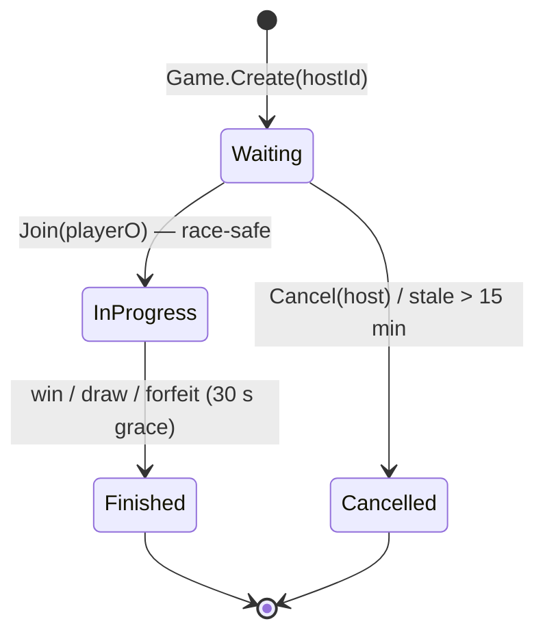
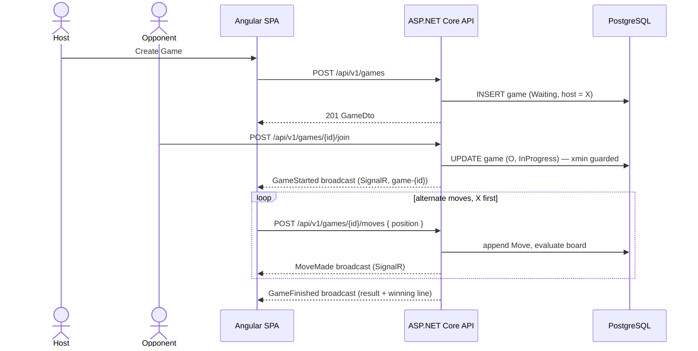

# Product Requirements Document (PRD) — Multiplayer Tic-Tac-Toe

*The canonical product source of truth for the MVP release of a real-time, two-player Tic-Tac-Toe platform. This file restructures the original ["Multiplayer Tic-Tac-Toe PRD & Technical Documentation"](archive/original-technical-documentation.md) (now archived and frozen at v1.1) and carries the 2026-11-04 stack modernization that its v1.1 mirrors (see [Stack modernization](#7-technical-blueprint-summary)). Technical deep dives live in [01-architecture](../01-architecture/system-architecture.md), [02-backend](../02-backend/api-spec.md), [03-database](../03-database/schema-and-erd.md), [04-frontend](../04-frontend/ux-ui-design-system.md), [05-quality](../05-quality/testing-strategy.md) and [06-devops](../06-devops/docker-and-environments.md).*

| | |
| --- | --- |
| **Version** | 1.1 (MVP) |
| **Status** | Approved for development |
| **Stack** | .NET 10 · Clean Architecture · DDD · CQRS (Cortex.Mediator) · Identity · PostgreSQL 18 · SignalR · Angular 22 (zoneless) · Tailwind CSS 4 |
| **Delivery plan** | V1 "Game Live" first, then the remaining M0–M6 slices (see [v1-scope](v1-scope.md) and [roadmap](roadmap.md)) |

---

## 1. Product Overview

### 1.1 Vision

A clean, professional, chess.com-inspired experience where anyone can sign up in seconds, see who is online, and play a fast, animated game of Tic-Tac-Toe against another real person.

### 1.2 Problem

Casual web games are usually anonymous, ugly, or ad-ridden, and most Tic-Tac-Toe implementations play against a script instead of a person. There is no polished, real-time, account-based Tic-Tac-Toe with a live lobby — so the "quick game with a real human" experience does not exist in a form we would want to use.

### 1.3 Goals (MVP)

1. Secure registration and login.
2. A lobby showing online players and open/ongoing games.
3. Create or join a game; a game accepts exactly two players, then locks for everyone else.
4. Real-time, server-authoritative gameplay (X vs O) with animated UI.
5. Many concurrent games; when one is full, other users play in other games.
6. Professional look and feel, responsive on desktop and mobile.
7. Architecture ready for future expansion (ratings, matchmaking, chat, more games) without rewrites.

### 1.4 Non-Goals (MVP)

Ratings/ELO, matchmaking queues, chat, friends, spectators, game history UI, social login, email verification, rematch, AI opponent, timers/clocks. These are listed in [Future scope](#11-future-scope-post-mvp) and the [roadmap](roadmap.md). The first build (**V1 — "Game Live"**) additionally defers presence, live lobby updates, disconnect-grace auto-forfeit and the hardening pass: see [v1-scope](v1-scope.md).

## 2. Users

### 2.1 Personas

| Persona | Description | Need |
| --- | --- | --- |
| Casual Player (Sara) | Wants a quick game during a break | Zero friction signup, instant play |
| Competitive Player (Rafi) | Likes seeing who is online and challenging others | Clear lobby, fair and reliable game |
| Admin/Developer | Maintains and extends the product | Clean, testable, documented code |

### 2.2 Success Metrics

| Metric | Target |
| --- | --- |
| Registration completion rate | > 80% |
| Time from login to first move | < 30 s average |
| Game completion rate | > 85% |
| Request error rate | < 1% |

## 3. Requirements

### 3.1 User Stories

> **V1 subset:** US-04 and US-10 are post-V1; US-05 and US-13 ship in simplified form. Mapping: [v1-scope](v1-scope.md).

| ID | Story | Priority |
| --- | --- | --- |
| US-01 | As a visitor, I can register with username, email and password. | Must |
| US-02 | As a user, I can log in and stay logged in (refresh token). | Must |
| US-03 | As a user, I can log out. | Must |
| US-04 | As a user, I see how many players are online and who they are. | Must |
| US-05 | As a user, I see a list of games: Waiting, In Progress. | Must |
| US-06 | As a user, I can create a new game and wait for an opponent. | Must |
| US-07 | As a user, I can join a waiting game; once two players are in, nobody else can join. | Must |
| US-08 | As a player, I can place my mark when it is my turn, and see my opponent's moves instantly. | Must |
| US-09 | As a player, I see win, lose or draw results with a clear animation. | Must |
| US-10 | As a player, if I leave or disconnect for too long, I forfeit and my opponent wins. | Should |
| US-11 | As a user, I can return to the lobby after a game ends. | Must |
| US-12 | As a user, I can cancel my own waiting game. | Should |
| US-13 | As a user, I can reconnect to my active game after a page refresh. | Should |

Full acceptance criteria per story: [user-stories.md](user-stories.md).

### 3.2 Functional Requirements

> **V1 subset:** FR-04, FR-10 and FR-11 are post-V1 (manual forfeit via Leave covers FR-11 in V1). Mapping: [v1-scope](v1-scope.md).

| ID | Requirement |
| --- | --- |
| FR-01 | Registration requires unique username (3–20 chars, letters/digits/underscore), unique valid email, password (min 8, upper, lower, digit). |
| FR-02 | Login by email or username + password; returns short-lived JWT access token and a rotating refresh token. |
| FR-03 | All lobby and game features require authentication. |
| FR-04 | Presence: server tracks connected users via SignalR; lobby shows online count and list. |
| FR-05 | Creating a game sets creator as Player X; game status is Waiting. |
| FR-06 | Joining sets the joiner as Player O, status becomes InProgress, game is removed from joinable list. Joining must be race-safe (only one joiner wins). |
| FR-07 | A user cannot join their own game and cannot be in more than one active (Waiting/InProgress) game at once. |
| FR-08 | X always moves first. Server validates turn, cell range, cell emptiness and game status. |
| FR-09 | Server detects win (8 lines) and draw (9 moves, no winner) and finalizes the game. |
| FR-10 | Lobby updates in real time (game created, joined, finished, cancelled, user online/offline). |
| FR-11 | On disconnect of a player in an active game, a 30 second grace period starts; reconnect cancels it; expiry means forfeit. |
| FR-12 | Completed games are persisted (moves, result, timestamps) for future history features. |

### 3.3 Non-Functional Requirements

| Category | Requirement |
| --- | --- |
| Performance | Move round trip under 200 ms p95 on a normal connection; lobby loads under 1 s. |
| Scalability | Stateless API; target 500 concurrent games on a single node; SignalR Redis backplane planned for scale-out. |
| Reliability | Server-authoritative state; no client can corrupt a game; optimistic concurrency on game updates. |
| Security | See [security](../05-quality/security.md). |
| Usability | Responsive (360 px–1920 px), WCAG 2.1 AA contrast, keyboard accessible board. |
| Maintainability | Clean Architecture, SOLID, 80%+ unit coverage on Domain and Application. |
| Observability | Structured logging (Serilog), health checks, correlation IDs. |

## 4. Core Flows

**Auth flow:** Visit app → (not logged in) Login page → Register (optional) → on success, tokens stored → Lobby.

**Game flow:** Lobby → Create Game (X waits) → Opponent clicks Join (O) → both redirected to Game page → alternate moves → result overlay → Back to Lobby.

### 4.1 Game State Machine

### 4.2 Happy-Path Game Sequence

## 5. Acceptance Criteria (Key Stories)

- **US-07:** Given a Waiting game, when two users click Join simultaneously, exactly one succeeds; the other receives a clear "Game is already full" message and the game disappears from their list.
- **US-08:** Given it is not my turn, when I click a cell, the server rejects the move and the UI shows a subtle shake; state is unchanged.
- **US-10:** Given an active game, when a player's connection drops for more than 30 s, the game finishes with the other player as winner (reason: Forfeit).
- **US-02:** Given an expired access token and valid refresh token, the client silently refreshes and retries the request without logging the user out.

## 6. Experience Summary

Design principles, tokens, page specs and animation details live in the frontend section: [design system](../04-frontend/ux-ui-design-system.md), [pages and flows](../04-frontend/pages-and-flows.md), [animations](../04-frontend/animations.md).

| Aspect | Decision |
| --- | --- |
| Theme | Dark-first (slate-950 background, slate-900 cards), light option later |
| Primary | indigo-500 / hover indigo-400 |
| Marks | X = sky-400 (glow), O = rose-400 (glow) |
| Fonts | Inter (UI), JetBrains Mono (numbers/timers) |
| Pages | Login, Register, Lobby, Game, Not Found |
| Motion | SVG stroke draw for marks (300 ms), win line draw (500 ms), reduced-motion respected |

## 7. Technical Blueprint Summary

> **Stack modernization (2026-11-04):** the original technical documentation §6.2 pinned .NET 8 / EF Core 8 / PostgreSQL 16 / Angular 17+. Per stakeholder decision, this project targets the **latest stable stack** below; the original document's §6.2 has since been aligned to this decision (its v1.1 update, archived at [00-product/archive](archive/original-technical-documentation.md)). Domain design, API contracts and database design are unchanged. Recorded in [ADR-0011](../01-architecture/adr/0011-latest-stable-stack.md) and [ADR-0012](../01-architecture/adr/0012-nunit-test-framework.md); the in-process mediator is Cortex.Mediator per [ADR-0013](../01-architecture/adr/0013-cortex-mediator.md) and assertions are Shouldly per [ADR-0014](../01-architecture/adr/0014-shouldly-assertions.md) and the code follows the vertical-slice structure with a single unit test project per [ADR-0015](../01-architecture/adr/0015-vertical-slice-structure-and-unit-only-tests.md).

| Layer | Choice |
| --- | --- |
| Backend | .NET 10 (LTS) / ASP.NET Core Web API, C# 14 |
| Architecture | Clean Architecture, DDD tactical patterns, CQRS |
| Mediator | Cortex.Mediator 3.1.2 — commands, queries, notifications, pipeline behaviors |
| Validation | FluentValidation |
| Mapping | Mapster (manual mapping in Domain; no mapping magic there) |
| ORM | EF Core 10 + Npgsql provider |
| Auth | ASP.NET Core Identity + JWT Bearer + rotating hashed refresh tokens |
| Real-time | SignalR |
| API docs | .NET built-in OpenAPI (Microsoft.AspNetCore.OpenApi) + Scalar UI |
| Logging | Serilog |
| Backend tests | **NUnit** (mandated) + **Shouldly** assertions + NSubstitute — one unit project (`test/TicTacToe.Application.UnitTests`, ADR-0015) |
| Frontend | Angular 22 — standalone components, signals, **zoneless** change detection |
| Styling | Tailwind CSS 4 (CSS-first `@theme` configuration) |
| Real-time client | @microsoft/signalr |
| Frontend tests | vitest + jsdom (unit), Playwright (E2E) |
| Database | PostgreSQL 18 |
| Containers | Docker, docker-compose, GitHub Actions CI |

Layer rules, folder structure and the dependency diagram: [system architecture](../01-architecture/system-architecture.md) and [clean architecture & DDD](../01-architecture/clean-architecture-ddd.md). Application layer patterns: [CQRS & MediatR](../01-architecture/cqrs-and-mediator.md).

## 8. Delivery Plan (M0–M6)

| Milestone | Scope |
| --- | --- |
| M0 Foundation | Solution skeleton, Docker, DB, CI, Angular 22 + Tailwind setup, design tokens |
| M1 Authentication | Identity, JWT/refresh, register/login/logout API; login and register UI |
| M2 Domain & Game API | Game aggregate + tests, CQRS commands/queries, repositories, migrations |
| M3 Real-time | SignalR hub, presence, lobby events, disconnect/forfeit service |
| M4 Lobby UI | Lobby page, game list, online players, create/join/cancel |
| M5 Game UI | Board, animations, turn indicator, result modal, reconnect handling |
| M6 Hardening | Rate limiting, integration and E2E tests, accessibility, polish, docs |

**V1 — "Game Live" (the first build):** auth complete plus a rules-complete live game only — the V1 slices of M0–M5, skipping M6. Exact in/out lists and the deferred-feature mapping live in [v1-scope.md](v1-scope.md).

Milestones are delivered in dependency order — there is deliberately no calendar schedule. Details, dependencies and milestone acceptance: [roadmap.md](roadmap.md). Agent build order: [AGENTS.md](../agents/AGENTS.md).

## 9. Risks

| Risk | Impact | Mitigation |
| --- | --- | --- |
| Join race condition | Two players in one slot | xmin concurrency + partial unique index + tests |
| Disconnects / flaky mobile networks | Unfair forfeits | 30 s grace, auto-reconnect, resync endpoint |
| Refresh token in localStorage (XSS) | Account takeover | Strict CSP; move to HttpOnly cookie in v1.1 |
| In-memory presence | Breaks with multiple API instances | Redis backplane and presence store before scaling out |
| Over-engineering for a small game | Slower delivery | Keep one bounded context; add complexity only where listed here |

## 10. Open Questions

1. Should the host choose X or O, or random assignment? (MVP: host is X.)
2. Allow one account on two devices at once? (MVP: yes, same presence entry.)
3. Should finished games remain visible in the lobby for a short time? (MVP: removed immediately.)

## 11. Future Scope (post-MVP)

Game history and profile stats; ELO rating and leaderboard; quick-match queue; private invite links; in-game chat and emotes; spectators; rematch; move timers; email verification and password reset; social login; AI opponent; additional games (Connect Four, Chess) via a shared `IGameEngine` abstraction; Redis backplane; admin dashboard; i18n and light theme.

## 12. Glossary

| Term | Meaning |
| --- | --- |
| Aggregate | A consistency boundary in DDD. |
| CQRS | Separating write (commands) and read (queries) models. |
| Backplane | A shared message bus letting multiple SignalR servers broadcast to each other. |
| Optimistic concurrency | Detecting conflicting updates via a version token instead of locking. |
| xmin | PostgreSQL's system column used as a row version. |
| Zoneless | Angular change detection driven by signals instead of Zone.js. |

## Assumptions

- This PRD restructures the original technical documentation (archived at [archive/original-technical-documentation.md](archive/original-technical-documentation.md)) without changing its requirements; where the two differ, **this file wins** (it carries the 2026-11-04 stack modernization: .NET 10, EF Core 10, PostgreSQL 18, Angular 22 zoneless, Tailwind CSS 4, built-in OpenAPI + Scalar, NUnit with Shouldly for backend tests, vitest/Playwright for frontend).
- "NUnit" is the mandated .NET test framework (stakeholder instruction "NUunittest" interpreted as NUnit); frontend unit testing uses vitest, the Angular CLI default.
- One game per user at a time; creator is always X; public games only (no private invite links in MVP).
- Email is not verified in MVP. Browser support: latest 2 versions of Chrome, Edge, Firefox, Safari.
- Product scope, user stories, functional requirements, state machine, API/SignalR contracts and database design are carried over verbatim from the original document and refined (not re-invented) in the section docs.
