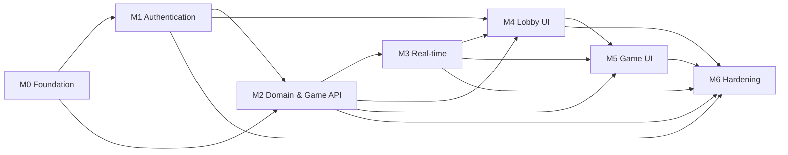

# Roadmap — Multiplayer Tic-Tac-Toe

*Turns the PRD delivery plan into a simple, milestone-by-milestone roadmap with per-area scope, deliverables, checkable exit criteria and dependencies — deliberately schedule-free.*

---

## 1. Overview

The MVP ships in seven milestones, **M0–M6**, delivered in dependency order with no calendar schedule (per the [PRD delivery plan](PRD.md#8-delivery-plan-m0m6)). Every user story, acceptance criterion and functional requirement traces to exactly one milestone sequence in the [user stories](user-stories.md) traceability matrix; the agent-level build order lives in [AGENTS.md](../agents/AGENTS.md).

| Milestone | Focus |
| --- | --- |
| M0 Foundation | Solution skeleton, Docker, DB, CI, Angular 22 + Tailwind 4, design tokens |
| M1 Authentication | Identity, JWT + rotating refresh, auth API, login/register UI |
| M2 Domain & Game API | Game aggregate + tests, CQRS commands/queries, repositories, migrations |
| M3 Real-time | SignalR hub, presence, lobby events, disconnect/forfeit service |
| M4 Lobby UI | Lobby page, game list, online players, create/join/cancel |
| M5 Game UI | Board, animations, turn indicator, result modal, reconnect |
| M6 Hardening | Rate limiting, integration/E2E tests, accessibility, polish, docs |

### Dependencies

With two developers the plan splits naturally along the layer boundary: one track takes M1 → M3 (backend), the other finishes the Angular scaffold from M0 and picks up the UI milestones as their backend dependencies land.

---

## 2. Milestones

### M0 — Foundation

**Goal:** a running, CI-guarded skeleton of the whole system — solution, database, containers, Angular shell — so every later milestone only fills in features.

| Area | Scope |
| --- | --- |
| Backend | Four projects (`TicTacToe.Domain`, `Application`, `Infrastructure`, `Api`) respecting the dependency rule; `Common` base types (Entity, AggregateRoot, ValueObject, IDomainEvent); Serilog bootstrap; `/health` health check; built-in OpenAPI document with Scalar UI in Development; Serilog console (JSON) logging |
| Frontend | Angular 22 standalone + zoneless scaffold in `client/`; Tailwind CSS 4 CSS-first `@theme` with the design tokens (slate-950 background, slate-900 cards, indigo-500 primary, X sky-400, O rose-400, Inter + JetBrains Mono); app shell and routes `/login`, `/register`, `/lobby`, `/game/:id`, `**` (not found) |
| Database | PostgreSQL 18 service in docker-compose with a named volume; empty baseline setup (Identity/game migrations come with their milestones) |
| DevOps | `docker-compose.yml` (`postgres`, `api`, `client` via nginx); GitHub Actions workflow: restore → build → test → build client; `.editorconfig` and analyzer configuration |
| Docs | `docs/` tree per the docs map; ADR-0011 (latest stable stack) and ADR-0012 (NUnit) recorded; [AGENTS.md](../agents/AGENTS.md) build order |

**Deliverables:** runnable compose stack; green CI on the initial commit; token-compliant app shell; [system-architecture](../01-architecture/system-architecture.md) skeleton.

**Exit criteria:**

- [ ] `docker compose up` starts PostgreSQL 18, the API and the Angular client; `GET /health` returns Healthy
- [ ] CI runs on every push: restore, build, NUnit tests, client lint + build
- [ ] Solution builds with zero analyzer warnings and the dependency rule holds (Api → Infrastructure → Application → Domain; Domain references nothing)
- [ ] The client renders the shell on `/` with routes `/login`, `/register`, `/lobby`, `/game/:id` and the not-found page, zoneless, with the design tokens applied
- [ ] OpenAPI document is served and browsable in Scalar UI in Development

**Dependencies:** none — this is the starting point.

**Not in this milestone:** any business logic, authentication, SignalR, or gameplay; page content beyond the shell and tokens; any database table beyond the PostgreSQL service itself.

### M1 — Authentication

**Goal:** secure registration, login, logout and token lifecycle (US-01, US-02, US-03) end to end — API and UI.

| Area | Scope |
| --- | --- |
| Backend | ASP.NET Core Identity (`ApplicationUser`), password policy and lockout (5 attempts / 5 min); JWT access token (15 min) + rotating hashed refresh token (7 days, reuse detection revokes the family); `RegisterCommand`, `LoginCommand`, `RefreshTokenCommand`, `LogoutCommand`; `AuthController` (`/api/v1/auth/*`); FluentValidation validators; ProblemDetails mapping |
| Frontend | Login and Register pages (split layout, show/hide password, live strength meter, inline validation, error toasts); `auth.service` + `token.storage` (access in memory, refresh in localStorage); `authInterceptor` with single-flight silent refresh and 401 queueing; `authGuard` / `guestGuard` |
| Database | Migrations: Identity tables, `player_profiles` (created in the same transaction as registration), `refresh_tokens` with unique token hash |
| DevOps | JWT configuration (`Jwt__Key`, issuer, audience, TTLs) via environment/user-secrets; CORS locked to the Angular origin |
| Docs | [auth-identity-jwt](../02-backend/auth-identity-jwt.md); auth endpoints in [api-spec](../02-backend/api-spec.md); [angular-architecture](../04-frontend/angular-architecture.md) |

**Deliverables:** a guest can register, land in the lobby shell, log out and log back in by email or username; integration tests for the full token lifecycle.

**Exit criteria:**

- [ ] Register/login/refresh/logout/me implemented with the documented codes (201/200/204, 400, 401, 409 duplicates, 423 locked)
- [ ] Integration tests (Testcontainers + Respawn) pass for: register, duplicate username/email 409, login by email and by username, wrong password 401, lockout 423, refresh rotation, reuse detection, logout revocation
- [ ] US-01, US-02 and US-03 acceptance criteria in [user-stories](user-stories.md) pass, including the silent-refresh scenario on an expired access token
- [ ] Access token expires in 15 min, refresh token in 7 days, refresh tokens stored hashed and rotated on every use
- [ ] Anonymous access to any auth-required endpoint returns 401; protected routes redirect to `/login`

**Dependencies:** M0 (solution, compose, CI).

**Not in this milestone:** email verification, password reset, social login, HttpOnly refresh cookie (v1.1, see post-MVP), rate limiting (M6), lobby or game functionality.

### M2 — Domain & Game API

**Goal:** the complete server-authoritative game core (FR-05..FR-09, FR-12) behind REST, with no real-time push yet.

| Area | Scope |
| --- | --- |
| Backend | `Game` aggregate (Create/Join/MakeMove/Forfeit/Cancel) with `Move`, `Mark`, `GameStatus`, `Result` value object and the six domain events; domain exceptions; `CreateGame`, `JoinGame`, `MakeMove`, `CancelGame`, `ForfeitGame` commands and `GetLobbyGames`, `GetGameById`, `GetMyActiveGame`, `GetOnlinePlayers` (stub) queries; `Result<T>`; pipeline behaviors Logging → Validation → UnitOfWork → Performance; repositories + `IUnitOfWork`; xmin concurrency handling (reload-once, re-evaluate, return domain error) |
| Frontend | None (API-first; only shared TypeScript models if convenient) |
| Database | Migrations: `games`, `moves` (owned collection, unique `(game_id, position)` and `(game_id, move_number)`, CHECK 0..8), `games(status, created_at_utc DESC)` index, partial unique indexes enforcing one active game per player |
| DevOps | Migrations applied on container startup in Development |
| Docs | [clean-architecture-ddd](../01-architecture/clean-architecture-ddd.md), [cqrs-and-mediator](../01-architecture/cqrs-and-mediator.md), game endpoints in [api-spec](../02-backend/api-spec.md), [schema-and-erd](../03-database/schema-and-erd.md), [migrations-and-indexes](../03-database/migrations-and-indexes.md), [concurrency](../03-database/concurrency.md) |

**Deliverables:** a full game playable with an HTTP client: create → join → alternate moves → win/draw result, with every invalid interaction rejected by the domain.

**Exit criteria:**

- [ ] Domain unit tests (NUnit + Shouldly) cover join guards, X-first turn alternation, all 8 win lines, draw, forfeit, cancel, and finished-game immutability — ≥ 80% coverage of `TicTacToe.Domain`
- [ ] Application unit tests (NSubstitute) cover each handler's success and failure paths through `Result<T>`
- [ ] An integration test proves the US-07 join race: two simultaneous joins produce exactly one 200 and one 409 "game is already full"
- [ ] All game endpoints return the documented codes (201 create, 200 join/move, 204 cancel, 401/403/404/409/422 errors) and map domain exceptions correctly
- [ ] One-active-game-per-user is enforced at the database level (partial unique index), verified by test
- [ ] US-06, US-07, US-08, US-09, US-12 API-level scenarios pass against real PostgreSQL

**Dependencies:** M0 (solution) and M1 (authenticated callers, `ICurrentUser`).

**Not in this milestone:** SignalR broadcasting, disconnect grace timers and stale-game sweeps (M3), any lobby/board UI (M4/M5), spectators or history endpoints.

### M3 — Real-time

**Goal:** the SignalR layer that makes the lobby and games live (FR-04, FR-10, FR-11): hub, presence, event fan-out, disconnect forfeit.

| Area | Scope |
| --- | --- |
| Backend | `GameHub` on `/hubs/game` (JWT via `access_token` query string, `[Authorize]`); groups `lobby` and `game-{id}` with server-validated membership (`JoinGameRoom`/`LeaveGameRoom`); `PresenceTracker` (in-memory, multi-tab aware); `SignalRGameNotifier` dispatching domain events as `PresenceChanged`, `GameCreated`, `GameUpdated`, `GameRemoved`, `GameStarted`, `MoveMade`, `GameFinished`, `OpponentConnection`; `DisconnectGraceService` (30 s forfeit timers, 15 min stale-Waiting sweep) |
| Frontend | `signalr.service` wrapping `@microsoft/signalr`: typed event streams, `withAutomaticReconnect([0, 1000, 3000, 5000])`, post-reconnect resync hook |
| Database | None |
| DevOps | WebSocket support through the nginx/client service and CORS for the hub |
| Docs | [realtime-signalr](../02-backend/realtime-signalr.md) |

**Deliverables:** every state change that M2 persists is now pushed to the right group; disconnects are arbitrated fairly.

**Exit criteria:**

- [ ] A two-client hub integration test receives `GameStarted`, `MoveMade` and `GameFinished` on group `game-{id}` and `GameCreated`/`GameRemoved` on `lobby`
- [ ] Connect/disconnect broadcasts `PresenceChanged` with the correct count; two tabs count as one user (US-04 scenarios)
- [ ] Disconnecting a player in an InProgress game starts a grace timer; staying away > 30 s finalizes the game with reason Forfeit; reconnecting within 30 s cancels it (US-10 scenarios)
- [ ] Waiting games older than 15 minutes are cancelled by the sweep and removed from the lobby
- [ ] Anonymous hub connections are rejected with 401

**Dependencies:** M2 (domain events, game state to broadcast).

**Not in this milestone:** lobby/board UI consumption (M4/M5), Redis backplane or distributed presence (post-MVP), chat, spectators.

### M4 — Lobby UI

**Goal:** the complete lobby experience (US-04, US-05, US-06, US-07, US-12) consuming the M2 APIs and M3 events.

| Area | Scope |
| --- | --- |
| Backend | None — consumes M2 endpoints and M3 events unchanged |
| Frontend | Lobby page: Games panel with "Open" / "In Progress" tabs, game cards (host, status, created time, Join; "Full" label when taken), prominent Create Game button, cancel from the waiting state; Online Players panel (avatar initials, status dot Available / In game); navbar with online-count pill and avatar menu with Logout; `lobby.store` on signals; list enter/leave animations and empty states |
| Database | None |
| DevOps | None |
| Docs | Lobby sections of [pages-and-flows](../04-frontend/pages-and-flows.md), [ux-ui-design-system](../04-frontend/ux-ui-design-system.md) |

**Deliverables:** two users in two browsers see games and presence update live; a third user is locked out of a full game.

**Exit criteria:**

- [ ] US-04, US-05, US-06, US-07 and US-12 acceptance criteria pass in the browser against the live stack
- [ ] The join-race demo passes: two browsers clicking Join simultaneously → one enters the game, the other sees "Game is already full" and the card disappears
- [ ] Creating, joining, finishing and cancelling a game in one browser updates another browser with no reload
- [ ] Layout is responsive from 360 px to 1920 px using the design tokens
- [ ] Frontend unit tests (vitest + jsdom) cover `lobby.store` and the join/full presentation logic

**Dependencies:** M1 (auth UI, guards), M2 (game endpoints), M3 (live events).

**Not in this milestone:** the game board and any gameplay UI (M5), matchmaking or quick-match, game history, spectators, chat.

### M5 — Game UI

**Goal:** the game page (US-08, US-09, US-10 surfaced, US-11, US-13): playable, animated, accessible, reconnect-safe.

| Area | Scope |
| --- | --- |
| Backend | None beyond M2/M3 (the `GET /games/active` resync endpoint already exists) |
| Frontend | Game page: centered 3×3 board with hover preview; SVG stroke-draw marks (300 ms) in sky-400 (X) and rose-400 (O); winning-line draw (500 ms, glow) and win burst; turn indicator pulsing ring; invalid-move shake; result modal (Victory / Defeat / Draw) with "Back to Lobby"; waiting state with animated dots and Cancel; connection badge (Connected / Reconnecting…) with opponent grace countdown; `game.store`; refresh/network-drop recovery via `GET /games/active` + hub group rejoin |
| Database | None |
| DevOps | None |
| Docs | [animations](../04-frontend/animations.md), game sections of [pages-and-flows](../04-frontend/pages-and-flows.md) |

**Deliverables:** the complete happy-path game flow — create, join, play, animated result, back to lobby — resilient to refreshes and brief disconnects.

**Exit criteria:**

- [ ] US-08, US-09, US-11 and US-13 acceptance criteria pass in the browser
- [ ] A rejected move (not your turn / occupied cell) shows the subtle shake and leaves the board unchanged
- [ ] The opponent's disconnect shows the Reconnecting… badge with grace countdown; expiry shows the forfeit result modal (US-10 surfaced)
- [ ] Reloading mid-game restores the exact board and turn; reloading while waiting restores the waiting state
- [ ] The board is keyboard accessible, cells expose ARIA labels ("Row 1, Column 2, empty"), a live region announces turns and results, and all animations respect `prefers-reduced-motion`

**Dependencies:** M2 (game API), M3 (hub events), M4 (navigation into a game from the lobby).

**Not in this milestone:** rematch, move timers, chat/emotes, confetti-heavy celebration beyond the specced burst, connection hardening beyond the automatic retry (M6).

### M6 — Hardening

**Goal:** production readiness: abuse protection, full test pyramid, accessibility, performance sanity and complete docs.

| Area | Scope |
| --- | --- |
| Backend | Rate limiting with the built-in .NET rate limiter (auth endpoints 10/min per IP; moves 5/s per user); security headers middleware (CSP, `X-Content-Type-Options`, `X-Frame-Options`); correlation IDs end to end; performance pass on hot paths |
| Frontend | WCAG 2.1 AA contrast audit; focus management in modals and board; error-toast and empty-state polish; keyboard-only play-through |
| Database | Index review against the lobby query plans (`games(status, created_at_utc DESC)`) |
| DevOps | Full CI pipeline (Testcontainers tests, client lint + build + unit, Docker images); production compose profile; health checks wired to DB |
| Docs | [testing-strategy](../05-quality/testing-strategy.md), [security](../05-quality/security.md), [docker-and-environments](../06-devops/docker-and-environments.md), [ci-cd](../06-devops/ci-cd.md); final cross-link and drift review of all docs |

**Deliverables:** a release-candidate stack that passes its own CI from a clean checkout.

**Exit criteria:**

- [ ] Playwright E2E green in CI: register → login → create in one context, join in a second → play to a win → both result modals → back to lobby
- [ ] Rate limits verified by test: a burst over 10 auth calls/min per IP is throttled; over 5 moves/s per user is throttled
- [ ] Security headers present on responses; logs carry correlation IDs and never contain passwords or tokens
- [ ] Coverage gate holds: ≥ 80% unit coverage on Domain and Application
- [ ] Accessibility pass: WCAG 2.1 AA contrast and a full keyboard-only game completed
- [ ] Local sanity check on the Docker stack: lobby loads < 1 s, move round trip < 200 ms p95 with a populated lobby
- [ ] All 13 user stories' acceptance criteria re-verified against [user-stories](user-stories.md); every doc file complete and cross-linked

**Dependencies:** M1–M5 (everything; M6 hardens the whole stack).

**Not in this milestone:** ratings/ELO, leaderboard, matchmaking, chat, friends, spectators, game-history UI, social login, email verification, rematch, AI opponent, move timers (all post-MVP), Redis backplane / multi-node scale-out (single node is the MVP target).

---

## 3. Global Definition of Done

From the [original technical documentation](archive/original-technical-documentation.md) §15 ("Definition of Done"), carried forward by the [PRD](PRD.md#7-technical-blueprint-summary) and applied to every milestone, story and pull request (Swagger-era wording realized as built-in OpenAPI + Scalar per the stack modernization):

- Code reviewed and merged via pull request.
- All automated tests passing — NUnit backend unit/integration suites, vitest frontend unit tests, and the Playwright E2E where UI is in scope.
- No compiler or analyzer warnings (.NET analyzers; client lint clean).
- API changes reflected in the OpenAPI document and browsable in Scalar UI.
- Accessibility checked for touched UI: keyboard operable, AA contrast, `prefers-reduced-motion` respected.
- Works in the Docker environment (`docker compose up` from a clean checkout).
- The story's acceptance criteria in [user-stories](user-stories.md) pass, including the unhappy paths.
- Unit coverage of Domain and Application layers stays at or above 80% (PRD maintainability NFR).
- Structured Serilog logs with correlation IDs added for any new request path; no secrets, passwords or tokens logged.

---

## 4. Post-MVP Outlook

Future scope items from the [PRD future-scope list](PRD.md#11-future-scope-post-mvp), each with the hook the MVP already provides:

| Future scope | Note |
| --- | --- |
| Game history & profile stats | FR-12 already persists every move and result; this is a read-side UI over `games`/`moves`. |
| ELO rating & leaderboard | `PlayerProfile` is the reserved future home of rating fields. |
| Quick-match queue | Automates create + join; the race-safe join (FR-06) is reused unchanged. |
| Private invite links | Extends game access beyond the MVP's public-lobby-only games. |
| In-game chat & emotes | The per-game hub group `game-{id}` is already the delivery channel. |
| Spectators | Read-only membership in `game-{id}` consuming `MoveMade`/`GameFinished`. |
| Rematch | A new `Game` aggregate referencing the previous game id. |
| Move timers | JetBrains Mono is already the token for numeric/timer displays. |
| Email verification & password reset | Identity hooks exist; requires SMTP infrastructure. |
| Social login | External providers via ASP.NET Core Identity. |
| AI opponent | A server-side engine playing as O within the existing authoritative move pipeline. |
| More games (Connect Four, Chess) | The shared `IGameEngine` abstraction keeps lobby and hub unchanged. |
| Redis backplane & distributed presence | Prerequisite for running multiple API instances (see the PRD risk table). |
| Admin dashboard | Moderation and monitoring on top of existing events and logs. |
| i18n & light theme | Token-based theming isolates both concerns. |
| HttpOnly refresh cookie (v1.1) | Removes the localStorage XSS risk flagged in the PRD risk table. |

---

## Assumptions

- Day estimates and the calendar schedule (gantt) were intentionally removed (2026-11-04): this is a simple milestone roadmap — order and dependencies drive delivery, not dates. The original estimates survive only in the frozen [archive](archive/original-technical-documentation.md) §17.
- "Swagger" in the legacy Definition of Done is delivered as .NET built-in OpenAPI + Scalar UI, per the PRD stack modernization note.
- Exit criteria referencing CI, compose services and migration behavior assume the conventions defined in [docker-and-environments](../06-devops/docker-and-environments.md) and [ci-cd](../06-devops/ci-cd.md) (migrations applied on startup in Development).
