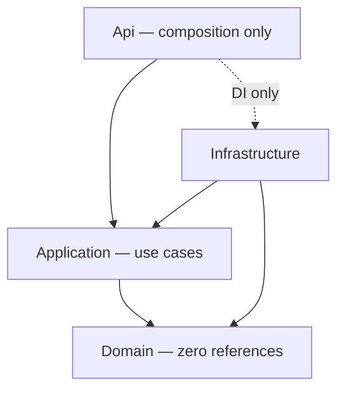

# ADR-0001: Clean Architecture with DDD tactical patterns

| Status | Accepted — 2026-11-04 |
| --- | --- |
| Scope | Solution structure, dependency direction, domain modeling approach |

## Context

The platform is small in scope (one game, one bounded context) but is explicitly designed as the seed for future features: ratings, matchmaking, chat, more games via a shared `IGameEngine` abstraction. The PRD demands server-authoritative rules, 80%+ unit coverage on Domain and Application, and "architecture ready for future expansion without rewrites." Two failure modes threaten this: leaking EF Core/SignalR/Identity concerns into business rules (making them untestable), and over-engineering a nine-cell game with event sourcing and microservices.

## Decision

Organize the backend as four projects following Clean Architecture with DDD tactical patterns in a single `Games` bounded context:

- **TicTacToe.Domain** — `Game` aggregate root, `Move` child entity, `Mark`/`Board`/`GameResult` value objects, domain events, domain exceptions, repository interfaces. References nothing.
- **TicTacToe.Application** — commands/queries with MediatR handlers, DTOs, validators, pipeline behaviors, `Result<T>`, and abstractions (`IUnitOfWork`, `ICurrentUser`, `IIdentityService`, `ITokenService`, `IPresenceTracker`, `IGameNotifier`, `IDateTimeProvider`, `IReadDbContext`). References Domain only.
- **TicTacToe.Infrastructure** — EF Core `AppDbContext`, configurations, migrations, repository/UnitOfWork implementations, Identity, JWT, SignalR notifier, presence tracker. References Application + Domain.
- **TicTacToe.Api** — controllers, `GameHub`, middleware, DI composition only. References Application + Infrastructure (composition only).

All game rules (turn order, cell occupancy, win/draw detection, join guards, immutability of finished games) live exclusively on the `Game` aggregate; persistence and transport adapt to it, never the reverse. Repository interfaces live in Domain (they speak in aggregates); implementations in Infrastructure.

Hard prohibitions that follow from this decision:

| Layer may NOT | Because |
| --- | --- |
| Domain | reference any package, EF, SignalR, Identity — it is pure C# plus the BCL |
| Application | reference Infrastructure types (`AppDbContext`, hub types) — it sees only its own abstractions |
| Infrastructure | reference Api — nothing knows the composition root |
| Api | contain business logic, LINQ projections, or repository calls — controllers dispatch `IMediator` requests and map `Result` |

## Consequences

**Positive**

- Game rules are pure C# unit-testable without mocks, DB or web host — the 80% Domain coverage goal is realistic.
- Infrastructure swaps (PostgreSQL→other, in-memory presence→Redis, REST→extra transports) touch only edge projects; abstractions already exist for each planned change.
- The dependency rule is mechanically enforced with NetArchTest, so violations fail CI rather than accumulate as debate.
- Adding future games can reuse the layer shape and pipeline; `IGameEngine` can be introduced in Domain without restructuring.

**Negative**

- More projects and files than a minimal CRUD service for the same nine cells — a fixed upfront cost.
- Every new abstraction (e.g. `IGameNotifier`) is an indirection a newcomer must trace to its Infrastructure implementation.
- Mappers between entities and DTOs must be maintained (addressed by ADR-0010 Mapster, kept out of Domain).
- DI composition is centralized in Api, so a missing registration surfaces at runtime rather than compile time (mitigated by integration tests).

## Alternatives considered

| Alternative | Why rejected |
| --- | --- |
| Layered (controller → service → repository) without domain isolation | Business rules spread across services; win/turn logic entangled with EF queries; weaker boundary for the future engine abstraction |
| Vertical slice architecture (feature folders, no shared domain) | Fast for CRUD, but the `Game` aggregate's invariants would be duplicated across slices (`MakeMove` vs `Forfeit` both finalize games) inviting divergence |
| Event sourcing | Replaying events to know a 3×3 board is needless machinery; FR-12 is satisfied by the persisted `moves` table; no audit/retrofit requirement |
| Microservices (auth service + game service) | One team, one node, 500 concurrent games — operational overhead with zero MVP benefit |

## References

- [PRD](../../00-product/PRD.md) (§7 Technical Blueprint, NFR Maintainability)
- [Clean Architecture & DDD](../clean-architecture-ddd.md) — full folder specification and tactical mapping
- [System architecture](../system-architecture.md)
- [ADR-0002 MediatR for CQRS](0002-mediatr-for-cqrs.md) · [ADR-0003 PostgreSQL/EF Core](0003-postgresql-ef-core-npgsql.md)

## Assumptions

- One bounded context for the whole MVP; a second context (e.g. matchmaking) would warrant its own aggregate set rather than widening `Game`.
- NetArchTest rules live in the integration test project rather than a dedicated architecture project (keeps the fixed solution layout).
