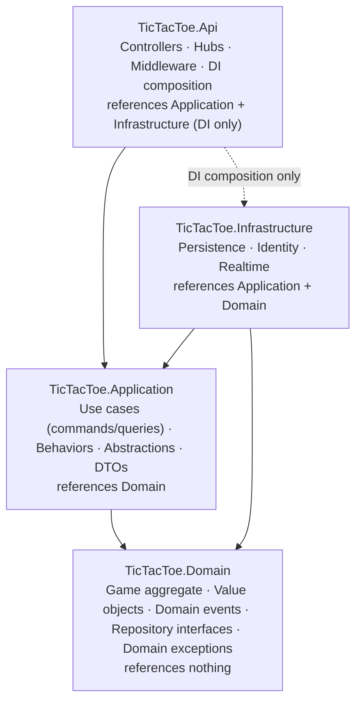
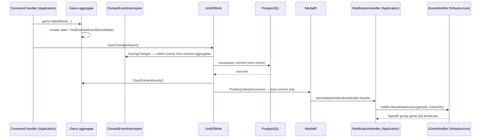

# Clean Architecture & DDD

*This document specifies the dependency rule, the per-project and folder-by-folder solution layout, the DDD tactical patterns applied to the Game bounded context, and how the layering is enforced by tests.*

Parent document: [PRD](../00-product/PRD.md) · Related: [System architecture](system-architecture.md) · [CQRS & MediatR](cqrs-and-mediatr.md) · [Coding standards](../02-backend/coding-standards.md) · Decision record: [ADR-0001](adr/0001-clean-architecture-and-ddd.md)

---

## 1. The Dependency Rule

Dependencies point inward only. The Domain references nothing; Application depends only on Domain; Infrastructure implements Application's abstractions; Api composes everything for DI. Frameworks, database and transport details live at the edge and are injected inward as interfaces owned by the Application (or Domain) layer.



What the rule buys this project:

| Benefit | Mechanism |
| --- | --- |
| Testable game rules | `Game` aggregate is pure C# — unit-tested with no mocks, no DB, no clock (`IDateTimeProvider` is passed in) |
| Swappable infrastructure | PostgreSQL, Identity, SignalR sit behind `IReadDbContext`, `IIdentityService`, `IGameNotifier`, `IPresenceTracker` |
| Transport freedom | Commands arrive via REST today; adding another transport (e.g. hub invocation later) reuses the same handlers |
| Protected write model | Only Application handlers touch repositories; queries cannot load aggregates at all (read side uses projections) |

## 2. Projects and Responsibilities

| Project | Responsibility | References | Tests |
| --- | --- | --- | --- |
| `TicTacToe.Domain` | Aggregates, entities, value objects, domain events, domain exceptions, repository interfaces (they speak in aggregates) | none | `TicTacToe.Domain.UnitTests` |
| `TicTacToe.Application` | Use cases as commands/queries + handlers, DTOs, FluentValidation validators, pipeline behaviors, `Result<T>`, abstractions (`IUnitOfWork`, `ICurrentUser`, `IIdentityService`, `ITokenService`, `IPresenceTracker`, `IGameNotifier`, `IDateTimeProvider`, `IReadDbContext`), Mapster mappings, domain-event notification handlers | Domain | `TicTacToe.Application.UnitTests` |
| `TicTacToe.Infrastructure` | `AppDbContext`, entity configurations, migrations, repository and UnitOfWork implementations, Identity stores, JWT/refresh token service, `PresenceTracker`, `SignalRGameNotifier`, clock, hosted services | Application, Domain | covered by `TicTacToe.Api.IntegrationTests` |
| `TicTacToe.Api` | Controllers, `GameHub`, middleware (exception handling, correlation ID), auth setup, OpenAPI/Scalar, rate limiting, Serilog, DI composition root | Application, Infrastructure (composition only) | `TicTacToe.Api.IntegrationTests` |

## 3. Folder-by-Folder Content Specification

The canonical solution layout (expands PRD §6.4 to file level). Every file below is part of the MVP build.

```text
src/
  TicTacToe.Domain/
    Common/
      Entity.cs                    — abstract base: Id (Guid), equality by identity
      AggregateRoot.cs             — : Entity; collects IDomainEvent; raises/clears events
      ValueObject.cs               — abstract base: value-based equality (GetEqualityComponents)
      IDomainEvent.cs              — marker interface for all domain events
    Games/
      Game.cs                      — aggregate root (state + behavior, §5)
      Move.cs                      — child entity of Game (Position, Mark, PlayerId, MoveNumber, PlayedAtUtc)
      Mark.cs                      — value object/enum-like: X, O
      GameStatus.cs                — enum: Waiting = 0, InProgress = 1, Finished = 2, Cancelled = 3
      Board.cs                     — value object rebuilt from Moves; occupancy + win-line evaluation
      GameResult.cs                — value object: Outcome (XWins|OWins|Draw), Reason (Normal|Forfeit), WinningLine
      Events/
        GameCreated.cs             — GameId, HostPlayerId, CreatedAtUtc
        GameStarted.cs             — GameId, PlayerXId, PlayerOId, StartedAtUtc
        MoveMade.cs                — GameId, Position, Mark, MoveNumber, PlayedAtUtc
        GameFinished.cs            — GameId, GameResult, FinishedAtUtc
        GameCancelled.cs           — GameId, CancelledByPlayerId, CancelledAtUtc
      IGameRepository.cs           — GetByIdAsync, GetActiveGameForPlayerAsync, AddAsync, Update
      WinLines.cs                  — the 8 winning lines as a static table (used by Board)
    Players/
      PlayerProfile.cs             — entity: Id (= identity user id), Username, CreatedAtUtc
      IPlayerProfileRepository.cs  — GetByIdAsync, GetByUsernameAsync, AddAsync
    Exceptions/
      GameFullException.cs
      NotYourTurnException.cs
      CellOccupiedException.cs
      InvalidPositionException.cs
      GameNotInProgressException.cs
      CannotJoinOwnGameException.cs
  TicTacToe.Application/
    Common/
      Behaviors/
        LoggingBehavior.cs         — logs every request start/end with correlation data
        ValidationBehavior.cs      — runs all FluentValidation validators, throws ValidationException → 400
        UnitOfWorkBehavior.cs      — SaveChanges + post-commit event dispatch for commands
        PerformanceBehavior.cs     — warns when a handler exceeds the slow-request threshold
      Interfaces/
        IUnitOfWork.cs             — SaveChangesAsync + domain-event dispatch contract
        ICurrentUser.cs            — UserId, Username of the JWT caller
        IIdentityService.cs        — register/login/lockout via Identity, without leaking Identity types
        ITokenService.cs           — issue access token; create/rotate/revoke hashed refresh tokens
        IPresenceTracker.cs        — add/remove connections, online snapshot
        IGameNotifier.cs           — broadcast hub events (LobbyX/GameX methods), implemented in Realtime
        IDateTimeProvider.cs       — UtcNow abstraction for determinism
        IReadDbContext.cs          — read-side DbSets/Queryables for projections (AsNoTracking)
      Results/
        Result.cs                  — Result and Result<T>: Success/Failure factories
        Error.cs                   — record Error(string Code, string Message)
      Exceptions/
        NotFoundException.cs       — mapped to 404 by the exception middleware
      Mappings/
        MappingConfigurations.cs   — Mapster config: entities/commands → DTOs (no Domain magic)
    Auth/
      Register/
        RegisterCommand.cs  RegisterCommandHandler.cs  RegisterCommandValidator.cs
      Login/
        LoginCommand.cs     LoginCommandHandler.cs     LoginCommandValidator.cs
      RefreshToken/
        RefreshTokenCommand.cs  RefreshTokenCommandHandler.cs  RefreshTokenCommandValidator.cs
      Logout/
        LogoutCommand.cs    LogoutCommandHandler.cs    LogoutCommandValidator.cs
      AuthResponse.cs  AuthDtos.cs (CurrentUserDto)
    Games/
      CreateGame/  (CreateGameCommand + Handler + Validator)
      JoinGame/    (JoinGameCommand + Handler + Validator)
      MakeMove/    (MakeMoveCommand + Handler + Validator)
      CancelGame/  (CancelGameCommand + Handler + Validator)
      ForfeitGame/ (ForfeitGameCommand + Handler + Validator)
      GetLobbyGames/ (GetLobbyGamesQuery + Handler)
      GetGameById/   (GetGameByIdQuery + Handler)
      GetMyActiveGame/ (GetMyActiveGameQuery + Handler)
      GameDto.cs  LobbyGameDto.cs  GameDtos.cs (PlayerDto, ResultDto)
      EventHandlers/
        GameCreatedNotificationHandler.cs  GameStartedNotificationHandler.cs
        MoveMadeNotificationHandler.cs     GameFinishedNotificationHandler.cs
        GameCancelledNotificationHandler.cs
    Players/
      GetOnlinePlayers/ (GetOnlinePlayersQuery + Handler)
      OnlinePlayerDto.cs
    DependencyInjection.cs         — AddApplication(): MediatR, validators, behaviors, Mapster
  TicTacToe.Infrastructure/
    Persistence/
      AppDbContext.cs              — IdentityDbContext<ApplicationUser, IdentityRole<Guid>, Guid> + DbSets
      AppConfigDbContextFactory.cs — design-time factory for `dotnet ef`
      Configurations/
        GameConfiguration.cs       — snake_case, owned Result, xmin token, indexes, FKs
        MoveConfiguration.cs       — owned/child collection, CHECK 0..8, unique constraints
        PlayerProfileConfiguration.cs
        RefreshTokenConfiguration.cs
      Migrations/                  — EF Core migration snapshots (generated)
      Repositories/
        GameRepository.cs          — implements Domain IGameRepository
        PlayerProfileRepository.cs — implements Domain IPlayerProfileRepository
      ReadDbContext.cs / ReadDbSet — IReadDbContext implementation over AppDbContext (AsNoTracking)
      UnitOfWork.cs                — SaveChangesAsync + interceptor-based event collection + dispatch
      DomainEventInterceptor.cs    — collects events from tracked aggregates pre-save
    Identity/
      ApplicationUser.cs           — IdentityUser<Guid>
      IdentityService.cs           — register, find by username/email, check password, lockout
      TokenService.cs              — JWT creation; 256-bit refresh tokens, hashed, rotated, reuse detection
      RefreshToken.cs              — entity for refresh_tokens table
    Realtime/
      PresenceTracker.cs           — ConcurrentDictionary<Guid, HashSet<string>> (userId → connectionIds)
      SignalRGameNotifier.cs       — IGameNotifier over IHubContext<GameHub>
    Hosting/
      DisconnectGraceService.cs    — 30 s forfeit timers; cancels Waiting games stale > 15 min
    DependencyInjection.cs         — AddInfrastructure(): DbContext (Npgsql), Identity, JWT, repos, hosted services
  TicTacToe.Api/
    Controllers/
      AuthController.cs            — /api/v1/auth (register, login, refresh, logout, me)
      GamesController.cs           — /api/v1/games (create, list, detail, active, join, moves, cancel, leave)
      PlayersController.cs         — /api/v1/players/online
    Hubs/
      GameHub.cs                   — /hubs/game: groups lobby / game-{id}; presence lifecycle
    Middleware/
      ExceptionHandlingMiddleware.cs — domain/validation → ProblemDetails mapping
      CorrelationIdMiddleware.cs
    Program.cs                     — composition root: Serilog, auth, rate limiting, OpenAPI + Scalar, health
tests/
  TicTacToe.Domain.UnitTests/      — game rules, invariants, all 8 win lines, forfeit, draw
  TicTacToe.Application.UnitTests/ — handlers (NSubstitute mocks), validators, behaviors, Result mapping
  TicTacToe.Api.IntegrationTests/  — WebApplicationFactory + Testcontainers PostgreSQL + Respawn; NetArchTest layering rules
client/                            — Angular 22 workspace (see 04-frontend)
docs/
docker-compose.yml
```

## 4. DDD Tactical Mapping

| DDD concept | Implementation | Notes |
| --- | --- | --- |
| Bounded context | `Games` (+ supporting `Players`, `Auth`) | One context for MVP; deliberately not split further (PRD over-engineering risk) |
| Aggregate root | `Game` | Only `Game` is loaded/saved through `IGameRepository`; consistency boundary for players, moves, status, result |
| Child entity | `Move` | Created only via `Game.MakeMove`; persisted as owned/child collection of Game; no direct Move repository |
| Entity (supporting) | `PlayerProfile` | Id = identity user id; keeps Identity concerns out of the Game aggregate; future home of stats |
| Value objects | `Mark`, `Board`, `GameResult` | Immutable, value equality; `Board` is derived from `Moves` (single source of truth) |
| Domain events | `GameCreated`, `GameStarted`, `MoveMade`, `GameFinished`, `GameCancelled` | Raised by aggregate methods, dispatched post-commit (§6) |
| Domain services | none needed | Win/draw evaluation is pure (`Board`/`WinLines`), no cross-aggregate coordination exists |
| Repository contracts | `IGameRepository`, `IPlayerProfileRepository` (in Domain) | One repository per aggregate root; no `IQueryable` leaked |
| Ubiquitous language | §5 | Names appear verbatim in code, API and UI |

## 5. Ubiquitous Language Glossary

| Term | Meaning (as used in code and UI) |
| --- | --- |
| Game | A match between two players; the aggregate root with Id, Status, players, Moves, Result |
| Host / Creator | The player who created the game; always Mark X |
| Opponent / Joiner | The player who joins a Waiting game; always Mark O |
| Mark | X or O — the symbol a player places |
| Board | The 3×3 grid (cells 0..8), derived from the Moves list |
| Move | A mark placed at a cell: Position, Mark, PlayerId, MoveNumber, PlayedAtUtc |
| Turn | The Mark allowed to move next; X starts, then strict alternation |
| Waiting | Status: created, waiting for an opponent to join |
| In Progress | Status: two players, moves being played |
| Finished | Status: win/draw/forfeit decided; immutable from here |
| Cancelled | Status: host cancelled a Waiting game or it went stale (> 15 min) |
| Result | Value object: Outcome (XWins/OWins/Draw), Reason (Normal/Forfeit), WinningLine |
| Forfeit | Ending a game because a player left/disconnected past the 30 s grace; opponent wins |
| Lobby | The real-time list of online players and open/in-progress games |
| Presence | Server-side knowledge of who is connected (SignalR connections per user) |
| Grace period | 30 seconds after a player's last connection drops before forfeit is enforced |

## 6. Aggregate Behavior and Invariants

### 6.1 Behavior (methods on `Game`)

| Method | Guard rules | Effect | Raises |
| --- | --- | --- | --- |
| `Game.Create(hostId, now)` | host has no other active game (checked by handler + DB index) | Status = Waiting, PlayerX = host, CurrentTurn = X | `GameCreated` |
| `Join(playerId)` | Status is Waiting; playerId ≠ PlayerX (`CannotJoinOwnGameException`); slot free (`GameFullException`) | PlayerO set, Status = InProgress, StartedAtUtc | `GameStarted` |
| `MakeMove(playerId, position)` | Status is InProgress (`GameNotInProgressException`); playerId is a participant; it is that player's turn (`NotYourTurnException`); position 0..8 (`InvalidPositionException`); cell empty (`CellOccupiedException`) | Appends `Move`, evaluates board, flips turn, finalizes if win/draw | `MoveMade` (+ `GameFinished` if ended) |
| `Forfeit(playerId)` | Status is InProgress; playerId is a participant | Opponent wins, Reason = Forfeit, FinishedAtUtc | `GameFinished` |
| `Cancel(playerId)` | Status is Waiting; playerId = PlayerX | Status = Cancelled | `GameCancelled` |

### 6.2 Invariants (enforced inside the aggregate)

1. A game has at most two players, and they are distinct.
2. Moves are accepted only while the game is InProgress.
3. Turns alternate strictly, starting with X (the host).
4. A cell can be marked exactly once per game.
5. A finished or cancelled game is immutable — no further moves, joins, cancels or forfeits.
6. Result is set exactly once, at the moment the game finishes.
7. The board is always derivable from the ordered Moves list (no redundant stored board).
8. Position domain is 0..8; anything outside is rejected before any state changes.

Backed at the database level by: `UNIQUE (game_id, position)`, `UNIQUE (game_id, move_number)` on `moves`, and the partial unique indexes enforcing one active game per player — see [Schema & ERD](../03-database/schema-and-erd.md) and [Concurrency](../03-database/concurrency.md).

## 7. Domain Event Dispatch Design

Events are raised in-memory by the aggregate, collected before save, and dispatched only **after** `SaveChanges` succeeds — no broadcast may describe state that failed to commit.



Design rules:

| Rule | Reason |
| --- | --- |
| Dispatch after commit, never inside the transaction | A failed commit must not produce "move made" broadcasts |
| Handlers are fire-and-forget from the command's perspective; broadcast failures are logged, not thrown | Push failure must not turn a successful move into an HTTP error |
| `INotificationHandler`s live in Application and depend only on `IGameNotifier` | Application never references SignalR; Infrastructure adapts to the hub |
| Each event gets its own handler class | Composable: adding "update lobby cache" later means a new handler, not edits to existing ones |
| Duplicate dispatch is tolerated because handlers are idempotent (broadcasts carry full state, clients reconcile) | Safety net if retry logic is ever added |

## 8. Enforcing the Layering (Architecture Tests)

The dependency rule is guarded mechanically in `TicTacToe.Api.IntegrationTests` using **NetArchTest** so violations fail CI, not review:

| Rule | Assertion |
| --- | --- |
| Domain purity | `Types.In(TicTacToe.Domain)` reference no other project and no `Microsoft.*`/`Infra` packages — only BCL |
| Application isolation | `TicTacToe.Application` may reference only `TicTacToe.Domain` (plus MediatR/FluentValidation/Mapster package types) |
| Infrastructure inward-only | `TicTacToe.Infrastructure` references only `TicTacToe.Application` and `TicTacToe.Domain` — never `TicTacToe.Api` |
| Api not referenced | no type in any layer references `TicTacToe.Api` |
| Controllers stay thin | `ApiController` types use `IMediator` and return `IActionResult`; they must not reference `AppDbContext`, repositories or Domain aggregates |
| Hub thinness | `GameHub` uses `IPresenceTracker` and `IMediator` only, never repositories or DbContext |
| Queries never load aggregates | `*QueryHandler` types must not reference `IGameRepository` (read side goes through `IReadDbContext` only) |

These run alongside the integration suite on every build in CI ([CI/CD](../06-devops/ci-cd.md), [Testing strategy](../05-quality/testing-strategy.md)).

## Assumptions

- Repository interfaces stay in the Domain project (classic DDD placement, per the PRD note) rather than Application; this deviates from some Clean Architecture variants and is a deliberate, recorded choice.
- `Board` is a reconstructed value object (not a stored column set); the `moves` table is the single source of truth for cell occupancy.
- Domain events are dispatched synchronously post-commit within the request; an outbox is not introduced in the MVP because broadcast loss is tolerable (clients resync via `GET /api/v1/games/active`).
- NetArchTest is added to the integration test project rather than a dedicated architecture test project to keep the solution layout fixed at four src + three test projects.
