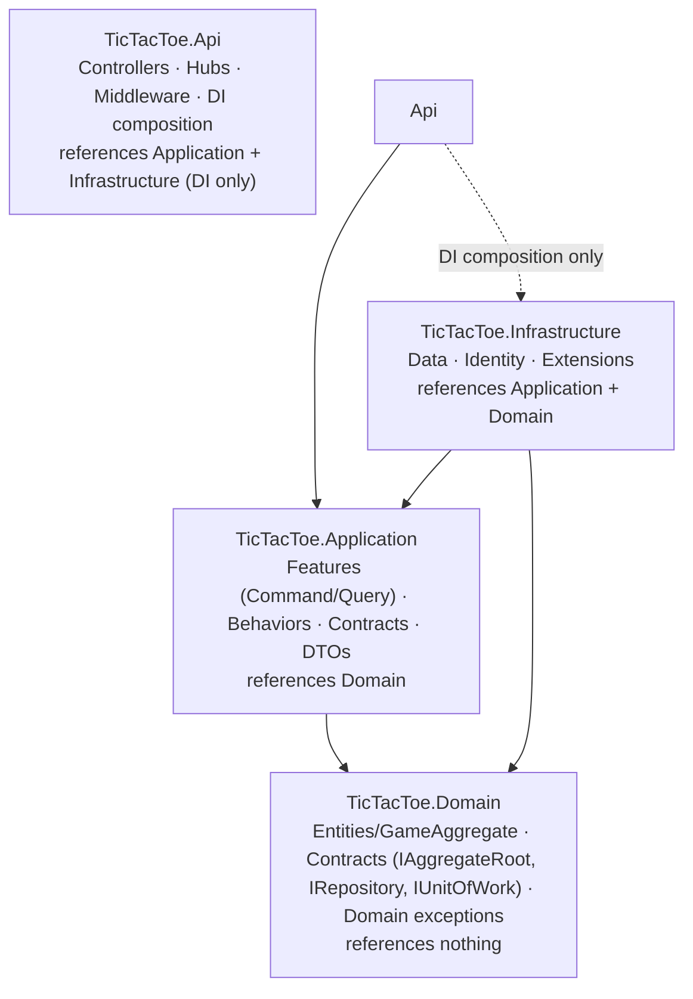
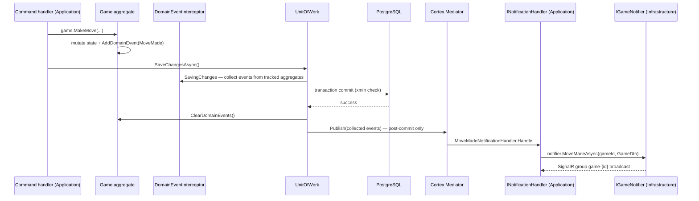

# Clean Architecture & DDD

*This document specifies the dependency rule, the per-project and folder-by-folder solution layout, the DDD tactical patterns applied to the Game bounded context, and how the layering is enforced by tests.*

Parent document: [PRD](../00-product/PRD.md) · Related: [System architecture](system-architecture.md) · [CQRS & Mediator](cqrs-and-mediator.md) · [Coding standards](../02-backend/coding-standards.md) · Decision record: [ADR-0001](adr/0001-clean-architecture-and-ddd.md)

---

## 1. The Dependency Rule

Dependencies point inward only. The Domain references nothing; Application depends only on Domain; Infrastructure implements Application's abstractions; Api composes everything for DI. Frameworks, database and transport details live at the edge and are injected inward as interfaces owned by the Application (or Domain) layer.



What the rule buys this project:

| Benefit | Mechanism |
| --- | --- |
| Testable game rules | `Game` aggregate is pure C# — unit-tested with no mocks, no DB, no clock (`IDateTimeProvider` is passed in) |
| Swappable infrastructure | PostgreSQL, Identity, SignalR sit behind `IReadDbContext`, `IIdentityService`, `IGameNotifier`, `IPresenceTracker` |
| Transport freedom | Commands arrive via REST today; adding another transport (e.g. hub invocation later) reuses the same handlers |
| Protected write model | Only Application handlers touch repositories; queries cannot load aggregates at all (read side uses projections) |

## 2. Projects and Responsibilities

| Project | Responsibility | References | Tests |
| --- | --- | --- | --- |
| `TicTacToe.Domain` | `Entities/GameAggregate` (Game, Move, enums, result VO, events, board evaluator), `Entities/PlayerProfile`, `Contracts` (`IAggregateRoot<TKey>`, generic `IRepository<TAggregateRoot,TKey>`, `IUnitOfWork`, `IDomainEvent`, `IHasDomainEvents`), domain exceptions | none | `TicTacToe.Application.UnitTests` (domain rules live there, ADR-0015) |
| `TicTacToe.Application` | `Features/<Feature>/Command` + `Query` (vertical slices: `<Name>Command{,Handler,Validator}.cs`), feature DTOs and event handlers, `Contracts/` (`IApplicationUnitOfWork` exposing the repositories, `Repositories/`, `Services/` — `ICurrentUser`, `IIdentityService`, `ITokenService`, `IGameNotifier`, `IDateTimeProvider`, `IReadDbContext`), `Common/` (`Results/`, `Behaviors/`, `Events/`) | Domain | `TicTacToe.Application.UnitTests` |
| `TicTacToe.Infrastructure` | `Data/` (`ApplicationDbContext` with inline configurations, `UnitOfWork` base + `ApplicationUnitOfWork` (post-commit event dispatch), generic `Repository<T,TKey>`, `Repositories/`, `Migrations/`, `ReadDbContext`), `Extensions/` (`DependencyInjections`, `DbContextExtension`, `IdentityConfiguration`), `Identity/` (ApplicationUser, IdentityService, TokenService, RefreshToken), `Services/` (clock) | Application, Domain | — (unit suite via Application seams) |
| `TicTacToe.Api` | Host: `Controllers/`, `Hubs/GameHub`, `Middleware/` (exception handling, correlation ID), `Realtime/SignalRGameNotifier`, `Services/CurrentUser`, auth setup, OpenAPI/Scalar, Serilog, DI composition root | Application, Infrastructure (composition only) | — |

## 3. Folder-by-Folder Content Specification

The canonical solution layout (expands PRD §6.4 to file level). Every file below is part of the MVP build.

```text
src/
  TicTacToe.Domain/
    Contracts/
      IAggregateRoot.cs            — IAggregateRoot<TKey> { Id } (entities implement it directly)
      IRepository.cs               — generic repository contract (Add/Edit/Get/Count/Remove families)
      IUnitOfWork.cs               — Save() / SaveAsync()
      IDomainEvent.cs              — EventId + OccurredOnUtc
      IHasDomainEvents.cs          — DomainEvents collection + ClearDomainEvents
    Entities/
      GameAggregate/
        Game.cs                    — aggregate root: Create/Join/MakeMove/Forfeit/Cancel + events + xmin Version
        Move.cs                    — child entity (Position, Mark, PlayerId, MoveNumber, PlayedAtUtc; Id is EF-generated)
        GameEnums.cs               — Mark, GameStatus, GameOutcome, FinishReason
        GameResult.cs              — value object: Outcome, Reason, WinningLine
        GameEvents.cs              — GameCreated, GameStarted, MoveMade, GameFinished, GameCancelled
        Board.cs                   — the 8 winning lines + evaluation over moves
      PlayerProfile.cs             — Id (= identity user id), Username, CreatedAtUtc
    Exceptions/
      GameExceptions.cs            — GameFull, NotYourTurn, CellOccupied, InvalidPosition, GameNotInProgress, CannotJoinOwnGame
  TicTacToe.Application/
    Contracts/
      IApplicationUnitOfWork.cs    — : IUnitOfWork; exposes GameRepository + PlayerProfileRepository
      Repositories/
        IGameRepository.cs         — : IRepository<Game, Guid> + GetGameByIdAsync/GetActiveGameForPlayerAsync/Detach
        IPlayerProfileRepository.cs
      Services/
        ICurrentUser.cs  IIdentityService.cs  ITokenService.cs  IGameNotifier.cs  IDateTimeProvider.cs  IReadDbContext.cs
    Common/
      Results/                     — Result, Result<T>, Error, DomainErrors (exception → Error mapping)
      Behaviors/                   — UnitOfWorkCommandPipelineBehavior (SaveAsync after handler success)
      Events/                      — DomainEventNotification<TEvent> wrapper + factory (keeps Domain package-free)
    Features/
      Auth/
        Command/                   — UserRegisterCommand{,Handler,Validator}, UserLogin*, UserRefreshToken*, UserLogout*
        Dtos/AuthDtos.cs           — UserDto, AuthResponse
      Games/
        Command/                   — GameCreate*, GameJoin*, GameMove*, GameCancel*, GameLeave* (each Command+Handler+Validator)
        Query/                     — GetAllGamesQuery+Handler, GetGameByIdQuery*+Handler, GetMyActiveGameQuery+Handler
        Dtos/GameDtos.cs           — GameDto, LobbyGameDto, PlayerRef, GameResultDto + mappings
        GameDtoLoader.cs           — assembles GameDto (profiles lookup, read-side reload)
        EventHandlers/             — one INotificationHandler per domain event → IGameNotifier
    DependencyInjection.cs         — AddApplication(): GameDtoLoader, validators, AddCortexMediator + behaviors
  TicTacToe.Infrastructure/
    Data/
      ApplicationDbContext.cs      — IdentityDbContext<ApplicationUser, IdentityRole<Guid>, Guid>; inline configurations (snake_case, owned Result, xmin, partial unique indexes)
      UnitOfWork.cs                — abstract base: Save/SaveAsync over the DbContext
      ApplicationUnitOfWork.cs     — : UnitOfWork, IApplicationUnitOfWork; SaveAsync → save → publish domain events → clear
      Repository.cs                — generic Repository<TAggregateRoot, TKey> base
      Repositories/
        GameRepository.cs          — : Repository<Game, Guid>, IGameRepository (Include moves, Detach)
        PlayerProfileRepository.cs
      ReadDbContext.cs             — IReadDbContext over ApplicationDbContext (AsNoTracking)
      Migrations/                  — EF Core migrations + snapshot
    Extensions/
      DependencyInjections.cs      — AddInfrastructure(): DbContext, identity config, repositories, UnitOfWork, services
      DbContextExtension.cs        — AddDbContext (Npgsql + snake_case naming)
      IdentityConfiguration.cs     — IdentityCore options + JwtBearer (incl. hub access_token query)
    Identity/
      ApplicationUser.cs           — IdentityUser<Guid>
      IdentityService.cs           — register (user + profile in one transaction), validate credentials, lockout
      TokenService.cs              — JWT creation; 256-bit refresh tokens, hashed, rotated, reuse detection
      RefreshToken.cs              — entity for refresh_tokens
    Services/
      SystemDateTimeProvider.cs
  TicTacToe.Api/
    Controllers/
      AuthController.cs            — /api/v1/auth (register, login, refresh, logout, me)
      GamesController.cs           — /api/v1/games (create, list, detail, active, join, moves, cancel, leave)
    Hubs/
      GameHub.cs                   — /hubs/game: JoinGameRoom/LeaveGameRoom with participant validation
    Middleware/
      ExceptionHandlingMiddleware.cs — Cortex ValidationException → 400 ProblemDetails; others → logged 500
      CorrelationIdMiddleware.cs
    Realtime/SignalRGameNotifier.cs — IGameNotifier over IHubContext<GameHub>
    Services/CurrentUser.cs        — ICurrentUser from JWT claims
    Common/HttpResults.cs          — single Result → HTTP mapping (api-spec §1.4 registry)
    Program.cs                     — composition root: Serilog, auth, CORS, OpenAPI + Scalar, health, hub mapping
test/
  TicTacToe.Application.UnitTests/ — the ONE test project (ADR-0015): Features/<X>/{Commands,Queries}/…HandlerTests,
                                     Features/Games/GameTests.cs (domain rules), Common/ResultTests.cs — NUnit + Shouldly
client/                            — Angular 22 workspace (see 04-frontend)
docs/
docker-compose.yml
```

## 4. DDD Tactical Mapping

| DDD concept | Implementation | Notes |
| --- | --- | --- |
| Bounded context | `Games` (+ supporting `Players`, `Auth`) | One context for MVP; deliberately not split further (PRD over-engineering risk) |
| Aggregate root | `Game` | Only `Game` is loaded/saved through `IGameRepository`; consistency boundary for players, moves, status, result |
| Child entity | `Move` | Created only via `Game.MakeMove`; persisted as owned/child collection of Game; no direct Move repository |
| Entity (supporting) | `PlayerProfile` | Id = identity user id; keeps Identity concerns out of the Game aggregate; future home of stats |
| Value objects | `Mark`, `Board`, `GameResult` | Immutable, value equality; `Board` is derived from `Moves` (single source of truth) |
| Domain events | `GameCreated`, `GameStarted`, `MoveMade`, `GameFinished`, `GameCancelled` | Raised by aggregate methods, dispatched post-commit (§6) |
| Domain services | none needed | Win/draw evaluation is pure (`Board`/`WinLines`), no cross-aggregate coordination exists |
| Repository contracts | `IGameRepository`, `IPlayerProfileRepository` (in Domain) | One repository per aggregate root; no `IQueryable` leaked |
| Ubiquitous language | §5 | Names appear verbatim in code, API and UI |

## 5. Ubiquitous Language Glossary

| Term | Meaning (as used in code and UI) |
| --- | --- |
| Game | A match between two players; the aggregate root with Id, Status, players, Moves, Result |
| Host / Creator | The player who created the game; always Mark X |
| Opponent / Joiner | The player who joins a Waiting game; always Mark O |
| Mark | X or O — the symbol a player places |
| Board | The 3×3 grid (cells 0..8), derived from the Moves list |
| Move | A mark placed at a cell: Position, Mark, PlayerId, MoveNumber, PlayedAtUtc |
| Turn | The Mark allowed to move next; X starts, then strict alternation |
| Waiting | Status: created, waiting for an opponent to join |
| In Progress | Status: two players, moves being played |
| Finished | Status: win/draw/forfeit decided; immutable from here |
| Cancelled | Status: host cancelled a Waiting game or it went stale (> 15 min) |
| Result | Value object: Outcome (XWins/OWins/Draw), Reason (Normal/Forfeit), WinningLine |
| Forfeit | Ending a game because a player left/disconnected past the 30 s grace; opponent wins |
| Lobby | The real-time list of online players and open/in-progress games |
| Presence | Server-side knowledge of who is connected (SignalR connections per user) |
| Grace period | 30 seconds after a player's last connection drops before forfeit is enforced |

## 6. Aggregate Behavior and Invariants

### 6.1 Behavior (methods on `Game`)

| Method | Guard rules | Effect | Raises |
| --- | --- | --- | --- |
| `Game.Create(hostId, now)` | host has no other active game (checked by handler + DB index) | Status = Waiting, PlayerX = host, CurrentTurn = X | `GameCreated` |
| `Join(playerId)` | Status is Waiting; playerId ≠ PlayerX (`CannotJoinOwnGameException`); slot free (`GameFullException`) | PlayerO set, Status = InProgress, StartedAtUtc | `GameStarted` |
| `MakeMove(playerId, position)` | Status is InProgress (`GameNotInProgressException`); playerId is a participant; it is that player's turn (`NotYourTurnException`); position 0..8 (`InvalidPositionException`); cell empty (`CellOccupiedException`) | Appends `Move`, evaluates board, flips turn, finalizes if win/draw | `MoveMade` (+ `GameFinished` if ended) |
| `Forfeit(playerId)` | Status is InProgress; playerId is a participant | Opponent wins, Reason = Forfeit, FinishedAtUtc | `GameFinished` |
| `Cancel(playerId)` | Status is Waiting; playerId = PlayerX | Status = Cancelled | `GameCancelled` |

### 6.2 Invariants (enforced inside the aggregate)

1. A game has at most two players, and they are distinct.
2. Moves are accepted only while the game is InProgress.
3. Turns alternate strictly, starting with X (the host).
4. A cell can be marked exactly once per game.
5. A finished or cancelled game is immutable — no further moves, joins, cancels or forfeits.
6. Result is set exactly once, at the moment the game finishes.
7. The board is always derivable from the ordered Moves list (no redundant stored board).
8. Position domain is 0..8; anything outside is rejected before any state changes.

Backed at the database level by: `UNIQUE (game_id, position)`, `UNIQUE (game_id, move_number)` on `moves`, and the partial unique indexes enforcing one active game per player — see [Schema & ERD](../03-database/schema-and-erd.md) and [Concurrency](../03-database/concurrency.md).

## 7. Domain Event Dispatch Design

Events are raised in-memory by the aggregate, collected before save, and dispatched only **after** `SaveChanges` succeeds — no broadcast may describe state that failed to commit.



Design rules:

| Rule | Reason |
| --- | --- |
| Dispatch after commit, never inside the transaction | A failed commit must not produce "move made" broadcasts |
| Handlers are fire-and-forget from the command's perspective; broadcast failures are logged, not thrown | Push failure must not turn a successful move into an HTTP error |
| `INotificationHandler`s live in Application and depend only on `IGameNotifier` | Application never references SignalR; Infrastructure adapts to the hub |
| Each event gets its own handler class | Composable: adding "update lobby cache" later means a new handler, not edits to existing ones |
| Duplicate dispatch is tolerated because handlers are idempotent (broadcasts carry full state, clients reconcile) | Safety net if retry logic is ever added |

## 8. Enforcing the Layering (Architecture Tests)

The dependency rule is guarded by review against these checks (the NetArchTest harness may return post-V1):

| Rule | Enforcement |
| --- | --- |
| Domain purity | `TicTacToe.Domain` references no other project and no packages — only BCL |
| Application isolation | `TicTacToe.Application` may reference only `TicTacToe.Domain` (plus Cortex.Mediator/FluentValidation/EF async-LINQ types) |
| Infrastructure inward-only | `TicTacToe.Infrastructure` references only `TicTacToe.Application` and `TicTacToe.Domain` — never `TicTacToe.Api` |
| Api not referenced | no type in any layer references `TicTacToe.Api` |


These run alongside the integration suite on every build in CI ([CI/CD](../06-devops/ci-cd.md), [Testing strategy](../05-quality/testing-strategy.md)).

## Assumptions

- Repository interfaces stay in the Domain project (classic DDD placement, per the PRD note) rather than Application; this deviates from some Clean Architecture variants and is a deliberate, recorded choice.
- `Board` is a reconstructed value object (not a stored column set); the `moves` table is the single source of truth for cell occupancy.
- Domain events are dispatched synchronously post-commit within the request; an outbox is not introduced in the MVP because broadcast loss is tolerable (clients resync via `GET /api/v1/games/active`).
- NetArchTest is added to the integration test project rather than a dedicated architecture test project to keep the solution layout fixed at four src + three test projects.
