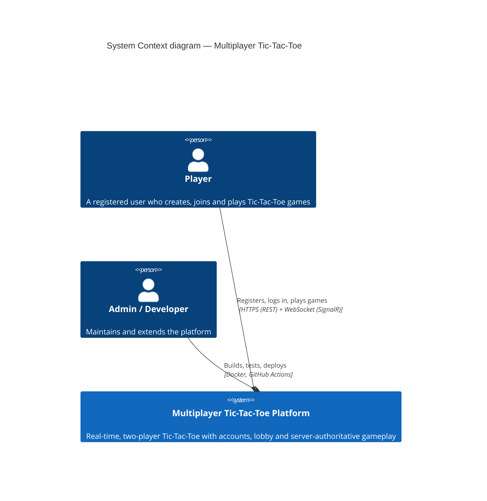
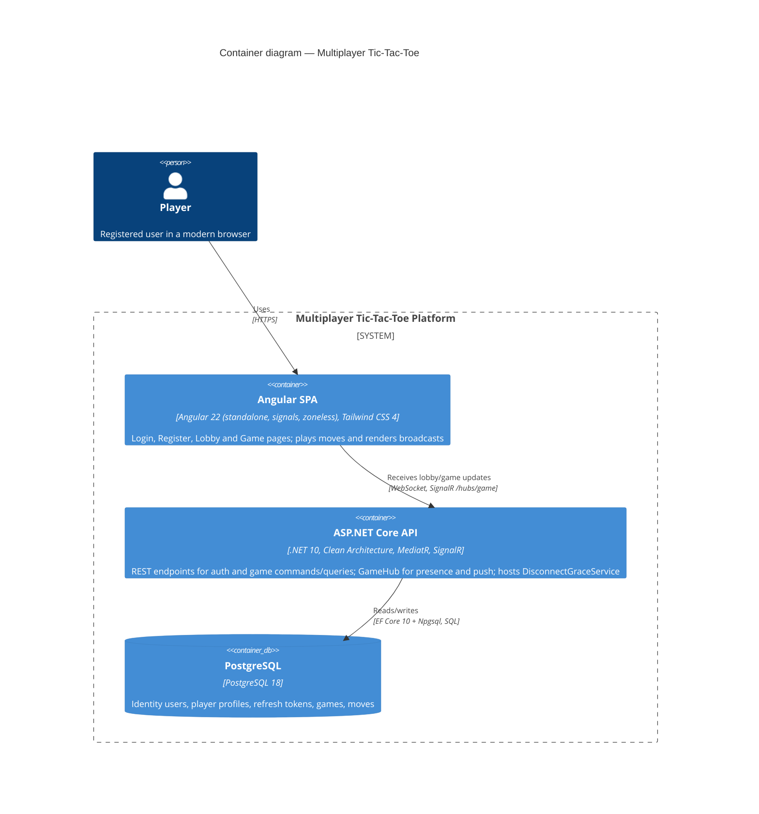
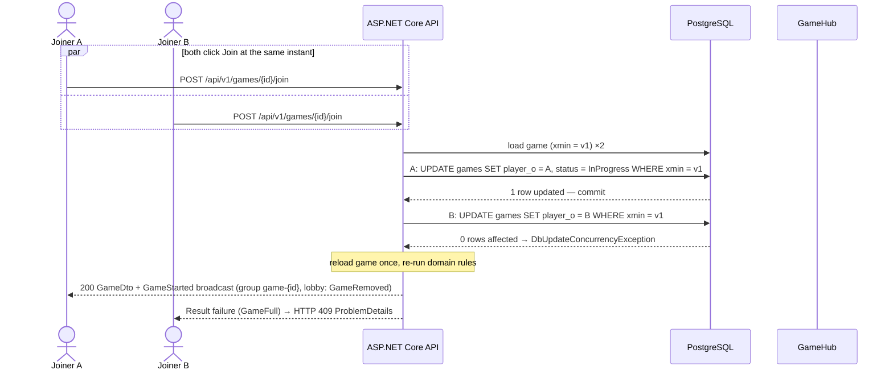
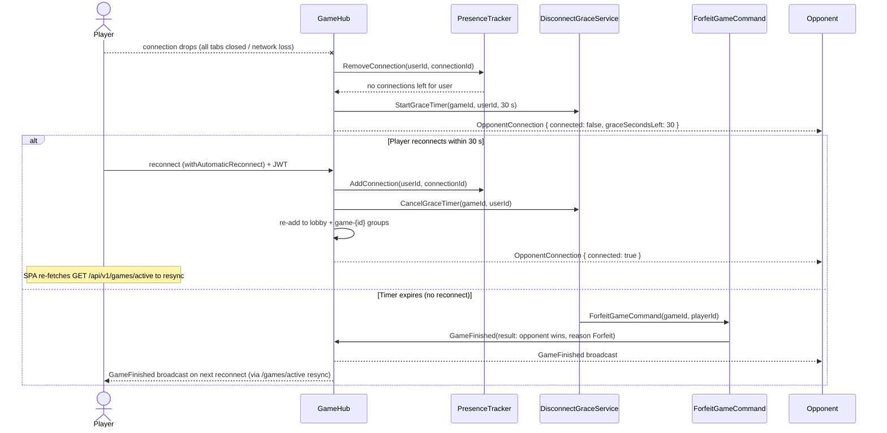
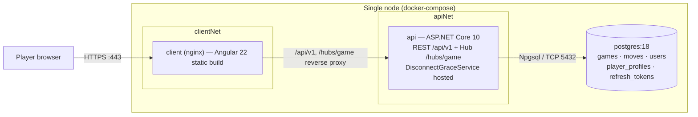

# System Architecture

*This document describes the high-level architecture of the Multiplayer Tic-Tac-Toe platform: system context, containers, key runtime sequences, the technology stack, cross-cutting concerns, and the deployment and scalability outlook.*

Parent document: [PRD](../00-product/PRD.md) · Related: [Clean Architecture & DDD](clean-architecture-ddd.md) · [CQRS & MediatR](cqrs-and-mediatr.md) · [Real-time & SignalR](../02-backend/realtime-signalr.md) · [Deployment](../06-devops/docker-and-environments.md)

---

## 1. System Context (C4 Level 1)

The platform is a self-contained web product: registered players interact with it through a browser; the only external dependency is the mail-less identity data stored locally. There are no third-party integrations in the MVP.



| Element | Description |
| --- | --- |
| Player | Registers with username/email/password, sees online players and games, plays in real time (see [PRD personas](../00-product/PRD.md)) |
| Admin / Developer | Operates the platform via CI/CD; no admin dashboard in MVP |
| Platform | Everything inside the dashed boundary below — a single deployable system for MVP |

## 2. Container Diagram (C4 Level 2)

One API process, one SPA, one database. Real-time push is a first-class channel alongside REST.



Key architectural facts:

| Fact | Value | Reference |
| --- | --- | --- |
| Game state authority | Server only — clients never mutate shared state | [PRD NFR Reliability](../00-product/PRD.md) |
| Write path | REST commands (`POST /api/v1/games/{id}/moves`, join, create…) | [API spec](../02-backend/api-spec.md) |
| Push path | SignalR hub `/hubs/game`, groups `lobby` and `game-{id}` — push only, no state mutation except presence | [Real-time](../02-backend/realtime-signalr.md) |
| Concurrency | PostgreSQL `xmin` optimistic concurrency, reload-once-and-retry policy | [Concurrency](../03-database/concurrency.md) · [ADR-0006](adr/0006-optimistic-concurrency-xmin.md) |
| Background work | `DisconnectGraceService` hosted service (30 s forfeit timers, stale-game cleanup > 15 min) | §4.3 below |

## 3. Technology Stack

Modernized on 2026-11-04 from the original document's §6.2 table (.NET 8 / EF Core 8 / PostgreSQL 16 / Angular 17+); recorded in [ADR-0011](adr/0011-latest-stable-stack.md).

| Layer | Choice | ADR |
| --- | --- | --- |
| Runtime / language | .NET 10 (LTS), C# 14 | [ADR-0011](adr/0011-latest-stable-stack.md) |
| Web framework | ASP.NET Core Web API (controllers) | — |
| Architecture | Clean Architecture + DDD tactical patterns + CQRS | [ADR-0001](adr/0001-clean-architecture-and-ddd.md) |
| Mediator | MediatR (latest) — commands, queries, notifications, pipeline behaviors | [ADR-0002](adr/0002-mediatr-for-cqrs.md) |
| Validation | FluentValidation (pipeline `ValidationBehavior`) | — |
| Mapping | Mapster (manual mapping inside Domain) | [ADR-0010](adr/0010-mapster-mapping.md) |
| ORM / DB access | EF Core 10 + Npgsql | [ADR-0003](adr/0003-postgresql-ef-core-npgsql.md) |
| Database | PostgreSQL 18 | [ADR-0003](adr/0003-postgresql-ef-core-npgsql.md) |
| Auth | ASP.NET Core Identity + JWT Bearer (15 min) + rotating hashed refresh tokens (7 d) | [ADR-0004](adr/0004-identity-jwt-rotating-refresh-tokens.md) |
| Real-time | SignalR (server) + @microsoft/signalr (client) | [ADR-0005](adr/0005-rest-moves-signalr-broadcasts.md) |
| API docs | .NET built-in OpenAPI (Microsoft.AspNetCore.OpenApi) + Scalar UI | [ADR-0011](adr/0011-latest-stable-stack.md) |
| Logging | Serilog (structured JSON console + correlation IDs) | — |
| Backend tests | NUnit 4 (mandated), FluentAssertions, NSubstitute, Testcontainers, Respawn | [ADR-0012](adr/0012-nunit-test-framework.md) |
| Frontend | Angular 22 — standalone components, signals, zoneless change detection | [ADR-0007](adr/0007-angular-signals-zoneless-tailwind.md) |
| Styling | Tailwind CSS 4, CSS-first `@theme` (no tailwind.config.js) | [ADR-0007](adr/0007-angular-signals-zoneless-tailwind.md) |
| Frontend tests | vitest + jsdom (unit), Playwright (E2E) | — |
| Containers / CI | Docker, docker-compose, GitHub Actions | [CI/CD](../06-devops/ci-cd.md) |

## 4. Runtime Views

### 4.1 Make-move round trip

The canonical write path: a REST command mutates the aggregate, commits, then domain events fan out as SignalR broadcasts. Target: p95 < 200 ms.

```mermaid
sequenceDiagram
    actor P as Player (SPA)
    participant C as GamesController
    participant M as MediatR pipeline
    participant H as MakeMoveHandler
    participant G as Game aggregate
    participant UO as UnitOfWork
    participant DB as PostgreSQL
    participant NH as Notification handlers
    participant Hub as GameHub

    P->>C: POST /api/v1/games/{id}/moves { position }
    C->>M: Send(MakeMoveCommand(gameId, position))
    Note over M: Logging → Validation → UnitOfWork → Performance
    M->>H: handle(command)
    H->>G: load via IGameRepository, game.MakeMove(playerId, position)
    Note over G: guards: InProgress, participant, turn, cell empty; append Move; evaluate board; raise MoveMade
    G-->>H: ok (or domain exception → Result error)
    H->>UO: SaveChangesAsync
    UO->>DB: UPDATE games / INSERT moves (xmin optimistic check)
    DB-->>UO: committed
    UO->>NH: publish domain events (post-commit)
    NH->>Hub: MoveMade(GameDto) → group game-{id}
    Hub-->>P: MoveMade broadcast (both players)
    C-->>P: 200 GameDto (authoritative state)
```

### 4.2 Join race (two simultaneous joiners)

Exactly one joiner wins; the loser gets a clear failure. Safety comes from three layers: domain guards, `xmin` optimistic concurrency, and a partial unique index (`UNIQUE (player_o_id) WHERE status = 1`) as last line of defense — see [Concurrency](../03-database/concurrency.md).



### 4.3 Disconnect → forfeit / reconnect

A player in an `InProgress` game who loses all connections gets a 30-second grace window; reconnecting cancels the forfeit; expiry ends the game with `Reason = Forfeit` and the opponent as winner. Waiting games stale for more than 15 minutes are cancelled by the same hosted service.



## 5. Cross-Cutting Concerns

| Concern | Design | Where |
| --- | --- | --- |
| Structured logging | Serilog with console sink emitting JSON in production, readable text in Development; every request logged by `LoggingBehavior` with `RequestId`, `UserId`, `UseCase`, `ElapsedMs`; sensitive values (passwords, tokens, full emails) never logged | [Coding standards](../02-backend/coding-standards.md) |
| Correlation IDs | `CorrelationIdMiddleware` accepts/propagates `X-Correlation-Id` (generates a new one if absent), stores it in `HttpContext` and `LogContext`, flows into logs and outgoing SignalR broadcasts' metadata; surfaced in `ProblemDetails.extensions` | — |
| Health checks | ASP.NET Core health checks at `/health`: PostgreSQL connectivity check plus a self-check; used by docker-compose and the load balancer | [Docker & environments](../06-devops/docker-and-environments.md) |
| Rate limiting | .NET built-in rate limiter: auth endpoints 10/min per IP, moves 5/s per user, global policy as backstop; 429 with `RetryAfter` | [Security](../05-quality/security.md) |
| Error contract | RFC 7807 `ProblemDetails` for every error; a single factory maps `Result.Error` codes and domain exceptions to status codes | [API spec](../02-backend/api-spec.md) |
| API documentation | .NET built-in OpenAPI document generation (`Microsoft.AspNetCore.OpenApi`) served to Scalar UI with JWT bearer support; enabled in all environments behind auth in production | [ADR-0011](adr/0011-latest-stable-stack.md) |
| AuthN/AuthZ | JWT Bearer (15 min access token) on REST and hub; every game command validates the caller is a participant; hub group joins validated server-side | [Auth & JWT](../02-backend/auth-identity-jwt.md) |
| Time | All timestamps UTC via `IDateTimeProvider` abstraction (testable) | [Clean Architecture](clean-architecture-ddd.md) |
| Configuration | `appsettings.{Env}.json` + environment variables (`ConnectionStrings__Default`, `Jwt__*`, `Cors__Origins`); secrets never committed | [Docker & environments](../06-devops/docker-and-environments.md) |

## 6. Deployment View (Summary)

Three docker-compose services on a single node: `postgres:18` (named volume), `api` (ASP.NET Core image), `client` (nginx serving the Angular 22 build). GitHub Actions CI: restore → build → test (Testcontainers-backed integration tests) → lint/build client → build Docker images. EF migrations apply on startup in Development and as a dedicated CI/CD step elsewhere. Full details: [Docker & environments](../06-devops/docker-and-environments.md) and [CI/CD](../06-devops/ci-cd.md).



## 7. Scalability Notes

| Concern | Position for the MVP | Path beyond MVP |
| --- | --- | --- |
| API process | Stateless between requests: no in-session state; JWT carries identity; all game state in PostgreSQL — the API can already run multiple replicas except for the two in-memory pieces below | Horizontal scaling once presence and SignalR fan-out move to Redis |
| Load target | 500 concurrent games on a single node (PRD scalability NFR); a move is one aggregate load + one transaction + one group broadcast — cheap by design | Vertical headroom first (DB connection pool, Kestrel threads), then scale-out |
| SignalR fan-out | Single-node groups; Redis backplane is the planned scale-out step so any server can deliver to `lobby` / `game-{id}` groups regardless of which server holds the connection | Add `AddSignalR().AddStackExchangeRedis(...)` backplane (see [PRD future scope](../00-product/PRD.md)) |
| Presence | In-memory `ConcurrentDictionary` (userId → set of connectionIds) — correct for one instance, documented constraint | Replace `IPresenceTracker` implementation with a Redis-backed store; consumers unchanged ([ADR-0008](adr/0008-in-memory-presence-tracker.md)) |
| Disconnect timers | `DisconnectGraceService` hosted service holds timers in-process | Timers move to a durable store (e.g. Redis) with idempotent expiry handling |
| Database | Lobby queries covered by `games(status, created_at_utc DESC)`; one-active-game partial unique indexes keep writes safe | Read replicas for history/stats features; CQRS read-side split already isolates queries behind `IReadDbContext` |

## Assumptions

- The MVP deploys as one API instance per environment; multi-instance deployment is explicitly out of scope until the Redis steps in §7 land.
- nginx serves the static Angular build and reverse-proxies `/api/v1` and `/hubs/game` to the API, so the browser sees a single origin and no CORS is needed in the composed environment (CORS remains configured for local dev servers).
- HTTPS terminates at the edge (nginx or the platform load balancer); the api container itself listens on plain HTTP inside the trusted docker network.
- Health endpoint is `/health` (single aggregated endpoint) rather than separate liveness/readiness paths, matching the original document.
