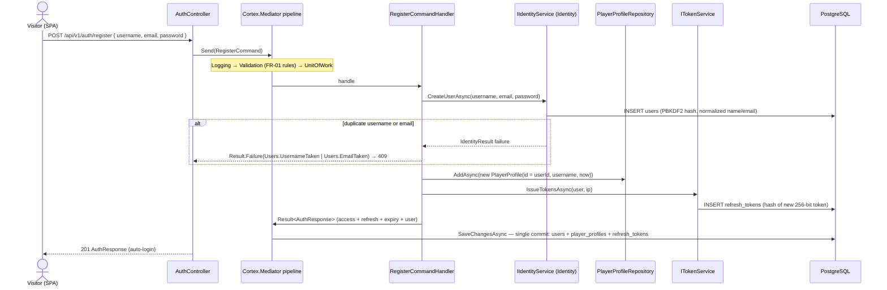

# Auth, Identity & JWT

*The identity and token design for Multiplayer Tic-Tac-Toe — ASP.NET Core Identity account configuration, the registration and login flows, the 15-minute JWT access token, the rotating hashed refresh tokens with reuse detection, logout, client-side token storage and the configuration keys.*

Parent document: [PRD](../00-product/PRD.md) · Related: [API spec](api-spec.md) · [Real-time & SignalR](realtime-signalr.md) · [Schema & ERD](../03-database/schema-and-erd.md) · [Security](../05-quality/security.md) · Decision record: [ADR-0004](../01-architecture/adr/0004-identity-jwt-rotating-refresh-tokens.md)

---

## 1. Token Model at a Glance

| Property | Access token | Refresh token |
| --- | --- | --- |
| Format | Signed JWT, HS-256, 256-bit key | Opaque 256-bit cryptographically random value (base64url) |
| Lifetime | 15 minutes | 7 days, sliding via rotation |
| Claims / payload | `sub`, `name`, `email`, `jti` (+ standard `iss`, `aud`, `iat`, `nbf`, `exp`) | None — meaningless to read |
| Client storage | Memory only (never `localStorage`) | `localStorage` in MVP (accepted risk — [security §7](../05-quality/security.md#7-accepted-risks-and-roadmap)) |
| Server storage | None — stateless signature validation | SHA-256 hash only, in `refresh_tokens` (never the raw value) |
| On use | Signature + lifetime check, no lookup | Hash lookup → expiry/revocation check → **rotate**: old revoked, new pair issued |
| Theft containment | Short lifetime bounds replay | Reuse of a revoked token revokes the entire family |

The API stays fully stateless per request: access tokens require no server lookup; refresh tokens require one indexed hash lookup. Identity and JWT are wired in Infrastructure (`Identity/`, `TokenService`) behind the Application-owned `IIdentityService` and `ITokenService`, so no Identity or JwtBearer type leaks into Domain/Application ([clean architecture §2](../01-architecture/clean-architecture-ddd.md#2-projects-and-responsibilities)).

## 2. ApplicationUser and Identity Configuration

`ApplicationUser : IdentityUser<Guid>` — the only Identity entity customization; mapped to the `users` table, with `PlayerProfile` (id = user id) as the domain-facing twin:

```csharp
public sealed class ApplicationUser : IdentityUser<Guid>;
```

Configured at startup (Infrastructure `DependencyInjection.cs`):

| Option | Value | Why |
| --- | --- | --- |
| `Password.RequiredLength` | 8 | FR-01 minimum |
| `Password.RequireUppercase` / `RequireLowercase` / `RequireDigit` | `true` × 3 | FR-01 complexity |
| `Password.RequireNonAlphanumeric` | `false` | Not required by FR-01; keeps policy friendly |
| `User.RequireUniqueEmail` | `true` | Unique email enforced by `UserManager` (distinct 409 code — [api-spec §2.1](api-spec.md#21-post-authregister--create-account)) |
| `Lockout.AllowedForNewUsers` | `true` | New accounts are lockout-protected from day one |
| `Lockout.MaxFailedAccessAttempts` | 5 | Brute-force backstop |
| `Lockout.DefaultLockoutTimeSpan` | 5 minutes | → HTTP 423 while `lockout_end` is in the future |
| `SignIn.RequireConfirmedEmail` | `false` | No email verification in MVP (PRD non-goal) |

Password hashing is Identity's default `PasswordHasher` — PBKDF2 with HMAC-SHA-256 (V3 format), per-password salt, framework-default iteration count (≥ 100 000). Roles, external logins and two-factor are unused (schema kept as generated — [schema §4.6](../03-database/schema-and-erd.md#46-identity-support-tables-as-generated)).

## 3. Password Policy (FR-01)

| Rule | Enforcement |
| --- | --- |
| Min 8 characters, ≥ 1 upper-case, ≥ 1 lower-case, ≥ 1 digit | Identity options **and** `RegisterCommandValidator` (FluentValidation) — the validator produces the field-level 400 the register form renders; Identity re-checks as defense in depth |
| Username 3–20 chars, `^[A-Za-z0-9_]+$`, unique (case-insensitive) | Validator + `users.normalized_user_name` unique index |
| Email valid format, ≤ 256 chars, unique | Validator + `RequireUniqueEmail` |
| No password change/reset in MVP | Documented roadmap item (no email verification exists to secure it) |

## 4. Registration Flow

One transaction creates the Identity user, the `PlayerProfile` and the initial refresh token; a failure anywhere rolls back all three — no orphan profiles, no tokenless users.



The handler never touches `UserManager` directly — `IIdentityService` wraps it so Application depends on an interface rather than Identity types. The client redirects to `/lobby` on 201; no confirmation email is sent (MVP).

## 5. Login by Email or Username

`POST /auth/login` accepts one `identifier` field that matches **either** the account's email or its username:

| Step | Rule |
| --- | --- |
| Resolution | Normalize the identifier (upper-case) and look up by `normalized_email` first, then `normalized_user_name` — a hit in either resolves the same account |
| Unknown identifier | Return `Auth.InvalidCredentials` (401) — **byte-identical** to the wrong-password response (no user enumeration, [security §2.2 I3](../05-quality/security.md#22-stride-analysis)) |
| Wrong password | Increment `access_failed_count`; same generic 401 |
| Lockout | 5 consecutive failures set `lockout_end = now + 5 min`; attempts during the window (even with the correct password) return 423 `Auth.LockedOut` |
| Success | Reset the failure counter, issue an access token and a **new refresh token family root** (each login starts an independent lineage — one device's logout does not kill other devices) |

## 6. JWT Access Token

| Attribute | Value |
| --- | --- |
| Signing | HS-256 (HMAC-SHA-256), key from `Jwt__Key`, ≥ 32 bytes (256-bit) |
| Lifetime | 15 minutes (`Jwt__AccessTokenMinutes`) |
| Issuer / Audience | `Jwt__Issuer` / `Jwt__Audience` (validated on every request) |

Claims:

| Claim | Source | Use |
| --- | --- | --- |
| `sub` | user id (GUID string) | **The only** identity source — `ICurrentUser.UserId`; never trust a client-supplied user id |
| `name` | username | Display/logging (`ICurrentUser.Username`) |
| `email` | email | Convenience claim; not used for authorization |
| `jti` | random GUID | Token tracing/correlation in logs (hashed if ever logged) |
| `iss`, `aud`, `iat`, `nbf`, `exp` | standard | Validated by the bearer handler |

No roles/permissions claims in MVP (no roles exist); keeping the token minimal shrinks the replay value of a stolen token ([security §3.2](../05-quality/security.md#32-token-security)).

Validation parameters (JwtBearer, identical for REST and the hub):

```csharp
options.TokenValidationParameters = new TokenValidationParameters
{
    ValidateIssuer = true,
    ValidateAudience = true,
    ValidateLifetime = true,
    ValidateIssuerSigningKey = true,
    RequireSignedTokens = true,
    ClockSkew = TimeSpan.FromSeconds(30),
    ValidIssuer = jwt.Issuer,
    ValidAudience = jwt.Audience,
    IssuerSigningKey = new SymmetricSecurityKey(keyBytes)  // Jwt__Key, >= 32 bytes
};
```

Clock skew is capped at 30 s (down from the 5-minute default): tokens are issued and validated by the same process family, so skew only needs to absorb minor clock drift — and a tight skew tightens the effective theft window.

## 7. Refresh Tokens: Rotation + Reuse Detection

Lifecycle rules:

| Rule | Detail |
| --- | --- |
| Generation | 32 random bytes from `RandomNumberGenerator` (256-bit entropy), base64url-encoded for transport |
| Storage | Only `SHA-256(token)` as hex (64 chars) in `refresh_tokens.token_hash` (unique index); the raw value is never persisted or logged |
| Expiry | 7 days (`Jwt__RefreshTokenDays`); expired → 401 `Auth.InvalidRefreshToken`, user must log in again |
| Rotation | **Every** successful refresh: the presented token is marked revoked (`revoked_at_utc`), its successor row records `replaced_by_token_hash`, and a new access+refresh pair is returned |
| Family | The replacement chain rooted at the login-issued token; `created_by_ip` is recorded per token for audit |
| Reuse detection | Presenting a token that is already revoked proves theft (a legitimately rotating client always holds the newest token): the handler walks the family and revokes **every** token in it — attacker and victim both lose the session and must re-login |
| Concurrency | Two parallel refreshes with the same token: one rotates, the other's presentation is now a revoked token → family revoked. The client's single-flight refresh queue ([angular architecture §5.4](../04-frontend/angular-architecture.md#54-authinterceptor--bearer--single-flight-refresh)) makes this a non-case in practice; the server behavior is safe regardless |

### 7.1 Happy-path refresh (rotation)

```mermaid
sequenceDiagram
    actor C as SPA (authInterceptor)
    participant API as POST /auth/refresh
    participant H as RefreshTokenCommandHandler
    participant T as ITokenService
    participant DB as refresh_tokens

    C->>API: { refreshToken: RT1 }
    API->>H: Send(RefreshTokenCommand)
    H->>DB: lookup by token_hash = SHA-256(RT1)
    alt not found or expired
        H-->>C: 401 Auth.InvalidRefreshToken
    else revoked (reuse — see §7.2)
        H->>DB: revoke entire family
        H-->>C: 401 Auth.InvalidRefreshToken
    else active
        H->>T: rotate(user, RT1)
        T->>DB: UPDATE RT1 SET revoked_at_utc, replaced_by_token_hash = hash(RT2)
        T->>DB: INSERT RT2 (hash, expiry +7d, created_by_ip)
        T->>T: issue new access token (15 min)
        H-->>C: 200 AuthResponse { accessToken, refreshToken: RT2, expiresAtUtc, user }
        Note over C: store RT2 (replace RT1); RT1 is dead from this moment
    end
```

### 7.2 Reuse-detection attack (stolen token)

Attacker copied RT1 (e.g. via XSS reading `localStorage`) while the victim keeps using the app:

```mermaid
sequenceDiagram
    actor A as Attacker (stole RT1)
    actor V as Victim (holding RT1)
    participant API as POST /auth/refresh
    participant DB as refresh_tokens

    rect rgb(60,20,30)
    Note over A,DB: 1) Attacker refreshes first with the stolen RT1
    A->>API: { refreshToken: RT1 }
    API->>DB: RT1 active → rotate: revoke RT1, issue RT2a to attacker
    API-->>A: 200 { refreshToken: RT2a }
    end
    rect rgb(20,60,30)
    Note over V,DB: 2) Victim's client refreshes with RT1 (now revoked)
    V->>API: { refreshToken: RT1 }
    API->>DB: RT1.revoked_at_utc != NULL → REUSE DETECTED
    API->>DB: revoke family: RT1, RT2a and every descendant/ancestor in the chain
    API-->>V: 401 Auth.InvalidRefreshToken → client clears tokens, redirect /login
    Note over A: RT2a is dead too — next attacker refresh returns 401
    end
```



Either order produces the same outcome: the thief's session dies no later than the victim's next refresh, and the victim is forced to re-authenticate with credentials the thief does not have. This is the designed containment for the accepted `localStorage` risk ([security §7](../05-quality/security.md#7-accepted-risks-and-roadmap)).

## 8. Logout

`POST /auth/logout` (Bearer-authenticated, body carries the device's current `refreshToken`):

1. Handler verifies the token hash belongs to the authenticated user; unknown/foreign tokens are a no-op (still 204 — idempotent, no enumeration).
2. The presented token and its lineage are revoked (`revoked_at_utc` set).
3. The client clears the in-memory access token and the stored refresh token, stops the SignalR connection and navigates to `/login`.

The just-used access token remains technically valid for up to 15 minutes (stateless JWTs cannot be un-issued) — accepted and bounded by the short lifetime ([security §3.3](../05-quality/security.md#33-session-and-logout)); no renewal is possible because the refresh family is dead. Logging out mid-game does **not** forfeit immediately: the SignalR disconnect starts the normal 30 s grace (US-03/US-10).

## 9. Client-Side Token Storage

| Token | Storage | Rationale |
| --- | --- | --- |
| Access token | In-memory only (Angular service/signal) | An XSS payload cannot read it after reload; losing it on refresh is fine — the refresh token restores it |
| Refresh token | `localStorage` (MVP) | Survives page reloads (US-02 "stay logged in"); **accepted XSS risk** — mitigated by strict CSP, rotation + family revocation (§7.2), and the plan to move to an `HttpOnly` + `Secure` + `SameSite=Strict` cookie in v1.1 ([security §7](../05-quality/security.md#7-accepted-risks-and-roadmap)) |

Rules the client must honor: never log either token; never send the refresh token anywhere except `POST /auth/refresh` and `POST /auth/logout`; never write the access token to any persistent store; queue parallel refreshes behind one call (single-flight).

## 10. Configuration Keys

| Key | Example | Rules |
| --- | --- | --- |
| `Jwt__Key` | dev: user-secrets; prod: env var | ≥ 32 bytes; never committed (gitleaks-enforced); rotation = dual-validate old+new for ≤ 15 min or force fleet re-login ([security §3.10](../05-quality/security.md#310-secrets-management)) |
| `Jwt__Issuer` | `tictactoe-api` | Must match `ValidIssuer` |
| `Jwt__Audience` | `tictactoe-spa` | Must match `ValidAudience` |
| `Jwt__AccessTokenMinutes` | `15` | Default 15; tests use 60 s (never shipped) |
| `Jwt__RefreshTokenDays` | `7` | Default 7; rotation makes the effective session "7 days since last use" |
| `GameRules__DisconnectGraceSeconds` | `30` | Auth-adjacent only in that logout + grace interact (§8) |

Sourced from `appsettings.json` (non-secret defaults) + environment variables / user-secrets (secrets), per [docker-and-environments](../06-devops/docker-and-environments.md). Integration tests override the lifetime keys via `WebApplicationFactory` configuration ([testing strategy §6.1](../05-quality/testing-strategy.md#61-fixture-design)).

## Assumptions

- `ApplicationUser` adds no custom properties in MVP — account metadata lives in `player_profiles` so the Domain stays free of Identity types (see [schema §4.2](../03-database/schema-and-erd.md#42-player_profiles)).
- Registration's three writes (user, profile, initial refresh token) commit in one `SaveChanges`/transaction; the sequence diagram shows the handler-driven flow, with `IIdentityService` encapsulating whatever Identity needs internally.
- JWTs are symmetric-signed (HS-256): the same service issues and validates. If a second service ever needs to validate tokens, switching to asymmetric keys (RS-256) is a configuration + key-management change, not a contract change.
- Email is never verified; therefore `email` claim contents are only as trustworthy as the registrant, and nothing security-relevant is ever sent by email in MVP.
- One account may hold multiple simultaneous sessions (devices), each an independent token family; presence and the one-active-game rule are per-user, not per-session (PRD open question #2).
- The illustrative token/claim values shown match the [API spec examples](api-spec.md#21-post-authregister--create-account); they are documentation samples, not live secrets.
