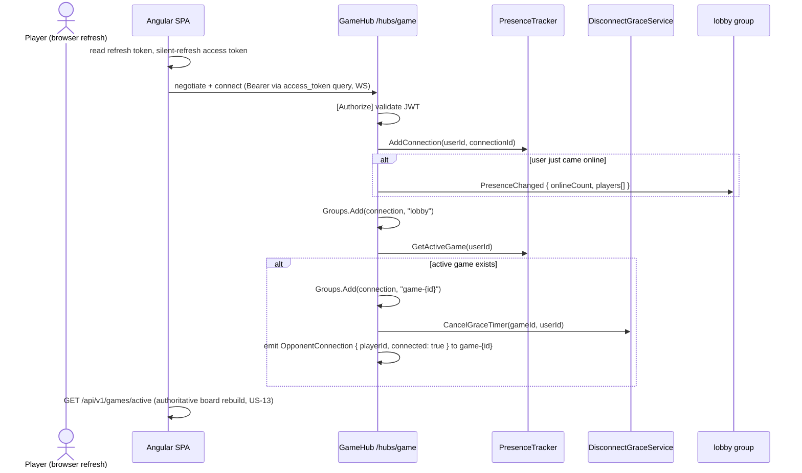
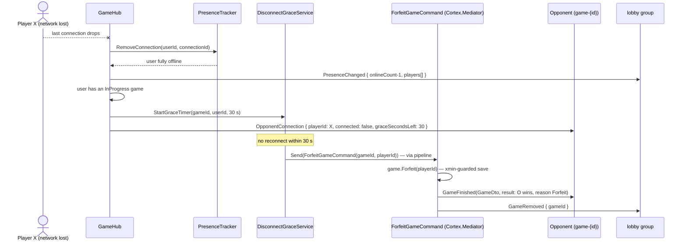

# Real-Time & SignalR

*The full SignalR contract for Multiplayer Tic-Tac-Toe — hub endpoint and transports, groups, the server-to-client event catalog with payload examples, client-to-server methods, the connection lifecycle (connect, disconnect-grace-forfeit, reconnect-resync), the DisconnectGraceService, reconnect and keep-alive policy, security notes and the scale-out path.*

Parent document: [PRD](../00-product/PRD.md) · Related: [API spec](api-spec.md) · [Auth, Identity & JWT](auth-identity-jwt.md) · [System architecture](../01-architecture/system-architecture.md) · [Security](../05-quality/security.md) · Decision records: [ADR-0005](../01-architecture/adr/0005-rest-moves-signalr-broadcasts.md) · [ADR-0008](../01-architecture/adr/0008-in-memory-presence-tracker.md)

---

## 1. Role of the Hub

Per [ADR-0005](../01-architecture/adr/0005-rest-moves-signalr-broadcasts.md): **all state mutations travel over REST** (`/api/v1`), and the hub is **push-only** — the sole exception is *presence* (connection lifecycle and group membership, which are transport bookkeeping, not domain state). The hub therefore mutates no game state; it broadcasts the results of committed commands and tracks who is connected.

| Channel | Carries | Never carries |
| --- | --- | --- |
| Hub server→client | lobby/game broadcasts, presence changes, opponent connection state | state-mutation requests |
| Hub client→server | `JoinGameRoom`, `LeaveGameRoom`, connect/disconnect lifecycle | moves, joins, cancels, forfeits |
| REST `/api/v1` | all mutations and reads | server-initiated pushes |

## 2. Hub Endpoint and Transport Negotiation

Hub path: **`/hubs/game`** (nginx reverse-proxies `/hubs/game` to the API alongside `/api/v1` — single origin, no extra CORS surface). Default JSON hub protocol; MessagePack is a post-MVP option, not part of this contract.

The client starts with the standard `/hubs/game/negotiate` POST, then upgrades. Transports, in SignalR's automatic preference order:

| Preference | Transport | JWT channel | Notes |
| --- | --- | --- | --- |
| 1 | **WebSockets** (`wss://…/hubs/game`) | `?access_token=<jwt>` **query string** — browsers cannot set headers on a WebSocket handshake | Preferred: lowest latency, no per-message HTTP overhead; required-in-practice for the 200 ms p95 move budget |
| 2 | Server-Sent Events | `Authorization: Bearer <jwt>` header | Fallback where WS is blocked by proxies/firewalls; unidirectional server→client; client→server goes as POSTs |
| 3 | Long Polling | `Authorization: Bearer <jwt>` header | Last resort; fully functional but chatty — presence and grace timers behave identically over it |

The browser client supplies the token through `accessTokenFactory` (the in-memory access token — [angular architecture §7](../04-frontend/angular-architecture.md)); the SignalR client automatically appends `access_token` as a query parameter for WebSocket connects and sets the `Authorization` header for HTTP-based transports and `negotiate`. Because the token rides the query string on WS, request logging strips query strings for `/hubs` paths and proxy access logs for `/hubs` are disabled ([security §3.11](../05-quality/security.md#311-privacy-and-logging)) — the 15-minute token lifetime bounds the exposure.

## 3. Authentication

The hub class is `[Authorize]`; JWT validation at negotiate/connect is identical to REST (issuer, audience, lifetime, signature, ≤ 30 s clock skew — [auth-identity-jwt §6](auth-identity-jwt.md#6-jwt-access-token)).

| Scenario | Behavior |
| --- | --- |
| No/invalid token at connect | Connection rejected with 401 before any lifecycle code runs; no presence registered |
| Token expires while connected | Existing connections stay up (authentication happens at connect); on reconnect the client silently refreshes first and reconnects with the fresh token |
| Anonymous `/negotiate` | 401 — the Angular client refreshes the access token before building the connection |

## 4. Groups

Group names are computed **server-side only**; clients never supply a group name — they invoke `JoinGameRoom(gameId)` and the hub decides membership.

| Group | Members | Purpose |
| --- | --- | --- |
| `lobby` | Every connected (authenticated) user, added automatically in `OnConnectedAsync` | `PresenceChanged`, `GameCreated`, `GameUpdated`, `GameRemoved` |
| `game-{id}` | The two participants of game `{id}`, added on `JoinGameRoom` (validated) and automatically on connect when the user has an active game | `GameStarted`, `MoveMade`, `GameFinished`, `OpponentConnection` |

A user with several tabs/devices has several connections, all added to the same groups; per-user presence aggregation is the tracker's job ([ADR-0008](../01-architecture/adr/0008-in-memory-presence-tracker.md)).

## 5. Server-to-Client Events

### 5.1 Event catalog

| Event | Payload | Target group | Emitted when |
| --- | --- | --- | --- |
| `PresenceChanged` | `{ onlineCount, players[] }` | `lobby` | Any user transitions online or offline (last connection dropped) |
| `GameCreated` | `LobbyGameDto` | `lobby` | A game is created (`GameCreated` domain event) |
| `GameUpdated` | `LobbyGameDto` | `lobby` | A lobby-visible property changed — in practice: game started (Waiting → InProgress) |
| `GameRemoved` | `{ gameId }` | `lobby` | A game left the lobby: finished or cancelled |
| `GameStarted` | `GameDto` | `game-{id}` | Second player joined; both players navigate to the game page |
| `MoveMade` | `GameDto` | `game-{id}` | A move committed (board, turn, and possibly result updated) |
| `GameFinished` | `GameDto` (with `result`) | `game-{id}` | Game ended: win, draw or forfeit (reason `Forfeit` when the grace timer or `/leave` ended it) |
| `OpponentConnection` | `{ playerId, connected, graceSecondsLeft? }` | `game-{id}` | Opponent's presence changed: disconnected (`connected: false`, with remaining grace), or returned (`connected: true`) |

All payloads are camelCase JSON matching the REST DTOs ([api-spec §3](api-spec.md#3-dto-schemas)) — one client model serves both channels. Broadcasts are dispatched **post-commit** by domain-event notification handlers via `IGameNotifier`, so the hub never announces state that was rolled back ([CQRS & Mediator §5](../01-architecture/cqrs-and-mediator.md#5-domain-event--notification-handler-flow)).

### 5.2 Payload examples

`PresenceChanged`:

```json
{
  "onlineCount": 3,
  "players": [
    { "id": "3f9d6c2e-8a41-4b7e-9c2d-1f5a8e6b4c01", "username": "sara_01" },
    { "id": "7c2e9a4f-6d3b-4f8a-b1e5-9d0c7a3f5e02", "username": "rafi_99" },
    { "id": "5ab8f0d1-9c3e-4a6b-8d2f-7e4c1b9a5e05", "username": "mina_x" }
  ]
}
```

`GameCreated` / `GameUpdated` (a `LobbyGameDto`; the `GameUpdated` example shows the same game after an opponent joined):

```json
{
  "id": "a58c31e0-2f4b-4c9a-8e7d-6b3f1d9c4a03",
  "status": "InProgress",
  "playerX": { "id": "3f9d6c2e-8a41-4b7e-9c2d-1f5a8e6b4c01", "username": "sara_01" },
  "playerO": { "id": "7c2e9a4f-6d3b-4f8a-b1e5-9d0c7a3f5e02", "username": "rafi_99" },
  "createdAtUtc": "2026-11-04T14:20:31Z"
}
```

`GameRemoved`:

```json
{ "gameId": "a58c31e0-2f4b-4c9a-8e7d-6b3f1d9c4a03" }
```

`GameStarted` / `MoveMade` / `GameFinished` — a full `GameDto`; the `GameFinished` example (X won the diagonal — the same body the REST move response returns):

```json
{
  "id": "a58c31e0-2f4b-4c9a-8e7d-6b3f1d9c4a03",
  "status": "Finished",
  "playerX": { "id": "3f9d6c2e-8a41-4b7e-9c2d-1f5a8e6b4c01", "username": "sara_01" },
  "playerO": { "id": "7c2e9a4f-6d3b-4f8a-b1e5-9d0c7a3f5e02", "username": "rafi_99" },
  "board": ["X", null, "O", null, "X", null, "O", null, "X"],
  "currentTurn": "X",
  "result": { "outcome": "XWins", "reason": "Normal", "winningLine": [0, 4, 8] },
  "createdAtUtc": "2026-11-04T14:20:31Z"
}
```

(A forfeit ends the same way but with `reason: "Forfeit"` and `winningLine: null`, since no line was completed — see [api-spec §3.4](api-spec.md#34-gamedto).)

`OpponentConnection`:

```json
{ "playerId": "7c2e9a4f-6d3b-4f8a-b1e5-9d0c7a3f5e02", "connected": false, "graceSecondsLeft": 30 }
{ "playerId": "7c2e9a4f-6d3b-4f8a-b1e5-9d0c7a3f5e02", "connected": true }
```

`graceSecondsLeft` is present only on the `connected: false` emission and starts at the configured grace (30 s); the client renders the countdown from it.

### 5.3 Client-to-server methods

| Method | Arguments | Server behavior | Failure |
| --- | --- | --- | --- |
| `JoinGameRoom(gameId)` | `gameId` (string) | Validates the caller is PlayerX or PlayerO of a non-terminal game, then `Groups.AddToGroupAsync(connectionId, "game-" + gameId)` | Non-participants are refused (not added); the invocation faults with a hub error — see [security §4](../05-quality/security.md#4-signalr-specific-security) |
| `LeaveGameRoom(gameId)` | `gameId` (string) | Removes the connection from `game-{gameId}` (leaving the room ≠ leaving the game — forfeit only happens via disconnect grace or `/leave`) | Unknown game id is a no-op |

These are the **only** client-invocable methods; the hub exposes no move/join/cancel invocations at all (ADR-0005).

### 5.4 Domain-event-to-broadcast mapping

| Domain event (post-commit) | Hub emissions |
| --- | --- |
| `GameCreated` | `GameCreated(LobbyGameDto)` → `lobby` |
| `GameStarted` | `GameStarted(GameDto)` → `game-{id}`; `GameUpdated(LobbyGameDto, status InProgress)` → `lobby` |
| `MoveMade` | `MoveMade(GameDto)` → `game-{id}` |
| `GameFinished` | `GameFinished(GameDto with result)` → `game-{id}`; `GameRemoved({gameId})` → `lobby` |
| `GameCancelled` | `GameRemoved({gameId})` → `lobby` (only the host is in the room and their own client drives navigation off the 204) |

## 6. Connection Lifecycle

Rules common to all three flows:

| Phase | Server behavior |
| --- | --- |
| `OnConnectedAsync` | Authenticate (JWT) → `PresenceTracker.AddConnection(userId, connectionId)` → add connection to `lobby` → if the user just came online, broadcast `PresenceChanged` → if the user has an active game (Waiting or InProgress), add the connection to its `game-{id}` group and **cancel any running grace timer** for that user |
| `OnDisconnectedAsync` | `PresenceTracker.RemoveConnection(userId, connectionId)` → if the user still has other connections, nothing else happens (multi-tab) → otherwise broadcast `PresenceChanged`, and if the user is in an `InProgress` game, start the 30 s grace timer and emit `OpponentConnection(connected: false, graceSecondsLeft: 30)` to `game-{id}` |
| Grace timer fires | `DisconnectGraceService` dispatches `ForfeitGameCommand(gameId, playerId)` through the Cortex.Mediator command pipeline (same validation, same xmin guard as a user command); commit publishes `GameFinished(reason Forfeit)` to `game-{id}` and `GameRemoved` to `lobby` |

### 6.1 Connect with an active game (page refresh mid-game)



### 6.2 Disconnect → grace → forfeit



### 6.3 Reconnect and resync

```mermaid
sequenceDiagram
    actor P as Player (connection dropped)
    participant SPA as Angular SPA
    participant H as GameHub
    participant Svc as DisconnectGraceService
    participant O as Opponent (game-{id})

    Note over SPA: withAutomaticReconnect: retry at 0, 1, 3, 5 s
    SPA->>SPA: onreconnecting → ConnectionBadge "Reconnecting…"
    SPA->>H: reconnect (fresh access token — silent refresh if expired)
    H->>H: OnConnectedAsync: presence, lobby group
    H->>H: active game → re-add to game-{id}, cancel grace timer
    H->>O: OpponentConnection { playerId, connected: true }
    SPA->>SPA: onreconnected → GET /api/v1/games/active
    SPA->>SPA: replace local state with authoritative GameDto (no missed event can corrupt the board)
    Note over P,O: play continues; forfeit never fires
```

## 7. DisconnectGraceService

A singleton `IHostedService` in Infrastructure (`Hosting/DisconnectGraceService.cs`) owning two duties:

| Duty | Trigger | Action |
| --- | --- | --- |
| Forfeit timers | A player in an `InProgress` game loses their **last** connection | Start a 30 s timer (`GameRules__DisconnectGraceSeconds`); on expiry dispatch `ForfeitGameCommand(gameId, playerId)` via `IMediator` |
| Stale-game sweep | Periodic scan (every minute) | `Waiting` games with `createdAtUtc` older than 15 minutes (`GameRules__StaleWaitingMinutes`) are cancelled via `CancelGameCommand` — same pipeline as user commands |

Design rules:

- **Cancel on reconnect:** the hub's `OnConnectedAsync` cancels the timer for that (gameId, userId) before the opponent sees `connected: true`; cancellation is idempotent.
- **Commands, not DbContext:** every timer executes a Cortex.Mediator command, so xmin optimistic concurrency, validation and the unit-of-work apply unchanged — including the forfeit-vs-move race, where the loser reloads once and re-evaluates ([concurrency §4.2](../03-database/concurrency.md#42-disconnect-forfeit-vs-simultaneous-move)). If the reload shows the game already finalized, the forfeit resolves as a success-no-op.
- **Idempotent expiry:** a forfeit firing for an already-Finished game is a no-op, so duplicate or late timers are harmless.
- **Process restart:** in-memory timers vanish with the process; a scheduled-but-unfired forfeit simply never happens (safe-side: the game resumes when the player reconnects). All sockets drop on restart anyway, which re-runs the normal grace flow.
- **One timer per (gameId, userId):** starting a timer for a pair that already has one replaces it.

## 8. Client Reconnect Policy

The Angular client ([angular architecture §7.5](../04-frontend/angular-architecture.md)) configures:

```ts
new HubConnectionBuilder()
  .withUrl(hubUrl, { accessTokenFactory: () => tokens.bearer ?? '' })
  .withAutomaticReconnect([0, 1000, 3000, 5000])
  .build();
```

| Aspect | Policy |
| --- | --- |
| Retry schedule | Fixed delays 0 s, 1 s, 3 s, 5 s (four attempts) — short by design: the grace window is 30 s and the player must be back inside it |
| Before each attempt | Ensure a valid access token: the `accessTokenFactory` reads the current in-memory token; if expired, the client silent-refreshes first (a reconnect with a stale token fails at `[Authorize]`) |
| On success (`onreconnected`) | Re-fetch `GET /api/v1/games/active` and replace local state; group membership is re-established server-side (plus the game page re-invokes `JoinGameRoom` as belt-and-braces) |
| On final failure (`onclose`) | Surface the offline badge; the client does not auto-retry forever — a user action (navigation/refresh) or a visible "Reconnect" action restarts the connection |
| UI during retry | Connection badge "Reconnecting…"; board is read-only-looking but input is allowed — the server remains authoritative and rejects moves with 401/409 as appropriate |

## 9. Keep-Alive and Timeout Settings

Explicit values in `AddSignalR` (defaults kept but pinned, so upgrades cannot silently change the disconnect behavior the 30 s grace depends on):

| Setting | Value | Effect |
| --- | --- | --- |
| `KeepAliveInterval` | 15 s | Server pings idle connections so intermediaries (nginx, NATs) keep the socket open |
| `ClientTimeoutInterval` | 30 s | If no message (including pings) arrives from a client within this window, the server closes the connection — **this** is what triggers `OnDisconnectedAsync` for silently-dead networks, before any TCP reset |
| `HandshakeTimeout` | 15 s | A client that fails to complete the hub handshake in time is dropped |
| `MaximumReceiveMessageSize` | 32 KB (default, kept) | Client→server payloads are tiny (a GUID string); oversized or malformed invocations terminate the connection |
| Per-user connection cap | 5 | Enforced at connect ([security §3.8](../05-quality/security.md#38-abuse-and-denial-of-service-controls)) — abuse resistance, not a product limit (tabs/devices are legitimate) |
| nginx | `proxy_read_timeout` ≥ 60 s for `/hubs/game` | The WS upgrade must outlive the 15 s keep-alive cadence; the default 60 s proxy timeout suffices |

Note the deliberate interplay: a silently dead connection is detected within ≤ 30 s (`ClientTimeoutInterval`), and the forfeit grace is another 30 s — so a player who loses connectivity without a TCP close is forfeited within roughly 60 s of the drop, and never sooner than the grace they are owed.

## 10. Security Notes

Full treatment in [security §4](../05-quality/security.md#4-signalr-specific-security); the essentials:

| Concern | Control |
| --- | --- |
| Authentication | `[Authorize]` hub; JWT validated at negotiate/connect exactly like REST |
| Token in query string | WebSockets cannot carry headers; mitigations are the 15-minute token lifetime, log scrubbing of `/hubs` query strings and disabled proxy access logs, and HTTPS in transit |
| Group integrity | `JoinGameRoom` validates participant identity server-side; group names are server-computed; a non-participant is never added to `game-{id}` |
| Push-only surface | No state mutation over the hub (except presence) — a hostile hub client cannot corrupt a game |
| Broadcast hygiene | Payloads carry usernames and board state only — never emails, tokens or IPs |
| Abuse | Per-user connection cap (5), 32 KB message cap, keep-alive/timeout to reap dead sockets |

## 11. Scale-Out

Presence, group membership and grace timers are **in-process** for the MVP: an in-memory `PresenceTracker` (`ConcurrentDictionary<Guid, HashSet<string>>`) and in-memory timers, correct for the single-node deployment the PRD sizes (500 concurrent games on one node). Running multiple API replicas would split presence sets and forfeit timers — unsupported until the scale-out step lands, as one coordinated migration: Redis backplane for SignalR fan-out (`AddSignalR().AddStackExchangeRedis(...)`) **plus** a Redis-backed `IPresenceTracker` implementation plus durable grace timers. Consumers depend only on the Application-owned interfaces, so the swap touches Infrastructure implementations and registration only. Decision record and constraints: [ADR-0008](../01-architecture/adr/0008-in-memory-presence-tracker.md).

## Assumptions

- This file finalizes the client-facing event mapping: on game start the lobby receives `GameUpdated` (the game must move to the lobby's In Progress tab, US-05) and `GameRemoved` is reserved for terminal states; where other documents sketch a `GameRemoved`-on-start lobby emission ([cqrs-and-mediator §5](../01-architecture/cqrs-and-mediator.md#5-domain-event--notification-handler-flow)) or annotate `GameRemoved` with "started", the mapping in §5.4 is canonical.
- A user is "online" iff they hold at least one live hub connection; REST-only activity does not count, and multiple tabs/devices aggregate into one presence entry (PRD open question #2).
- Grace-timer countdowns shown to the opponent start at the configured `GameRules__DisconnectGraceSeconds` (30 s default, 2 s in integration tests); clients render from `graceSecondsLeft` rather than counting independently.
- Hub payload examples use the same illustrative GUIDs/identities as the [API spec](api-spec.md#2-endpoints); they are samples, not fixtures.
- `LeaveGameRoom` only detaches the connection from the room; deliberate mid-game exit goes through `POST /games/{id}/leave` (immediate forfeit) or simply closing the connection (grace forfeit).
- Both `reason` variants of `GameFinished` (`Normal`, `Forfeit`) are part of the same event, distinguished only by payload content.
