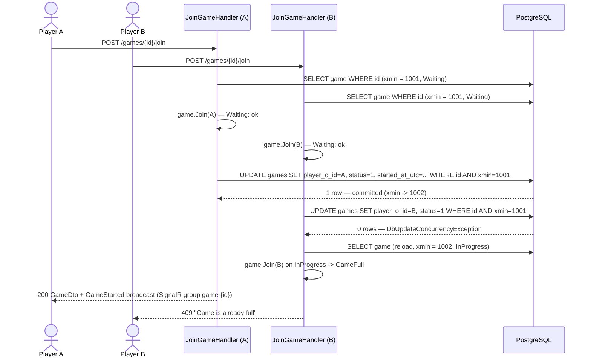
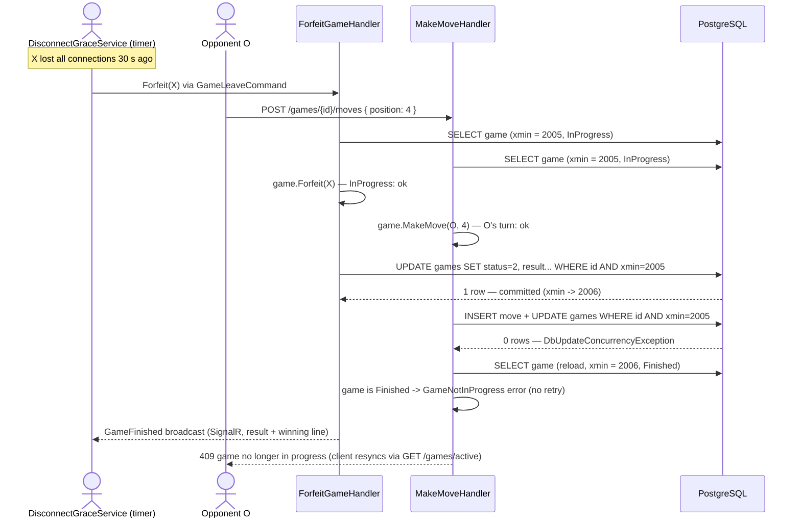

# Concurrency

*How PostgreSQL `xmin` optimistic concurrency, single-reload re-evaluation, database unique constraints and the unit-of-work pipeline together guarantee race-safe game mutations (two simultaneous joins → exactly one winner, double moves impossible, forfeit/cancel races safe) at the 500-concurrent-games target.*

## 1. Goals

| Scenario | Guarantee |
| --- | --- |
| Two users click **Join** on the same Waiting game at the same instant (US-07/FR-06) | Exactly one join succeeds; the other gets the domain error "Game is already full" |
| Both players (or a double-clicking client) submit a **move** for the same game concurrently | One move commits; the other re-validates against fresh state and fails cleanly (not your turn / cell taken / game finished) |
| **Cancel vs join**: the host cancels while another user is joining | First writer wins; the loser reloads once and gets a coherent domain answer |
| **Forfeit vs move**: the 30 s grace timer fires while the opponent is moving | The game finalizes exactly once; the late mutation is rejected with "game no longer in progress" |
| Finished games | Immutable — no transition path from Finished/Cancelled exists in the domain model, and every write is xmin-guarded |

## 2. `xmin` as the EF Concurrency Token

Every PostgreSQL row carries a hidden system column `xmin` holding the transaction id (xid) that last inserted or updated it. Any `UPDATE` writes a new `xmin` for that row. Two concurrent transactions therefore cannot both apply "read the same version, then update it": the second one's predicate no longer matches.

EF Core + Npgsql turns this into a zero-cost row version:

```csharp
// Game aggregate
public uint Version { get; set; }                 // not part of domain logic

// GameConfiguration
builder.Property(g => g.Version).IsRowVersion();  // Npgsql maps this to xmin
```

- There is **no physical column**: `xmin` is a system column, so nothing is added to the schema and no extra write occurs.
- On load, EF captures the row's `xmin`; on save, it emits a single atomic statement:
  `UPDATE games SET ... WHERE id = @id AND xmin = @originalXmin;`
- If another transaction committed first, `0` rows match and EF raises `DbUpdateConcurrencyException` — no locks were ever taken.
- Only **equality** is used; `xmin` must never be treated as a monotonic counter or ordering (xids wrap around).

## 3. The Pattern: Load → Domain Method → Save → Reload Once → Re-evaluate

Every game-mutating command (`JoinGame`, `MakeMove`, `CancelGame`, `ForfeitGame`) follows the same shape:

1. **Load the aggregate** (tracked) — EF records `xmin`.
2. **Call the domain method** — `game.Join(...)`, `game.MakeMove(...)` enforce all invariants against the loaded state and raise domain events.
3. **`SaveChangesAsync`** via the unit of work — one transaction covering the `games` row plus any appended `moves` rows, guarded by `WHERE id AND xmin = @v`.
4. On `DbUpdateConcurrencyException`: **reload the game once** from the database (fresh state, fresh `xmin`).
5. **Re-evaluate the domain rules** on fresh state and return the proper domain error — e.g. the second joiner now sees `InProgress` and gets `GameFullException` → "Game is already full".
6. **Never blind-retry the mutation.** The user's intent is re-validated against reality; if the intent is still valid (rare — e.g. the reload shows the conflicting change was unrelated), the handler may re-apply once, otherwise it returns a result.

```csharp
public async Task<Result<GameDto>> Handle(JoinGameCommand cmd, CancellationToken ct)
{
    var game = await _gameRepository.GetByIdAsync(cmd.GameId, ct)
               ?? return Result.Failure(GameErrors.NotFound);

    var outcome = game.Join(cmd.PlayerId);          // guards: Waiting, not own game, ...
    if (outcome.IsFailure) return outcome;

    try
    {
        await _unitOfWork.SaveChangesAsync(ct);     // UPDATE ... WHERE id AND xmin = @v
    }
    catch (DbUpdateConcurrencyException)
    {
        await _gameRepository.ReloadAsync(game, ct); // ONE reload, fresh state
        return game.Join(cmd.PlayerId);              // re-evaluate → GameFull etc.
    }

    return Result.Success(game.ToDto());
}
```

Why **one** reload is enough: at the 500-games target, each `games` row has at most three potential writers (two players plus an occasional sweep), all issuing millisecond-scale single-statement transactions. The chance of a second conflict landing inside the reload-retry window is negligible; if it somehow happens, the handler fails with a retryable error instead of looping.

## 4. Sequence Diagrams

### 4.1 The join race — two concurrent joins, one winner



### 4.2 Disconnect-forfeit vs simultaneous move

Player X's connection dropped 30 s ago; the grace timer expires at the same moment X (reconnected just in time) or the opponent O submits a move.



The mirror case (move commits first, forfeit fails the xmin check) resolves the same way: the forfeit handler reloads, finds the game Finished, and returns success-as-no-op — the timer's goal (game finalized) is already true. This symmetry is why the rule is "reload once and re-evaluate", never "retry the write".

## 5. Why Optimistic (`xmin`) Instead of Pessimistic (`SELECT ... FOR UPDATE`)

| Aspect | Optimistic (`xmin`) — chosen | Pessimistic (`FOR UPDATE`) |
| --- | --- | --- |
| Statements per mutation | One guarded `UPDATE` (single round trip, atomic) | `SELECT ... FOR UPDATE` then `UPDATE`, inside a held transaction |
| Locks | None held between requests | Row locks held for the transaction's duration; lock timeouts must be tuned |
| Failure mode | Clean `DbUpdateConcurrencyException` → domain error | Possible deadlocks (two handlers locking games rows and token/profile rows in different orders), `lock_not_available` errors |
| Client interaction | None inside a transaction — a stalled client never blocks anyone | Locks survive until commit regardless of client behavior |
| Fit for this workload | Contention is at most 2–3 writers per row with millisecond write windows; conflicts are rare, so the reload path costs almost nothing | Lock machinery buys nothing when transactions are this short |

The PRD's reliability NFR names optimistic concurrency on game updates explicitly, and the 500-concurrent-games scale target (≈ 500 hot `games` rows, ≤ 2 players each) makes contention statistically small. Pessimistic locking would add round trips and deadlock surface for zero correctness gain.

## 6. Transactions and Domain Events

- **Single commit point:** `UnitOfWorkBehavior` wraps every command handler. The handler mutates aggregates only; `SaveChangesAsync` afterwards is the one place a transaction commits — EF wraps the aggregate's `games` update plus any `moves` inserts in a single implicit transaction. There is exactly one aggregate (Game) per mutation, so no cross-aggregate coordination is needed. (Registration is the one other multi-write flow — Identity user + `player_profiles` row + initial refresh token — also a single `SaveChanges`.)
- **Events dispatch after commit:** domain events (`GameCreated`, `GameStarted`, `MoveMade`, `GameFinished`, `GameCancelled`) raised inside aggregate methods are collected and published via Cortex.Mediator only **after** `SaveChangesAsync` succeeds. SignalR broadcasts (`IGameNotifier`) therefore never announce state that was rolled back. Ordering and pipeline placement: [CQRS & Mediator](../01-architecture/cqrs-and-mediator.md).
- **Queries never take locks:** the read side (`IReadDbContext`, `AsNoTracking` projections) is never part of a write transaction.

## 7. Unique Constraints: the Last Line of Defense

`xmin` guards **same-row** races (join vs join, move vs move, join vs cancel, forfeit vs move). Database constraints additionally catch **cross-row and logic-bug** races that a row version cannot see — two different rows that must not both exist:

| Race | Guard | Error surfaced |
| --- | --- | --- |
| Double click / two tabs: two `CreateGame` requests by the same player | `uq_games_player_x_id_active` rejects the second **insert** (different rows — invisible to `xmin`) | 409 "You are already in a game" |
| A player joins two different waiting games concurrently (two rows) | `uq_games_player_o_id_active` (and/or the X-side index) rejects the second update | 409 busy |
| Any application bug that lets a second move claim an occupied cell | `uq_moves_game_id_position` rejects the insert | 500 → investigated as a bug; state stays clean |
| Move sequence corruption | `uq_moves_game_id_move_number` | same |

`DbUpdateException`s with PostgreSQL SQLSTATE `23505` (unique violation) are mapped to domain `Result` errors like any expected failure — never surfaced as raw 500s. Index definitions: [migrations-and-indexes](migrations-and-indexes.md#3-index-catalog); constraint catalog: [schema-and-erd](schema-and-erd.md#6-constraint-catalog).

## 8. DisconnectGraceService Sweep

`DisconnectGraceService` (Infrastructure, `IHostedService`) is a *third writer* that races with player commands, and it goes through exactly the same pipeline:

- **30 s forfeit timers:** when a player in an InProgress game loses their last SignalR connection, a timer starts; a reconnect cancels it; on expiry the service dispatches `GameLeaveCommand` through the Cortex.Mediator command pipeline — same validation, same `UnitOfWorkBehavior`, same `xmin` guard (diagram 4.2).
- **Stale-lobby sweep:** Waiting games older than 15 minutes are cancelled via `CancelGameCommand` on the same path.
- **Sweep vs join:** a joiner and the stale-sweep both load a Waiting game; whoever saves first wins. The loser reloads once: the joiner sees `Cancelled` → "game no longer available"; the sweep sees `InProgress` → the game is no longer stale, no-op.
- Because every timer executes a command rather than touching the DbContext directly, no special concurrency code exists outside the pattern in [section 3](#3-the-pattern-load--domain-method--save--reload-once--re-evaluate).

## 9. Load and Performance Notes

- Target: **500 concurrent games** on a single node ≈ 500 hot rows in `games`; peak write rate is bounded by game pace (≤ 9 moves per game plus transitions), i.e. a few hundred small statements per second worst case.
- Each move costs one indexed `INSERT` into `moves` plus one PK-targeted guarded `UPDATE` of `games` — sub-millisecond, single round trip each; the 200 ms p95 move round-trip budget is dominated by network and SignalR fan-out, not the database.
- Row-rewrite footprint: at most ~11 row versions per finished game; autovacuum absorbs this trivially (see [maintenance](migrations-and-indexes.md#5-maintenance)).
- Expected `DbUpdateConcurrencyException` rate is near zero (two players must write within the same millisecond); when it happens, the reload path adds one extra `SELECT` — invisible next to the p95 budget.

The join race, forfeit-vs-move race and stale-sweep race are reproduced by parallel requests in the integration suite against a real PostgreSQL container (Testcontainers) — see [testing strategy](../05-quality/testing-strategy.md) and the [PRD](../00-product/PRD.md) risk table.

## Assumptions

- Reload-once policy: a second consecutive `DbUpdateConcurrencyException` after the reload returns a retryable error rather than looping.
- `UnitOfWorkBehavior` is the only commit point and dispatches domain events only after a successful `SaveChangesAsync`.
- `DisconnectGraceService` issues `GameLeaveCommand` / `CancelGameCommand` through the Cortex.Mediator command pipeline (so all sweep mutations are xmin-guarded like any user command).
- `Version` (`uint`) on `Game` exists solely for EF/Npgsql concurrency mapping and carries no domain meaning; only equality is ever used.
- PostgreSQL SQLSTATE `23505` unique violations are translated to domain `Result` errors in Application, not rethrown as 500s.
