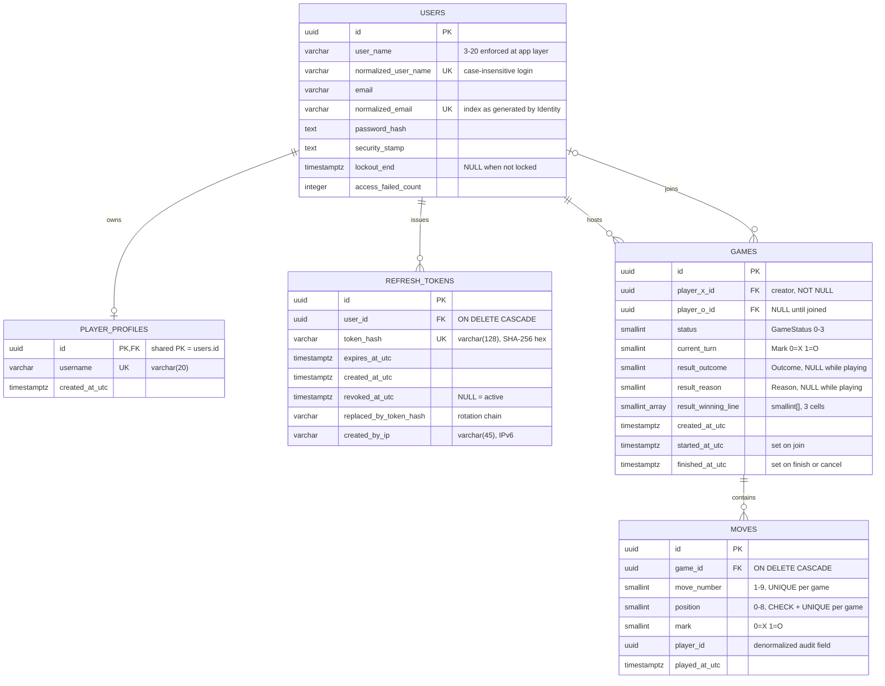

# Database Schema & ERD

*The canonical physical data model for Multiplayer Tic-Tac-Toe on PostgreSQL 18 — entities, relationships, columns, enums, constraints, and the EF Core 10 mappings that produce them, per [PRD](../00-product/PRD.md) §12.*

## 1. Overview

The database is a single PostgreSQL 18 instance accessed exclusively through EF Core 10 + Npgsql inside `TicTacToe.Infrastructure`. It contains five application tables — `users`, `player_profiles`, `refresh_tokens`, `games`, `moves` — plus the framework-managed ASP.NET Core Identity support tables. All writes to `games` and `moves` flow through the `Game` aggregate; see [concurrency](concurrency.md) for the race-safety model and [migrations-and-indexes](migrations-and-indexes.md) for how this schema is produced and evolved.

| Property | Rule |
| --- | --- |
| Naming | `snake_case` for all tables, columns and indexes via `UseSnakeCaseNamingConvention` (EFCore.NamingConventions) |
| Primary keys | `uuid` (`Guid`), column always named `id` |
| Timestamps | `timestamptz`, UTC only, always suffixed `_utc`; values provided by the application via `IDateTimeProvider` (no DB defaults, keeps tests deterministic) |
| Enums | Stored as `smallint` via EF value conversions (see [Enum mappings](#5-enum-mappings)) |
| Concurrency | PostgreSQL `xmin` system column as the row version on `games` (see [concurrency](concurrency.md)) |
| Board state | **Derived from `moves` — there is no `board` column** (see [Board is derived from moves](#9-board-is-derived-from-moves)) |

## 2. Entity-Relationship Diagram



> `games` also carries the PostgreSQL system column `xmin` used by EF as the concurrency token. It is not a physical column in the model or in migrations; Npgsql reads and predicates on it directly.

| Relationship | Cardinality | Notes |
| --- | --- | --- |
| `users` → `player_profiles` | 1 : 0..1 | Shared primary key (`player_profiles.id = users.id`); the profile is created in the same transaction as registration |
| `users` → `refresh_tokens` | 1 : 0..N | Rotating refresh tokens; old tokens are kept (revoked) for reuse detection |
| `users` → `games` (as X) | 1 : 0..N | `player_x_id`; at most **one active** (status Waiting/InProgress) via partial unique index |
| `users` → `games` (as O) | 1 : 0..N | `player_o_id`, NULL until someone joins; at most **one InProgress** via partial unique index |
| `games` → `moves` | 1 : 0..9 | Owned/child collection of the `Game` aggregate; 0 moves while Waiting, at most 9 once played |

## 3. Naming Conventions

| Rule | Detail |
| --- | --- |
| Identifiers | `snake_case` everywhere, applied by `options.UseNpgsql(...).UseSnakeCaseNamingConvention()` — no hand-written column names in entity configurations |
| Domain tables | Plural: `games`, `moves`, `player_profiles`, `refresh_tokens` |
| Users table | `ApplicationUser` is explicitly mapped with `ToTable("users")` — this is the `AspNetUsers` table under a clean name |
| Identity support tables | Kept exactly as generated by `IdentityDbContext`, merely snake_cased by the convention: `asp_net_roles`, `asp_net_role_claims`, `asp_net_user_claims`, `asp_net_user_logins`, `asp_net_user_roles`, `asp_net_user_tokens` |
| Primary keys | Column `id uuid`; constraint names `pk_<table>` |
| Foreign keys | Column `<referenced>_id`; constraint names `fk_<table>_<column>__<ref>` |
| Uniques / checks / indexes | `uq_`, `ck_`, `ix_` prefixes with full names listed in the [constraint catalog](#6-constraint-catalog) and [migrations-and-indexes](migrations-and-indexes.md) |
| Timestamps | Always `timestamptz` and `_utc`-suffixed; the application writes UTC only |

## 4. Table Specifications

### 4.1 `users` (AspNetUsers via Identity)

One row per registered account. Written by ASP.NET Core Identity (`ApplicationUser : IdentityUser<Guid>`); the application never writes these columns directly.

| Column | Type | Null | Default | Description |
| --- | --- | --- | --- | --- |
| `id` | uuid | NO | — (client-generated `Guid`) | User identifier; referenced by every other table |
| `user_name` | varchar(256) | NO | — | Username as typed; 3–20 chars `[A-Za-z0-9_]` enforced by FluentValidation, not the DB |
| `normalized_user_name` | varchar(256) | YES | — | Upper-cased username; unique index `asp_net_user_names` makes usernames case-insensitively unique |
| `email` | varchar(256) | YES | — | Email as typed; required at registration by application policy |
| `normalized_email` | varchar(256) | YES | — | Upper-cased email; index `asp_net_users_email_index`; uniqueness enforced by `UserManager` with `RequireUniqueEmail = true` |
| `email_confirmed` | boolean | NO | false | Always false in MVP (no email verification) |
| `password_hash` | text | YES | — | PBKDF2 hash produced by Identity |
| `security_stamp` | text | YES | — | Invalidation stamp; rotated on credential change |
| `concurrency_stamp` | text | YES | — | Identity's own optimistic concurrency token for user rows |
| `phone_number` | text | YES | — | Unused in MVP |
| `phone_number_confirmed` | boolean | NO | false | Unused in MVP |
| `two_factor_enabled` | boolean | NO | false | Unused in MVP |
| `lockout_end` | timestamptz | YES | — | When lockout expires; NULL when not locked (5 failed attempts / 5 min per policy) |
| `lockout_enabled` | boolean | NO | false | Set true by application policy at startup |
| `access_failed_count` | integer | NO | 0 | Failed login counter driving lockout |

### 4.2 `player_profiles`

Domain-facing player record; the future home of stats and rating so Identity concerns stay out of the Domain.

| Column | Type | Null | Default | Description |
| --- | --- | --- | --- | --- |
| `id` | uuid | NO | — | **Equals `users.id`** (shared PK + FK); created atomically with the Identity user at registration |
| `username` | varchar(20) | NO | — | Display/login name; unique (exact-case — case-insensitive uniqueness comes from `users.normalized_user_name`) |
| `created_at_utc` | timestamptz | NO | — | Registration time, application-provided |

### 4.3 `refresh_tokens`

Rotating refresh tokens, stored **hashed** (SHA-256 hex of a 256-bit random value; 64 hex chars fit comfortably in 128).

| Column | Type | Null | Default | Description |
| --- | --- | --- | --- | --- |
| `id` | uuid | NO | — | Token row id |
| `user_id` | uuid | NO | — | Owning user; `ON DELETE CASCADE` |
| `token_hash` | varchar(128) | NO | — | Unique hash; the raw token never touches the database |
| `expires_at_utc` | timestamptz | NO | — | 7 days after issue |
| `created_at_utc` | timestamptz | NO | — | Issue time |
| `revoked_at_utc` | timestamptz | YES | — | NULL while active; set on rotation/logout/reuse detection |
| `replaced_by_token_hash` | varchar(128) | YES | — | Hash of the successor token, forming the rotation chain used by reuse detection to revoke the family |
| `created_by_ip` | varchar(45) | YES | — | Client IP at issue (45 = max IPv6 length); NULL when unavailable (e.g. tests) |

### 4.4 `games`

The `Game` aggregate root. Exactly one row per game; status transitions and `moves` writes happen only inside aggregate methods.

| Column | Type | Null | Default | Description |
| --- | --- | --- | --- | --- |
| `id` | uuid | NO | — | Game id (also the SignalR group `game-{id}`) |
| `player_x_id` | uuid | NO | — | Creator, always X; `ON DELETE RESTRICT` protects history |
| `player_o_id` | uuid | YES | — | Joiner, always O; NULL while Waiting; `ON DELETE RESTRICT` |
| `status` | smallint | NO | — | `GameStatus`: 0 Waiting, 1 InProgress, 2 Finished, 3 Cancelled |
| `current_turn` | smallint | NO | — | `Mark` whose turn it is; 0 (X) at creation, flips per move |
| `result_outcome` | smallint | YES | — | `Outcome`: 0 XWins, 1 OWins, 2 Draw; NULL until finished |
| `result_reason` | smallint | YES | — | `Reason`: 0 Normal, 1 Forfeit; NULL until finished |
| `result_winning_line` | smallint[] | YES | — | The 3 winning cell indexes (e.g. `{0,4,8}`); NULL on draw/forfeit-without-line/cancel |
| `created_at_utc` | timestamptz | NO | — | Set by `Game.Create` |
| `started_at_utc` | timestamptz | YES | — | Set when `Join` succeeds |
| `finished_at_utc` | timestamptz | YES | — | Set on finish (win/draw/forfeit) or cancellation |
| *(xmin)* | xid | — | — | PostgreSQL system column; EF concurrency token (`Version` property) — not a mapped column |

### 4.5 `moves`

Child collection of `Game`. Rows are only appended by `Game.MakeMove`; nothing else inserts, updates or deletes them.

| Column | Type | Null | Default | Description |
| --- | --- | --- | --- | --- |
| `id` | uuid | NO | — | Move id |
| `game_id` | uuid | NO | — | Parent game; `ON DELETE CASCADE` (moves cannot outlive their game) |
| `move_number` | smallint | NO | — | 1-based sequence within the game (1–9); assigned by the aggregate |
| `position` | smallint | NO | — | Cell index 0–8, enforced by `ck_moves_position_range` **and** `uq_moves_game_id_position` |
| `mark` | smallint | NO | — | `Mark` placed: 0 X, 1 O |
| `player_id` | uuid | NO | — | Player who made the move; deliberately **no DB foreign key** — it is an audit denormalization, and player integrity is already enforced through `games.player_x_id` / `games.player_o_id` |
| `played_at_utc` | timestamptz | NO | — | Server time from `IDateTimeProvider` |

### 4.6 Identity support tables (as generated)

`asp_net_roles`, `asp_net_role_claims`, `asp_net_user_claims`, `asp_net_user_logins`, `asp_net_user_roles`, `asp_net_user_tokens` are produced by `IdentityDbContext<ApplicationUser, IdentityRole<Guid>, Guid>` and kept untouched. They are unused by MVP features (no roles, no external logins) but cost nothing and avoid fighting the framework — see [section 10](#10-why-the-identity-schema-stays-as-is).

## 5. Enum Mappings

Each C# enum is converted to `smallint` with explicit numeric values, so the stored values are stable even if members are reordered in code.

| Enum | Values | Stored in |
| --- | --- | --- |
| `GameStatus` | `Waiting = 0`, `InProgress = 1`, `Finished = 2`, `Cancelled = 3` | `games.status` |
| `Mark` | `X = 0`, `O = 1` | `games.current_turn`, `moves.mark` |
| `Outcome` | `XWins = 0`, `OWins = 1`, `Draw = 2` | `games.result_outcome` |
| `Reason` | `Normal = 0`, `Forfeit = 1` | `games.result_reason` |

`smallint` (not a PostgreSQL native enum type) is deliberate: adding a member later is a code change, not a database `ALTER TYPE`; numeric comparisons and partial-index predicates (`status IN (0, 1)`) stay simple; and the mapping table above is the single place to look up values.

## 6. Constraint Catalog

| Name | Table | Type | Columns / predicate | Notes |
| --- | --- | --- | --- | --- |
| `pk_users` | users | PRIMARY KEY | `id` | |
| `asp_net_user_names` | users | UNIQUE index | `normalized_user_name` | Case-insensitive username uniqueness |
| `asp_net_users_email_index` | users | index | `normalized_email` | Login-by-email lookup; uniqueness enforced by `UserManager` |
| `pk_player_profiles` | player_profiles | PRIMARY KEY | `id` | Doubles as the FK target-side index for the shared PK |
| `fk_player_profiles_id__users` | player_profiles | FOREIGN KEY | `id → users.id` | `ON DELETE CASCADE` — profile dies with the account |
| `uq_player_profiles_username` | player_profiles | UNIQUE index | `username` | Exact-case uniqueness; fast profile lookup |
| `pk_refresh_tokens` | refresh_tokens | PRIMARY KEY | `id` | |
| `fk_refresh_tokens_user_id__users` | refresh_tokens | FOREIGN KEY | `user_id → users.id` | `ON DELETE CASCADE` |
| `uq_refresh_tokens_token_hash` | refresh_tokens | UNIQUE index | `token_hash` | Point lookup on refresh |
| `pk_games` | games | PRIMARY KEY | `id` | Target of the xmin-guarded `UPDATE` |
| `fk_games_player_x_id__users` | games | FOREIGN KEY | `player_x_id → users.id` | `ON DELETE RESTRICT` — protects game history |
| `fk_games_player_o_id__users` | games | FOREIGN KEY | `player_o_id → users.id` | `ON DELETE RESTRICT` |
| `uq_games_player_x_id_active` | games | UNIQUE **partial** index | `player_x_id` `WHERE status IN (0, 1)` | One active game per player (host side); one-active-game rule, see [migrations-and-indexes](migrations-and-indexes.md) |
| `uq_games_player_o_id_active` | games | UNIQUE **partial** index | `player_o_id` `WHERE status = 1` | One active game per player (opponent side) |
| `ix_games_status_created_at_utc` | games | index | `(status, created_at_utc DESC)` | Lobby list query |
| `pk_moves` | moves | PRIMARY KEY | `id` | |
| `fk_moves_game_id__games` | moves | FOREIGN KEY | `game_id → games.id` | **`ON DELETE CASCADE`** — moves are part of the game aggregate |
| `uq_moves_game_id_position` | moves | UNIQUE index | `(game_id, position)` | A cell is marked at most once per game; last line of defense against double moves; leading `game_id` also serves FK lookups |
| `uq_moves_game_id_move_number` | moves | UNIQUE index | `(game_id, move_number)` | Preserves the move sequence; serves move-history reads |
| `ck_moves_position_range` | moves | CHECK | `position >= 0 AND position <= 8` | Board bounds at the storage layer |

## 7. Reference DDL

The migrations generate this schema; the DDL below is the equivalent reference form for review and DBAs.

```sql
CREATE TABLE users (
    id                      uuid          NOT NULL,
    user_name               varchar(256)  NOT NULL,
    normalized_user_name    varchar(256)  NULL,
    email                   varchar(256)  NULL,
    normalized_email        varchar(256)  NULL,
    email_confirmed         boolean       NOT NULL DEFAULT false,
    password_hash           text          NULL,
    security_stamp          text          NULL,
    concurrency_stamp       text          NULL,
    phone_number            text          NULL,
    phone_number_confirmed  boolean       NOT NULL DEFAULT false,
    two_factor_enabled      boolean       NOT NULL DEFAULT false,
    lockout_end             timestamptz   NULL,
    lockout_enabled         boolean       NOT NULL DEFAULT false,
    access_failed_count     integer       NOT NULL DEFAULT 0,
    CONSTRAINT pk_users PRIMARY KEY (id)
);

CREATE TABLE player_profiles (
    id              uuid          NOT NULL,
    username        varchar(20)   NOT NULL,
    created_at_utc  timestamptz   NOT NULL,
    CONSTRAINT pk_player_profiles PRIMARY KEY (id),
    CONSTRAINT fk_player_profiles_id__users
        FOREIGN KEY (id) REFERENCES users (id) ON DELETE CASCADE
);
CREATE UNIQUE INDEX uq_player_profiles_username ON player_profiles (username);

CREATE TABLE refresh_tokens (
    id                       uuid          NOT NULL,
    user_id                  uuid          NOT NULL,
    token_hash               varchar(128)  NOT NULL,
    expires_at_utc           timestamptz   NOT NULL,
    created_at_utc           timestamptz   NOT NULL,
    revoked_at_utc           timestamptz   NULL,
    replaced_by_token_hash   varchar(128)  NULL,
    created_by_ip            varchar(45)   NULL,
    CONSTRAINT pk_refresh_tokens PRIMARY KEY (id),
    CONSTRAINT fk_refresh_tokens_user_id__users
        FOREIGN KEY (user_id) REFERENCES users (id) ON DELETE CASCADE
);
CREATE UNIQUE INDEX uq_refresh_tokens_token_hash ON refresh_tokens (token_hash);

CREATE TABLE games (
    id                   uuid          NOT NULL,
    player_x_id          uuid          NOT NULL,
    player_o_id          uuid          NULL,
    status               smallint      NOT NULL,
    current_turn         smallint      NOT NULL,
    result_outcome       smallint      NULL,
    result_reason        smallint      NULL,
    result_winning_line  smallint[]    NULL,
    created_at_utc       timestamptz   NOT NULL,
    started_at_utc       timestamptz   NULL,
    finished_at_utc      timestamptz   NULL,
    CONSTRAINT pk_games PRIMARY KEY (id),
    CONSTRAINT fk_games_player_x_id__users
        FOREIGN KEY (player_x_id) REFERENCES users (id) ON DELETE RESTRICT,
    CONSTRAINT fk_games_player_o_id__users
        FOREIGN KEY (player_o_id) REFERENCES users (id) ON DELETE RESTRICT
);

CREATE TABLE moves (
    id             uuid         NOT NULL,
    game_id        uuid         NOT NULL,
    move_number    smallint     NOT NULL,
    position       smallint     NOT NULL,
    mark           smallint     NOT NULL,
    player_id      uuid         NOT NULL,
    played_at_utc  timestamptz  NOT NULL,
    CONSTRAINT pk_moves PRIMARY KEY (id),
    CONSTRAINT fk_moves_game_id__games
        FOREIGN KEY (game_id) REFERENCES games (id) ON DELETE CASCADE,
    CONSTRAINT ck_moves_position_range
        CHECK (position >= 0 AND position <= 8)
);
```

The index DDL (`ix_games_status_created_at_utc`, the two partial uniques, `uq_moves_*`, `ix_refresh_tokens_user_id` and the Identity-generated indexes) is catalogued with its purpose in [migrations-and-indexes](migrations-and-indexes.md).

## 8. How EF Core Maps This

`ApplicationDbContext` lives in `TicTacToe.Infrastructure/Persistence` and derives from `IdentityDbContext` so Identity's stores, schema and migrations come for free:

```csharp
public sealed class ApplicationDbContext
    : IdentityDbContext<ApplicationUser, IdentityRole<Guid>, Guid>
{
    public DbSet<Game> Games => Set<Game>();
    public DbSet<Move> Moves => Set<Move>();                       // query surface only
    public DbSet<PlayerProfile> PlayerProfiles => Set<PlayerProfile>();
    public DbSet<RefreshToken> RefreshTokens => Set<RefreshToken>();
}
```

Registration (Infrastructure `DependencyInjection.cs`):

```csharp
services.AddDbContext<ApplicationDbContext>(options =>
    options.UseNpgsql(connectionString)
           .UseSnakeCaseNamingConvention());   // all identifiers snake_case
```

`Game` configuration (`IEntityTypeConfiguration<Game>`):

```csharp
builder.ToTable("games");
builder.HasKey(g => g.Id);

builder.Property(g => g.Status).HasConversion<short>();
builder.Property(g => g.CurrentTurn).HasConversion<short>();
builder.Property(g => g.Version).IsRowVersion();   // uint → PostgreSQL xmin

builder.HasOne<ApplicationUser>().WithMany()
       .HasForeignKey(g => g.PlayerXId).OnDelete(DeleteBehavior.Restrict);
builder.HasOne<ApplicationUser>().WithMany()
       .HasForeignKey(g => g.PlayerOId).OnDelete(DeleteBehavior.Restrict);

// Result value object → owned columns on games
builder.OwnsOne(g => g.Result, result =>
{
    result.Property(r => r.Outcome).HasConversion<short>();   // result_outcome
    result.Property(r => r.Reason).HasConversion<short>();    // result_reason
    result.Property(r => r.WinningLine);                      // result_winning_line smallint[]
});

// Moves: child collection of the aggregate
builder.HasMany(g => g.Moves).WithOne()
       .HasForeignKey(m => m.GameId)
       .OnDelete(DeleteBehavior.Cascade);
```

Mapping decisions and why:

| Decision | Rationale |
| --- | --- |
| `Version` (`uint`) + `IsRowVersion()` | Npgsql translates this to the `xmin` system column — no physical column, no extra write; every `UPDATE` is emitted as `UPDATE games SET ... WHERE id = @id AND xmin = @original` (deep dive in [concurrency](concurrency.md)) |
| `Result` as owned type (`OwnsOne`) | The value object has no identity or table of its own; its columns live on `games` as `result_outcome`, `result_reason`, `result_winning_line` |
| `Moves` as a child collection | Moves belong to the `Game` aggregate boundary: loaded and saved only with their game, cascade-deleted with it, and no repository or write path exposes `Move` independently. `DbSet<Move>` exists purely as a read-side query surface |
| `HasConversion<short>()` on enums | Pins the numeric storage documented in [Enum mappings](#5-enum-mappings) |
| `HasFilter(...)` partial unique indexes | `HasIndex(g => g.PlayerXId).IsUnique().HasDatabaseName("uq_games_player_x_id_active").HasFilter("status IN (0, 1)")` (and the O-side equivalent) — migrations render these as `CREATE UNIQUE INDEX ... WHERE ...`; see [migrations-and-indexes](migrations-and-indexes.md) |
| Snake-case convention plugin | One line replaces per-property `HasColumnName` calls and keeps Domain entities persistence-ignorant |

## 9. Board Is Derived from Moves

There is **no `board` column** anywhere. The `moves` rows are the single source of truth for what happened; the board is a projection:

- On load, the aggregate rebuilds an in-memory `Board` value object from `Moves` for rule checks (turn, cell emptiness, win/draw detection).
- On read (`GameDto.board`), the 9-cell array is computed from `moves` at query time.
- Consequence: the board can never drift from the move log — there is nothing to keep in sync, and `UNIQUE (game_id, position)` guarantees the derivation is unambiguous.

## 10. Why the Identity Schema Stays As-Is

- The generated `AspNetUsers`/support schema matches what `UserManager`, `SignInManager` and the EF stores expect; keeping it means package upgrades and store bug fixes apply without migration churn.
- Renaming or reshaping framework tables buys no product value while adding a custom store implementation to maintain.
- The only concession is `ToTable("users")` for readability in queries and this documentation; the six support tables keep their generated names so it is obvious they are framework-owned.
- Our own tables stay clean of Identity clutter: everything player-facing lives in `player_profiles`, which is also where post-MVP stats and ratings will grow.

## Assumptions

- `ApplicationUser` is mapped to a table literally named `users`; the remaining Identity tables keep framework-generated names under snake_case casing.
- Refresh tokens are hashed with SHA-256 (64 hex characters); `varchar(128)` leaves room for a longer hash format later.
- `games` foreign keys use `ON DELETE RESTRICT` and profile/token FKs use `ON DELETE CASCADE`, so a hard user delete is blocked once the user has played games (history is protected); MVP ships no user-deletion feature.
- Timestamp columns carry no database defaults — the application sets them via `IDateTimeProvider` so domain and tests are deterministic.
- `moves.move_number` is 1-based (1–9), assigned by the aggregate as `Moves.Count + 1`.
- `moves.player_id` intentionally has no database foreign key (audit denormalization; player referential integrity is enforced through `games`).
- Exact lengths of free-form Identity columns (`password_hash`, `security_stamp`, `concurrency_stamp`, `phone_number` → `text`) are whatever the provider emits; they are not hand-tuned.
