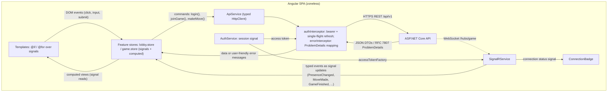
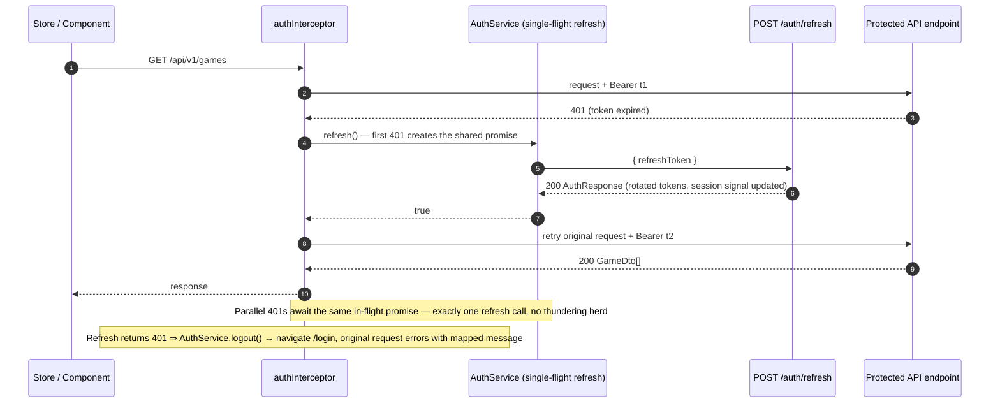

# Angular Architecture

*The frontend architecture playbook for the Angular 22 zoneless SPA in `client/` — folder structure, zoneless rules, routing, HTTP/auth/real-time layers, signal stores, forms, Tailwind 4 integration, performance, testing and tooling — implementing the frontend decisions of the [PRD](../00-product/PRD.md).*

---

## 1. Overview

The client is a single Angular 22 application using **standalone components**, **signals** for all shared state, **zoneless change detection**, **Tailwind CSS 4** (CSS-first, no `tailwind.config.js`), **@microsoft/signalr** for real-time events, and **RxJS only for streams and HTTP**. The server is authoritative for all game state; the client renders REST responses plus SignalR broadcasts and never invents state.

End-to-end data flow:



Companion documents: [design system](ux-ui-design-system.md), [pages and flows](pages-and-flows.md), [animations](animations.md), [system architecture](../01-architecture/system-architecture.md), [API spec](../02-backend/api-spec.md), [SignalR contract](../02-backend/realtime-signalr.md), [auth & JWT](../02-backend/auth-identity-jwt.md), [testing strategy](../05-quality/testing-strategy.md), [security](../05-quality/security.md).

---

## 2. Folder Structure

File-level expansion of the PRD §13 structure. Every artifact has a colocated `*.spec.ts` (omitted below for readability, see [Testing](#12-testing)); barrels and route files do not.

```text
client/
├─ proxy.conf.json                     # dev proxy: /api and /hubs (ws) → local API
├─ playwright.config.ts                # E2E config (localhost:4200 against ng serve)
├─ e2e/                                # Playwright specs (see §12)
├─ eslint.config.mjs                   # ESLint flat config
├─ .prettierrc                         # Prettier + prettier-plugin-tailwindcss
├─ public/
│  └─ favicon.svg
├─ src/
│  ├─ environments/
│  │  ├─ environment.ts                # dev: apiBase/hubUrl '' (same-origin, proxied)
│  │  └─ environment.production.ts     # prod: same-origin behind nginx
│  ├─ index.html                       # lang, meta description/theme-color, font preload
│  ├─ main.ts
│  ├─ styles.css                       # Tailwind 4 entry: @import + @theme tokens (§10)
│  ├─ testing/
│  │  └─ test-utils.ts                 # TestBed defaults: zoneless + HttpClientTesting
│  └─ app/
│     ├─ app.component.ts              # shell: router-outlet, toast container, ConnectionBadge
│     ├─ app.config.ts
│     ├─ app.routes.ts
│     ├─ core/
│     │  ├─ auth/
│     │  │  ├─ auth.service.ts
│     │  │  └─ token.storage.ts
│     │  ├─ http/
│     │  │  ├─ api.service.ts
│     │  │  ├─ auth.interceptor.ts
│     │  │  └─ error.interceptor.ts
│     │  ├─ guards/
│     │  │  ├─ auth.guard.ts
│     │  │  └─ guest.guard.ts
│     │  ├─ realtime/
│     │  │  └─ signalr.service.ts
│     │  ├─ game/
│     │  │  └─ board.utils.ts          # pure helpers: cellFree, isMyTurn, markOf
│     │  ├─ not-found.page.ts
│     │  └─ models/
│     │     ├─ auth.models.ts          # AuthResponse, SessionUser, LoginRequest, RegisterRequest
│     │     ├─ game.models.ts          # GameDto, LobbyGameDto?, Mark, GameStatus, GameResult
│     │     └─ lobby.models.ts         # LobbyGameDto, OnlinePlayerDto, PresenceDto
│     ├─ shared/
│     │  ├─ ui/
│     │  │  ├─ button/button.component.ts
│     │  │  ├─ input/input.component.ts
│     │  │  ├─ card/card.component.ts
│     │  │  ├─ avatar/avatar.component.ts
│     │  │  ├─ toast/toast.component.ts + toast.service.ts
│     │  │  ├─ modal/modal.component.ts
│     │  │  ├─ spinner/spinner.component.ts
│     │  │  ├─ skeleton/skeleton.component.ts
│     │  │  └─ connection-badge/connection-badge.component.ts
│     │  └─ forms/
│     │     ├─ validators.ts           # FR-01 username/email/password validators
│     │     └─ password-strength.ts    # pure score function for the meter
│     └─ features/
│        ├─ auth/
│        │  ├─ pages/login.page.ts
│        │  ├─ pages/register.page.ts
│        │  ├─ auth.routes.ts          # child routes used by app.routes.ts loadChildren-style
│        │  └─ index.ts                # public API barrel
│        ├─ lobby/
│        │  ├─ lobby.page.ts
│        │  ├─ components/game-list.component.ts
│        │  ├─ components/online-players.component.ts
│        │  ├─ components/create-game-button.component.ts
│        │  ├─ lobby.store.ts
│        │  └─ index.ts
│        └─ game/
│           ├─ game.page.ts
│           ├─ components/board.component.ts
│           ├─ components/cell.component.ts
│           ├─ components/player-badge.component.ts
│           ├─ components/result-modal.component.ts
│           ├─ game.store.ts
│           └─ index.ts
```

### 2.1 Layering rules

- `core/` — singleton, app-wide services with no component markup: auth, HTTP, guards, SignalR, pure models. Nothing in `core/` imports from `features/` or `shared/ui`.
- `shared/` — dumb, reusable presentational building blocks; may import `core/models` types but never feature stores.
- `features/` — pages and feature state; import freely from `core/` and `shared/`; never import each other (lobby and game communicate through the API/SignalR, not directly).

### 2.2 Public API (barrel) pattern

Each feature exposes a barrel that is the **only** legal import path for other files. It exports the page components (for `loadComponent`), the route array, and any public types — never stores or internals.

```ts
// features/lobby/index.ts — the feature's public API
export { LobbyPage } from './lobby.page';
export { LOBBY_ROUTES } from './lobby.routes';
export type { LobbyFilter } from './lobby.models';   // public type only
// NOT exported: LobbyStore, game-list.component, online-players.component
```

### 2.3 Environments

Both environments keep URLs same-origin and relative: in dev the Vite dev-server proxy forwards `/api` and `/hubs` to the local API; in production nginx serves the built SPA and reverse-proxies the same paths (see [docker and environments](../06-devops/docker-and-environments.md)). `angular.json` maps `environment.ts` → `environment.production.ts` via `fileReplacements` for the production configuration.

```ts
// src/environments/environment.ts (development)
export const environment = {
  production: false,
  apiBase: '',   // same-origin: dev proxy forwards /api → http://localhost:8080
  hubUrl: '',    // same-origin: dev proxy forwards /hubs (ws) → http://localhost:8080
};
```

### 2.4 Dev proxy (`proxy.conf.json`)

Wired into `angular.json` under `"serve": { "options": { "proxyConfig": "proxy.conf.json" } }`, so `ng serve` needs no extra flags and the app never hardcodes hostnames (no CORS in dev):

```json
{
  "/api":   { "target": "http://localhost:8080", "secure": false, "changeOrigin": true },
  "/hubs":  { "target": "http://localhost:8080", "secure": false, "changeOrigin": true, "ws": true }
}
```

The `ws: true` flag is what lets the dev server proxy the SignalR WebSocket upgrade, not just REST calls.

---

## 3. Zoneless Playbook

### 3.1 What zoneless means in Angular 22

The app runs **without Zone.js** (no polyfill; `provideZonelessChangeDetection()` in `app.config.ts`). Angular no longer monkey-patches browser async APIs to guess that "something might have changed" — change detection (CD) is scheduled only by explicit, known triggers:

1. **A signal read in a template changes** — the framework marks exactly the affected views dirty.
2. **A template event binding runs** — `(click)`, `(input)`, form submits.
3. **Explicit requests** — render/effect hooks (`afterRenderEffect`), and structural DOM changes.

Benefits for this app: a smaller polyfill-free bundle, no wasted CD cycles from the constant stream of SignalR messages and timers, and no "expression changed after it was checked" surprises from stray `setTimeout` callbacks.

### 3.2 Why signals are the source of truth

Because signal writes are the *only* mechanism guaranteed to notify the framework in zoneless mode, **all shared state must live in signals**: the auth session, lobby lists, the active game, and the SignalR connection status. Mutating a plain class field from a callback will update the data but never refresh the UI.

### 3.3 Zoneless-safety rules

| # | Rule | Why |
| --- | --- | --- |
| 1 | State = `signal` / `computed`. No mutable public fields read by templates. | Only signal writes schedule CD. |
| 2 | RxJS is for streams only (HTTP calls, hub emitters, timers). Bridge into state with `toSignal(...)`, or subscribe with `takeUntilDestroyed` and write signals in the handler. | Subscriptions themselves don't trigger CD. |
| 3 | Use `toObservable(signal)` only when a signal must feed RxJS operators (e.g., debouncing); keep the signal as the owner of truth. | One-way escapes lead to split-brain state. |
| 4 | Any callback from outside Angular — `setTimeout`, `Promise.then`, SignalR `onreconnected`, `withAutomaticReconnect` retries — must end in a **signal write**, never in direct DOM manipulation or field mutation. | No zone means no automatic flush after these callbacks. |
| 5 | Prefer `computed` for derived state; reserve `effect()` for side effects (navigation, logging). Deriving state in effects causes cascading re-runs. | Predictable dependency graph. |
| 6 | Use `signal.update` for read-modify-write patches; never `sig.set(sig() + …)` from concurrent event handlers. | `update` serializes reads against the scheduler. |
| 7 | Control flow `@if` / `@for` / `@switch` only — no `*ngIf`/`*ngFor` (deprecated directives), no `async pipe` in new code (`toSignal` instead). | New control flow is signal-aware and allocation-light. |
| 8 | `@for` **requires** a `track` expression — compile error without one. Use stable identity: `track game.id`, `track player.id`; for the fixed 9-cell board use `track $index`. | Wrong/absent tracking re-creates DOM nodes, restarting draw/shake animations (see [animations](animations.md)). |
| 9 | Declare `changeDetection: ChangeDetectionStrategy.OnPush` on every component. Zoneless components already behave OnPush; the flag documents intent and keeps tooling/lint happy. | Consistency, and safety if zone is ever reintroduced. |
| 10 | In tests, drive CD with `await fixture.whenStable()` / `TestBed.tick()` rather than assuming auto-flush; TestBed is configured zoneless (see §12). | Same scheduling semantics as production. |

---

## 4. Routing

### 4.1 Routes table

| Path | Component | Guards | Loading | Title / meta | Notes |
| --- | --- | --- | --- | --- | --- |
| `/` | — | — | — | — | `pathMatch: 'full'`, `redirectTo: 'lobby'` |
| `/login` | `LoginPage` (features/auth) | `guestGuard` | `loadComponent` | "Sign in · TicTacToe" | indexable; `?returnUrl=` support |
| `/register` | `RegisterPage` (features/auth) | `guestGuard` | `loadComponent` | "Create account · TicTacToe" | indexable |
| `/lobby` | `LobbyPage` (features/lobby) | `authGuard` | `loadComponent` | "Lobby · TicTacToe" | default destination after login; `robots: noindex` |
| `/game/:id` | `GamePage` (features/game) | `authGuard` | `loadComponent` | "Game · TicTacToe" | `noindex`; `id` bound via `withComponentInputBinding()` |
| `**` | `NotFoundPage` (core) | — | `loadComponent` | "Page not found · TicTacToe" | link back to `/lobby` |

Route config sketch (each lazy route imports the feature **barrel**, keeping feature internals private):

```ts
// app.routes.ts
export const appRoutes: Routes = [
  { path: '', pathMatch: 'full', redirectTo: 'lobby' },
  { path: 'login', title: 'Sign in · TicTacToe', canActivate: [guestGuard],
    loadComponent: () => import('./features/auth').then(m => m.LoginPage) },
  { path: 'lobby', title: 'Lobby · TicTacToe', canActivate: [authGuard],
    loadComponent: () => import('./features/lobby').then(m => m.LobbyPage) },
  { path: 'game/:id', title: 'Game · TicTacToe', canActivate: [authGuard],
    loadComponent: () => import('./features/game').then(m => m.GamePage) },
  { path: '**', title: 'Page not found · TicTacToe',
    loadComponent: () => import('./core/not-found.page').then(m => m.NotFoundPage) },
];
```

Redirect logic: unauthenticated users hitting a protected route are sent to `/login?returnUrl=<url>` and returned there after login; authenticated users hitting `/login` or `/register` are sent to `/lobby`. SEO-ish meta: the default `TitleStrategy` renders each route's `title`; `index.html` carries the app-level `description` and `theme-color` meta; authed routes (`/lobby`, `/game/:id`) add `robots: noindex` via the `Meta` service inside their page components (dynamic, per-user content should not be indexed).

### 4.2 Guard sketches

```ts
// core/guards/auth.guard.ts
export const authGuard: CanActivateFn = () => {
  const auth = inject(AuthService);
  const router = inject(Router);
  if (auth.session()) return true;
  const target = router.getCurrentNavigation()?.initialUrl.toString() ?? '/lobby';
  return router.createUrlTree(['/login'], { queryParams: { returnUrl: target } });
};
```

```ts
// core/guards/guest.guard.ts
export const guestGuard: CanActivateFn = () => {
  const auth = inject(AuthService);
  const router = inject(Router);
  return auth.session() ? router.createUrlTree(['/lobby']) : true;
};
```

Both guards read the synchronous session **signal**, so routing never waits on HTTP — session restore happens once at app startup (§6.3) before the first navigation completes.

---

## 5. HTTP Layer

### 5.1 `ApiService`

A single `ApiService` (`core/http/api.service.ts`) is the only place that builds HTTP URLs; stores and components never touch `HttpClient` directly. It is a thin, fully typed facade over the [API spec](../02-backend/api-spec.md):

| Method | Endpoint | Returns |
| --- | --- | --- |
| `register(body)` | `POST /auth/register` | `AuthResponse` |
| `login(body)` / `refresh(refreshToken)` / `logout()` | `POST /auth/...` | `AuthResponse` / `AuthResponse` / `void` |
| `me()` | `GET /auth/me` | `SessionUser` |
| `onlinePlayers()` | `GET /players/online` | `OnlinePlayerDto[]` |
| `listGames(status?)` | `GET /games?status=waiting,inprogress` | `LobbyGameDto[]` |
| `createGame()` / `activeGame()` | `POST /games` / `GET /games/active` | `GameDto` / `GameDto \| null` (204 → null) |
| `game(id)` / `joinGame(id)` | `GET /games/{id}` / `POST /games/{id}/join` | `GameDto` |
| `makeMove(id, position)` | `POST /games/{id}/moves` | `GameDto` |
| `cancelGame(id)` / `leaveGame(id)` | `POST /games/{id}/cancel` / `leave` | `void` |

```ts
@Injectable({ providedIn: 'root' })
export class ApiService {
  private readonly http = inject(HttpClient);
  private readonly base = `${environment.apiBase}/api/v1`;
  login(b: LoginRequest) { return this.http.post<AuthResponse>(`${this.base}/auth/login`, b); }
  makeMove(gameId: string, position: number) {
    return this.http.post<GameDto>(`${this.base}/games/${gameId}/moves`, { position });
  }
  // …all endpoints from the table above, same pattern
}
```

### 5.2 Typed models (`core/models/`)

Shapes mirror the [API contract](../02-backend/api-spec.md) exactly — no client-side renaming, so mapping bugs are impossible and DTO changes surface as type errors:

```ts
export type Mark = 'X' | 'O';
export type GameStatus = 'Waiting' | 'InProgress' | 'Finished' | 'Cancelled';
export interface GameDto {
  id: string; status: GameStatus;
  playerX: PlayerRef; playerO: PlayerRef | null;
  board: ReadonlyArray<Mark | null>;        // exactly 9 cells
  currentTurn: Mark;
  result: { outcome: 'Win' | 'Draw'; reason: string; winningLine: [number, number, number] } | null;
  createdAtUtc: string;
}
export interface AuthResponse { accessToken: string; refreshToken: string; expiresAtUtc: string; user: SessionUser; }
```

`LobbyGameDto` (id, status, playerX, playerO, createdAtUtc), `OnlinePlayerDto` (id, username), `PresenceDto` (onlineCount, players) and `ProblemDetails` complete the set.

### 5.3 Error mapping from RFC 7807 ProblemDetails

All API errors are RFC 7807 `ProblemDetails` — `{ type, title, status, detail, errors?: Record<string, string[]>, extensions }` — carrying a stable machine-readable `errorCode` extension emitted by the API. `errorInterceptor` (`core/http/error.interceptor.ts`) intercepts non-401 failures once (after `authInterceptor` retried or declined), maps them through one pure function, and pushes the result either into a form's control errors (field-level, keyed by `errors`) or the toast service (page-level):

```ts
// core/http/problem-details.ts (pure, unit-tested)
const MESSAGES: Record<string, string> = {
  InvalidCredentials: 'Wrong email/username or password.',
  DuplicateUsername: 'That username is already taken.',
  DuplicateEmail: 'An account with this email already exists.',
  AccountLocked: 'Too many attempts — please wait a few minutes and try again.',
  GameFull: 'That game is already full.',
  NotYourTurn: 'It is not your turn yet.',
  AlreadyInGame: 'Finish or leave your current game first.',
  InvalidMove: 'That cell is not playable.',
};
export function problemToMessage(p: ProblemDetails): string {
  const code = p.extensions?.['errorCode'] as string | undefined;
  return (code && MESSAGES[code]) ?? p.detail ?? 'Something went wrong. Please try again.';
}
```

Unknown codes degrade gracefully to the server `detail`, then to a generic message; network failures (`err.status === 0`) map to "Cannot reach the server — check your connection." and flip the ConnectionBadge to offline.

### 5.4 `authInterceptor` — bearer + single-flight refresh

The interceptor attaches the in-memory access token to every `/api/v1` request. On `401` it performs exactly **one** refresh call even when several parallel requests fail simultaneously: the first failure creates a shared in-flight promise; subsequent failures await it; a successful refresh rotates tokens (via `AuthService`) and replays the original request; a failed refresh logs the user out.



Interceptor sketch (illustrative):

```ts
let refreshInFlight: Promise<boolean> | null = null;
export const authInterceptor: HttpInterceptorFn = (req, next) => {
  const auth = inject(AuthService), tokens = inject(TokenStorage);
  const withBearer = (r: HttpRequest<unknown>) =>
    tokens.bearer ? r.clone({ setHeaders: { Authorization: `Bearer ${tokens.bearer}` } }) : r;
  if (req.url.includes('/auth/login') || req.url.includes('/auth/register')) return next(req); // anonymous
  return next(withBearer(req)).pipe(
    catchError((err: HttpErrorResponse) => {
      if (err.status !== 401 || req.url.includes('/auth/refresh')) {
        if (err.status === 401) auth.logout();          // refresh token rejected/absent
        return throwError(() => err);
      }
      refreshInFlight ??= auth.refresh().finally(() => (refreshInFlight = null));
      return from(refreshInFlight).pipe(
        switchMap(ok => (ok ? next(withBearer(req)) : throwError(() => err))),
      );
    }),
  );
};
```

**Proactive refresh (optional, post-MVP):** `AuthResponse.expiresAtUtc` allows an `effect()` on the session signal to schedule a refresh timer at `expiresAtUtc − 60 s`, eliminating most 401 round trips. The interceptor remains as the correctness safety net; MVP ships interceptor-only, which already satisfies US-02's silent-refresh acceptance criterion.

---

## 6. Authentication & Session

### 6.1 `AuthService` and token storage

`AuthService` (`core/auth/auth.service.ts`) owns the session as a signal and is the only writer of `TokenStorage`:

```ts
@Injectable({ providedIn: 'root' })
export class AuthService {
  private readonly sessionSignal = signal<AuthResponse | null>(null);
  readonly session = this.sessionSignal.asReadonly();
  readonly user = computed(() => this.sessionSignal()?.user ?? null);

  login(b: LoginRequest): Observable<boolean> { /* ApiService.login → apply */ }
  register(b: RegisterRequest): Observable<boolean> { /* ApiService.register → apply */ }
  refresh(): Promise<boolean> { /* POST /auth/refresh with stored refresh token; rotate or clear */ }
  logout(): void { /* POST /auth/logout best-effort, clear session + storage, stop hub, → /login */ }
  private apply(a: AuthResponse) { this.tokens.save(a); this.sessionSignal.set(a); this.signalR.start(); }
}
```

`TokenStorage` (`core/auth/token.storage.ts`) keeps the **access token in memory only** (dies with the tab — limits exfiltration) and the **refresh token in `localStorage`** for MVP persistence:

```ts
@Injectable({ providedIn: 'root' })
export class TokenStorage {
  private accessToken: string | null = null;          // memory only, never persisted
  private readonly REFRESH_KEY = 'ttt.refreshToken';
  save(a: AuthResponse) { this.accessToken = a.accessToken; localStorage.setItem(this.REFRESH_KEY, a.refreshToken); }
  clear() { this.accessToken = null; localStorage.removeItem(this.REFRESH_KEY); }
  get bearer() { return this.accessToken; }
  get refreshToken() { return localStorage.getItem(this.REFRESH_KEY); }
}
```

**Upgrade path to HttpOnly cookies (v1.1, see [security](../05-quality/security.md)):** the server sets the refresh token as an `HttpOnly; Secure; SameSite=Strict` cookie. Client changes are confined to `TokenStorage` (drop localStorage entirely, keep the access token in memory) and `ApiService.refresh()` (send `withCredentials: true`, empty body); the interceptor's 401→refresh→retry flow, `AuthService`, guards and stores are untouched because they only talk to `AuthService`. This removes the XSS token-theft vector flagged in the PRD risk table.

### 6.3 Startup session restore

`app.config.ts` restores the session **before the first route activates**, so guards see a synchronous, final session state:

```ts
export const appConfig: ApplicationConfig = {
  providers: [
    provideZonelessChangeDetection(),
    provideRouter(appRoutes, withComponentInputBinding(), withViewTransitions()),
    provideHttpClient(withInterceptors([authInterceptor, errorInterceptor])),
    provideAppInitializer(() => inject(AuthService).restoreSession()),
  ],
};
```

`restoreSession()` is a no-op returning `false` when no refresh token exists (first visit — zero added latency); otherwise it calls `refresh()` (rotating the stored token), maps success to a hydrated session signal plus `SignalRService.start()`, and clears storage on failure. `provideAppInitializer` is the modern, injection-aware replacement for the `APP_INITIALIZER` multi-provider.

---

## 7. Real-Time Layer (`SignalRService`)

`SignalRService` (`core/realtime/signalr.service.ts`) is the app's only hub connection (`@microsoft/signalr`), `providedIn: 'root'`.

### 7.1 Connection lifecycle

- **Start** — called by `AuthService.apply()` after login/restore (the hub is `[Authorize]`, so a token must exist first) and after `refresh()` rotates the token.
- **Stop** — called from `logout()`; also on `beforeunload` via `window.addEventListener` writing through the service so the server can start the 30 s forfeit grace immediately (FR-11).
- **Token attachment** — `accessTokenFactory: () => this.tokens.bearer ?? ''`; the SignalR client automatically appends `?access_token=` for the WebSocket handshake (browsers cannot set headers on WS), matching the [SignalR contract](../02-backend/realtime-signalr.md).
- **URL** — `${environment.hubUrl}/hubs/game`, same-origin through the dev proxy in development.

```ts
private readonly hub = new HubConnectionBuilder()
  .withUrl(`${environment.hubUrl}/hubs/game`, {
    accessTokenFactory: () => this.tokens.bearer ?? '',
  })
  .withAutomaticReconnect([0, 1000, 3000, 5000])   // then onclose → status 'offline'
  .build() as HubConnection;
```

### 7.2 Connection status and the ConnectionBadge

A status signal — `'offline' | 'connecting' | 'online' | 'reconnecting'` — is updated from `onreconnecting`, `onreconnected`, `onclose` and `start()`. All of these fire outside Angular's knowledge, which is zoneless-safe **because** they write signals (§3.3 rule 4). `shared/ui/connection-badge` reads it and renders a green dot, an amber "Reconnecting…" pill, or a red "Offline" pill (per the [design system](ux-ui-design-system.md)); `ToastService` announces the offline transition once per drop.

### 7.3 Typed event mapping

Each server event has a typed mapping function and a single store effect — raw payloads never leak into components:

| Server event | Mapping | Store effect |
| --- | --- | --- |
| `PresenceChanged` | `mapPresence` → `PresenceDto` | `LobbyStore.applyPresence` — replaces players + onlineCount |
| `GameCreated` | `mapLobbyGame` → `LobbyGameDto` | `LobbyStore.upsertGame` |
| `GameUpdated` | `mapLobbyGame` | `LobbyStore.upsertGame` |
| `GameRemoved` | `{ gameId }` | `LobbyStore.removeGame` |
| `GameStarted` | `mapGame` → `GameDto` | `GameStore.applyGame`; navigation effect sends both players to `/game/:id` |
| `MoveMade` | `mapGame` → `GameDto` | `GameStore.applyGame` (board, currentTurn) |
| `GameFinished` | `mapGame` → `GameDto` (result + winningLine) | `GameStore.applyGame`; result modal opens |
| `OpponentConnection` | `{ playerId, connected, graceSecondsLeft? }` | `GameStore.setOpponent` (badge + grace countdown) |

Registration is a typed table applied at construction so every event name lives in exactly one place:

```ts
private readonly handlers: ReadonlyArray<[ServerEventName, (raw: unknown) => void]> = [
  ['PresenceChanged', raw => this.lobby.applyPresence(mapPresence(raw))],
  ['MoveMade',       raw => this.gameApiEvent(mapGame(raw))],
  // …one row per event from the table above
];
constructor() {
  for (const [name, handler] of this.handlers) this.hub.on(name, handler);
  this.hub.onreconnecting(() => this.status.set('reconnecting'));
  this.hub.onreconnected(() => this.resync());
}
```

### 7.4 Reconnection and resync

`withAutomaticReconnect([0, 1000, 3000, 5000])` retries instantly, then after 1 s, 3 s, 5 s; if all fail, `onclose` fires and the badge shows offline (manual reconnect attempt happens on the next user interaction or when the access token refreshes). After **every** successful reconnect, `resync()` repairs any state missed while disconnected (US-13):

1. `GET /games/active` — if the user is in a game, `GameStore.applyGame(dto)` replaces the board wholesale (server-authoritative, no delta merging).
2. `GET /games?status=waiting,inprogress` and `GET /players/online` — refresh `LobbyStore` through the same code path as the initial lobby load.
3. Group membership self-heals server-side: on reconnect the hub re-adds the user to `lobby` and, if they have an active game, to its `game-{id}` group and cancels any forfeit timer (see the hub lifecycle in [realtime-signalr](../02-backend/realtime-signalr.md)); the client still re-invokes `JoinGameRoom` when the game page is active (§7.5) as a belt-and-braces measure.

### 7.5 Game room membership

Entering `/game/:id`: `GamePage` loads the game, then invokes `JoinGameRoom(gameId)` (the server validates the caller is a participant and adds them to the `game-{id}` group). Leaving is symmetric and guaranteed by `DestroyRef`:

```ts
// inside GamePage's constructor (injection context)
inject(SignalRService).joinRoom(id);
inject(DestroyRef).onDestroy(() => inject(SignalRService).leaveRoom(id));
```

(In real code the service references are captured once before `onDestroy`; shown inline for brevity.) Because moves are submitted over REST and results broadcast to the room, membership must be established before the first move to avoid a missed `MoveMade`.

---

## 8. State Management (Signal Stores)

Two feature stores hold all client state; there is **no NgRx**. Rationale: the domain has two small, shallow views (lobby list, single game), the server is authoritative so the client keeps no normalized entity cache, and derived state is trivially expressed with `computed`. Signals + services give the same guarantees (single writer, typed reads, granular CD) at a fraction of the boilerplate. **Reconsider adding a store library** only if the app grows many interacting feature states, needs time-travel debugging/devtools, or requires normalized entity caching and orchestrated multi-action effects (post-MVP features such as chat or matchmaking queues).

### 8.1 `LobbyStore` — `providedIn: 'root'` singleton

```ts
export interface LobbyState {
  loading: boolean;
  games: ReadonlyArray<LobbyGameDto>;
  players: ReadonlyArray<OnlinePlayerDto>;
  onlineCount: number;
}
@Injectable({ providedIn: 'root' })
export class LobbyStore {
  private readonly state = signal<LobbyState>({ loading: true, games: [], players: [], onlineCount: 0 });
  readonly joinableGames = computed(() => this.state().games.filter(g => g.status === 'Waiting'));
  readonly myGame = computed(() => {
    const me = inject(AuthService).user()?.id;   // captured in field in real code
    return this.state().games.find(g => g.playerX.id === me || g.playerO?.id === me) ?? null;
  });
  private patch(p: Partial<LobbyState>) { this.state.update(s => ({ ...s, ...p })); }
}
```

- **Loading** — `LobbyPage` triggers `loadAll()` (`listGames` + `onlinePlayers` in `forkJoin`, RxJS boundary), which patches both slices; skeletons render while `loading`.
- **Real-time updates** — `upsertGame` (insert-or-replace by id) and `removeGame` come from the SignalR handler table (§7.3); `applyPresence` replaces the player list.
- **Commands** — `createGame()` / `joinGame(id)` / `cancelGame(id)` call `ApiService`, patch the store from the REST response, and surface `ProblemDetails` messages as toasts (e.g., "Game is already full" for the join race loser, US-07).
- **GameStarted navigation** — a single `effect()` watches `myGame()?.status === 'InProgress'` and routes the player to `/game/:id` (guarded against re-navigation while already there).

### 8.2 `GameStore` — provided by `GamePage`, reset per game

```ts
export interface GameState {
  game: GameDto | null;
  submittingMove: boolean;             // optimistic "my move in flight" flag for cell disable
  opponentOnline: boolean;
  graceSecondsLeft: number | null;     // OpponentConnection countdown while opponent dropped
  error: string | null;                // mapped ProblemDetails message ("It is not your turn yet.")
}
@Injectable({ providedIn: 'root' })    // reset() clears state on page enter/leave
export class GameStore {
  readonly board   = computed(() => this.state().game?.board ?? EMPTY_BOARD);
  readonly myMark  = computed<Mark | null>(() => { /* playerX.id === me → 'X', playerO.id === me → 'O', else null */ });
  readonly myTurn  = computed(() => this.state().game?.currentTurn === this.myMark());
  readonly finished = computed(() => this.state().game?.result ?? null);
}
```

Providing the store in `GamePage`'s `providers` array would scope it per navigation automatically; it is kept root-provided with an explicit `reset(gameId)` on page init so a browser-refresh resync (§7.4) can hydrate it from `GET /games/active` before navigation. `makeMove(position)` sets `submittingMove`, POSTs, and on error clears the flag and stores the mapped message — the board itself is only ever replaced by `GameDto`s (REST response or `MoveMade` broadcast), so a rejected move can never desync the UI (US-08 acceptance).

### 8.3 Update pattern summary

| Trigger | Pattern |
| --- | --- |
| Initial load | `patch({ ...data, loading: false })` from a `forkJoin` in the store's load method |
| Real-time event | narrow mutator (`upsertGame`, `applyPresence`, `applyGame`) via `signal.update` |
| Command response | replace the affected entity with the REST `GameDto`; errors → toast/`error` slice |
| Derived views | `computed` only — never stored twice |

---

## 9. Forms & Validation

### 9.1 Shared validators (FR-01)

`shared/forms/validators.ts` is the single source matching the server rules — username 3–20 chars `[A-Za-z0-9_]`, valid email ≤ 256, password min 8 with upper + lower + digit (see [api-spec](../02-backend/api-spec.md)):

```ts
export const USERNAME_PATTERN = /^[A-Za-z0-9_]{3,20}$/;
export function passwordStrength(c: AbstractControl): ValidationErrors | null {
  const v: string = c.value ?? '';
  return v.length >= 8 && /[A-Z]/.test(v) && /[a-z]/.test(v) && /\d/.test(v)
    ? null : { passwordStrength: true };
}
export const SHARED_VALIDATORS = {
  username: [Validators.required, Validators.pattern(USERNAME_PATTERN)],
  email:    [Validators.required, Validators.email, Validators.maxLength(256)],
  password: [Validators.required, passwordStrength],
};
```

### 9.2 Reactive form setup per auth page

`LoginPage` builds `FormGroup<{ login, password }>` (login accepts **email or username**, FR-02 — validated as required only, the server resolves which). `RegisterPage` builds `FormGroup<{ username, email, password, confirmPassword }>` where `confirmPassword` uses a `mustMatch('password')` group validator. Pages are dumb-ish: they read `AuthService`/`AuthService` errors and disable submit while pending. Server-side field errors from `ProblemDetails.errors` are merged into the matching controls via `control.setErrors({ server: message })` so API duplicates (409) appear inline, exactly where the user is looking.

### 9.3 Error message conventions

Every control error key has exactly one human message, resolved by a pure `controlError(control): string | null` used by `shared/ui/input`:

| Key | Message |
| --- | --- |
| `required` | "This field is required." |
| `pattern` (username) | "3–20 characters: letters, numbers, underscore." |
| `email` / `maxlength` | "Enter a valid email." / "Too long." |
| `passwordStrength` | "At least 8 characters with upper, lower and a digit." |
| `mustMatch` | "Passwords do not match." |
| `server` | The mapped `ProblemDetails` message (§5.3) |

Messages render when `control.touched && control.invalid`; no red-by-default forms.

### 9.4 Password strength meter

`password-strength.ts` is a pure `scorePassword(value): 0 | 1 | 2 | 3 | 4` function (length tiers, character classes, digit) consumed by a small meter component in `RegisterPage`: four segments colored from the design system's accent scale, a textual label ("Weak/Fair/Good/Strong"), `aria-live="polite"`, and `aria-describedby` wiring to the input. Pure function + signal input keeps it unit-testable without DOM.

---

## 10. Styling — Tailwind CSS 4 (CSS-first)

### 10.1 Integration

Tailwind 4 is installed as a Vite plugin inside the Angular builder — **no `tailwind.config.js`**, no PostCSS config, all tokens live in CSS. `angular.json` (application builder) registers the plugin and the budgets:

```jsonc
// angular.json (excerpt)
"build": {
  "builder": "@angular/build:application",
  "options": {
    "browser": "src/main.ts",
    "plugins": ["@tailwindcss/vite"],
    "styles": ["src/styles.css"]
  },
  "configurations": {
    "production": {
      "outputHashing": "all",
      "fileReplacements": [{ "replace": "src/environments/environment.ts",
                             "with": "src/environments/environment.production.ts" }]
    }
  }
}
```

`src/styles.css` is the single theme source, holding the dark-first tokens from the [design system](ux-ui-design-system.md) (slate-950 surface, slate-900 cards, indigo-500 primary, X sky-400, O rose-400, Inter + JetBrains Mono):

```css
@import "tailwindcss";

@theme {
  --font-sans: "Inter", ui-sans-serif, system-ui, sans-serif;
  --font-mono: "JetBrains Mono", ui-monospace, monospace;
  --color-surface: var(--color-slate-950);
  --color-card: var(--color-slate-900);
  --color-primary: var(--color-indigo-500);
  --color-primary-hover: var(--color-indigo-400);
  --color-mark-x: var(--color-sky-400);
  --color-mark-o: var(--color-rose-400);
  --animate-draw: draw 300ms ease-out forwards;      /* SVG stroke, see animations.md */
  --animate-shake: shake 300ms ease-in-out;
}
@keyframes draw { to { stroke-dashoffset: 0; } }
@keyframes shake { 25% { translate: -2px 0; } 75% { translate: 2px 0; } }
```

`@theme` entries generate real utilities (`bg-surface`, `text-mark-x`, `animate-draw`), so components stay in utility classes while tokens remain centralized.

### 10.2 Component styling conventions

- **Utility-first in templates**; components order classes via `prettier-plugin-tailwindcss`.
- **Component `styles`** are for host rules (`:host { display: block }`), component-specific keyframes, and third-party overrides — nothing global ever lives outside `styles.css`.
- **`@apply` is acceptable only rarely**: inside `shared/ui` component styles to alias a repeated utility combo (e.g., a shared focus ring shared by `button` and `input` variants). Never in feature templates, never to override design tokens.
- Animation timings/easings reference the tokens above so the [animations doc](animations.md) and CSS cannot drift; `prefers-reduced-motion` is honored globally with one `@media` block in `styles.css`.

---

## 11. Performance

| Concern | Approach |
| --- | --- |
| Initial load | Lazy `loadComponent` routes (§4): login/register visitors download no lobby/game code; `authGuard` runs before chunks load. |
| Zoneless CD | OnPush-by-default + signal-driven views mean a `MoveMade` for game A costs zero CD in unrelated components. |
| `track` functions | `@for (g of joinableGames(); track g.id)`, `@for (p of players(); track p.id)`, `@for (c of board(); track $index)` — stable identity preserves in-flight cell animations. |
| SignalR bursts | The lobby can receive `PresenceChanged`/`GameCreated`/`GameUpdated` in bursts (many users acting at once). `LobbyStore` coalesces: incoming events are queued and flushed in a single `signal.update` per animation frame (a `requestAnimationFrame`-scheduled flush), so the game list re-renders once, not N times, per burst. |
| Move latency | Only `submittingMove` toggles locally; the board updates from the authoritative `GameDto` — no double render, p95 < 200 ms is transport-bound, not client-bound. |
| Fonts | Inter + JetBrains Mono self-hosted woff2 with `font-display: swap`, preloaded in `index.html`; no runtime font CSS. |
| Bundle budgets | `initial` ≤ **300 KB** hard error (250 KB warning), `anyComponentStyle` 8 KB error — enforced in `angular.json` budgets so CI fails on regressions. The SignalR client (~40 KB gz) stays in the initial bundle because the ConnectionBadge needs it immediately after login; if the budget tightens, it moves behind a dynamic `import()` in `SignalRService.start()`. |

---

## 12. Testing

Full strategy (coverage targets, matrix, CI): [testing strategy](../05-quality/testing-strategy.md). Unit runner is **vitest + jsdom** (the Angular CLI default for new v22 apps): `ng test` uses the CLI's vitest builder with the jsdom environment; `src/testing/test-utils.ts` provides `createTestBed` that pre-registers `provideZonelessChangeDetection()`, `provideHttpClient()` and `provideHttpClientTesting()` so specs run under the same CD semantics as production. Specs are colocated and named `*.spec.ts`.

| Artifact | What to unit test | Notable tooling |
| --- | --- | --- |
| `LobbyStore` / `GameStore` | State transitions: load → patch, `upsertGame`/`removeGame` idempotency, `applyGame` from fake broadcasts, computed views (`joinableGames`, `myMark`, `myTurn`), burst coalescing | Plain signal asserts; fake event payloads |
| `authInterceptor` | Bearer attachment; 401 → single refresh for **parallel** failures (assert exactly one `POST /auth/refresh`); successful retry with new token; refresh failure → logout | `HttpTestingController.verify()` |
| `errorInterceptor` + `problemToMessage` | Every `errorCode` → message mapping; field errors merged into controls; network failure message | Pure function tests |
| Guards | `authGuard` redirect with `returnUrl`, `guestGuard` redirect to `/lobby` | `TestBed.runInInjectionContext` |
| `AuthService` / `TokenStorage` | Session signal lifecycle, restore success/no-token/failed-refresh; access token never persisted | jsdom `localStorage` |
| `SignalRService` | Handler table wiring, resync calls on `onreconnected`, room join/leave — hub mocked | NSubstitute-style hand fake |
| `board.utils`, validators, `password-strength`, `controlError` | Pure-function coverage: turn/cell checks, FR-01 rule boundaries (3/20 chars, 7/8 password length) | No TestBed needed |
| `shared/ui` | Button/input variants, toast lifecycle, modal focus trap and Escape | `@angular/cdk` a11y matchers |

Playwright E2E specs (in `client/e2e/`, run against `ng serve` with the real API from docker-compose):

| Spec | Smoke coverage |
| --- | --- |
| `auth.spec.ts` | Register → logout → login by username and by email → protected-route redirect |
| `lobby-realtime.spec.ts` | Two browser contexts: online players list updates, create game appears for the other user, join race shows "Game is already full" to the loser |
| `gameplay.spec.ts` | Full X-vs-O game across two contexts: alternating turns, wrong-turn rejection shake, win line draw, result modal, back to lobby |
| `reconnect.spec.ts` | Page reload mid-game resyncs board from `GET /games/active`; 30 s grace badge after killing one context |

---

## 13. Tooling & Commands

- **TypeScript** — strict mode plus `noImplicitOverride`, `noImplicitReturns`, `noFallthroughCasesInSwitch`, `noPropertyAccessFromIndexSignature` in `tsconfig.json`; DTO field access stays explicit.
- **ESLint** — flat config (`eslint.config.mjs`) combining `typescript-eslint` strict and `@angular-eslint` TS + template rules (component selector prefixes `app-`, no `*ngIf` in zoneless code, enforce `track`):

```js
// eslint.config.mjs (illustrative)
import tseslint from 'typescript-eslint';
import angular from '@angular-eslint/eslint-plugin';
export default tseslint.config(
  { ignores: ['dist/**', 'coverage/**', 'playwright-report/**'] },
  tseslint.configs.strict,
  ...angular.configs.tsAll,
  ...angular.configs.templateRecommended,
);
```

- **Prettier** — `.prettierrc` with `printWidth: 100`, `singleQuote: true`, `trailingComma: "all"` and `prettier-plugin-tailwindcss` for deterministic class ordering; `npm run format` writes, CI checks.

Commands cheat-sheet (run inside `client/`):

| Task | Command |
| --- | --- |
| Dev server (proxy active) | `npm start` → `ng serve` (proxyConfig wired in `angular.json`) |
| Production build (budgets enforced) | `ng build` |
| Unit tests (vitest + jsdom) | `ng test` / watch: `ng test --watch` / coverage: `ng test --coverage` |
| Lint / format | `npm run lint` / `npm run format` |
| E2E (needs API via docker-compose) | `npm run e2e` → `playwright test` |
| Bundle analysis | `ng build --source-map && npx source-map-explorer dist/**/*.js` |

---

## Assumptions

- The local API listens on `http://localhost:8080` (dotnet run / compose default); `proxy.conf.json` targets it. In production nginx serves the SPA and reverse-proxies `/api` and `/hubs` same-origin, so `environment.*.ts` keep `apiBase`/`hubUrl` empty in every environment.
- The API includes a stable machine-readable `errorCode` extension in `ProblemDetails` (documented in [api-spec](../02-backend/api-spec.md)); the client error map keys off it, degrading to `detail` and a generic message.
- Two small additions beyond the PRD §13 structure, both required by other fixed decisions: `shared/ui/connection-badge` (consumes the SignalR status signal) and `core/not-found.page.ts` (the `**` route from the PRD page list).
- `RegisterPage` adds a `confirmPassword` field with a `mustMatch` group validator — a UX nicety beyond FR-01's three fields; the API contract is unchanged.
- One SignalR connection per browser tab; multiple tabs create multiple connections that the server's presence tracker dedupes (PRD open question 2).
- Lobby burst coalescing uses a single animation-frame flush rather than a time-based debounce, trading at most ~16 ms of latency for at most one render per frame.
