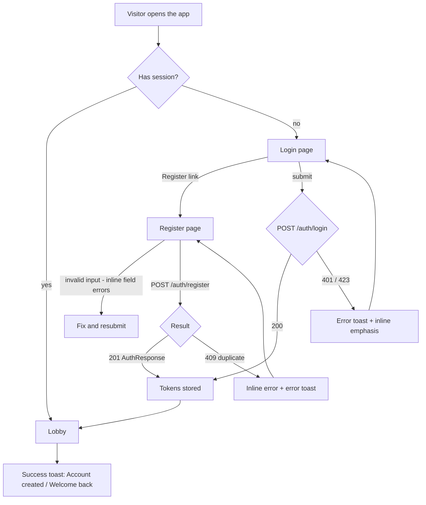
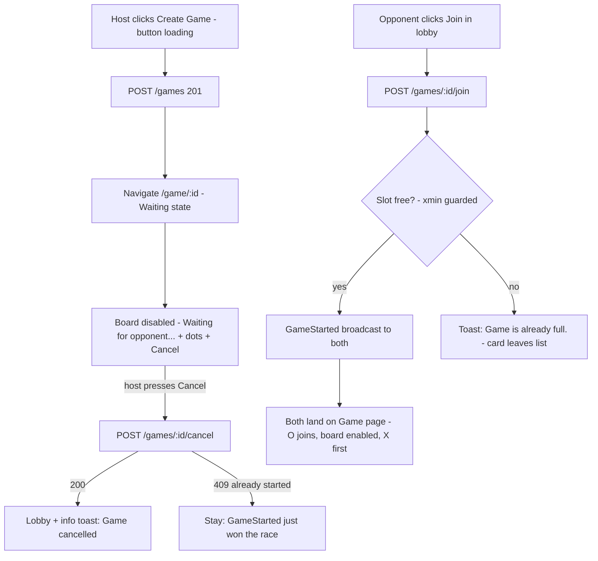
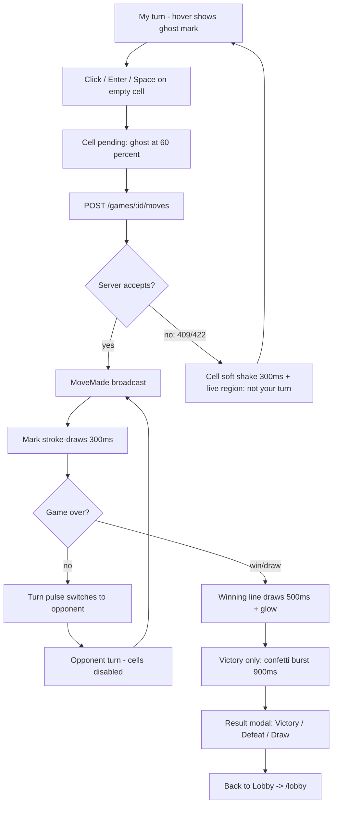
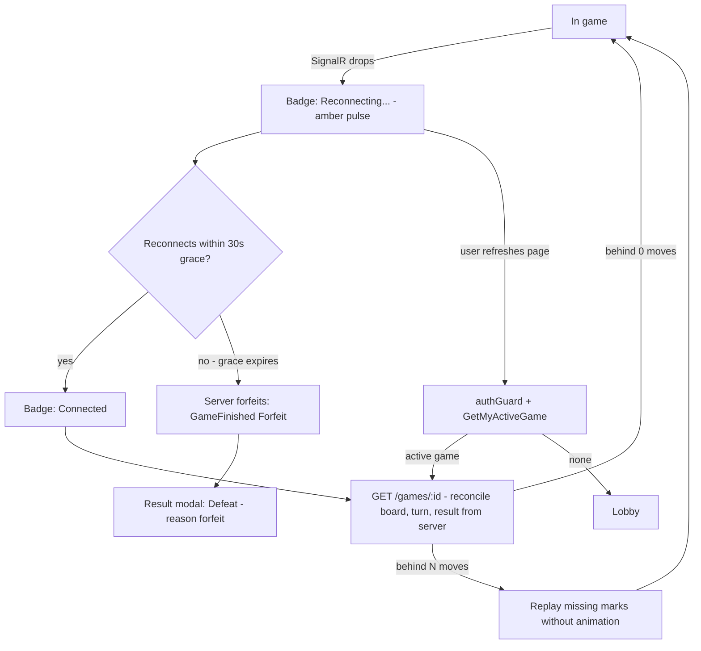
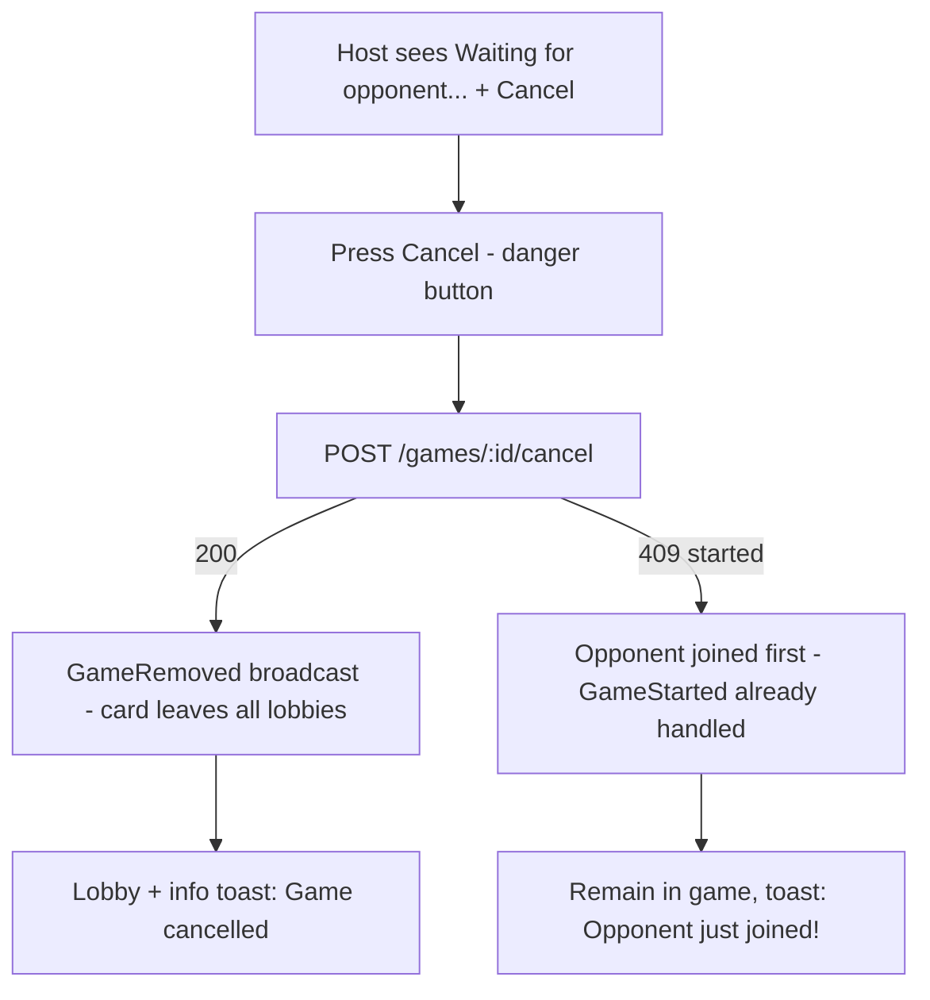

# Pages & Flows

*Page-by-page wireframes (desktop + mobile), element-level specs, user journey flowcharts, state matrices, responsive behavior and accessibility annotations for every route of the Multiplayer Tic-Tac-Toe SPA.*

Implements PRD [§5.3 page specs](../00-product/PRD.md); tokens and components referenced by name are defined in [ux-ui-design-system.md](ux-ui-design-system.md); motion details in [animations.md](animations.md).

---

## 1. Route Map

| Route | Page | Access | Guard |
| --- | --- | --- | --- |
| `/login` | Login | Public | `guestGuard` — logged-in users redirect to `/lobby` |
| `/register` | Register | Public | `guestGuard` |
| `/lobby` | Lobby (default) | Authenticated | `authGuard` |
| `/game/:id` | Game | Authenticated + player of `:id` (or Waiting host) | `authGuard` |
| `**` | Not Found | Public | none |

---

## 2. Login (`/login`)

### 2.1 Desktop wireframe (≥ 768 px) — split layout

```
+===========================================================================+
|  LEFT — BRAND PANEL (55%, full viewport height)     RIGHT — FORM (45%)    |
|                                                  vertical center, the     |
|   X    ~drifting marks~        O                  form card sits on the   |
|        (sky-400)      (rose-400)                  page background         |
|                                                     +------------------+  |
|        Tic-Tac-Toe                                  |  Welcome back    |  |
|        Play a real person. Right now.               |  text-text-muted |  |
|                                                     +------------------+  |
|   O                    X                            | LABEL  Email or  |  |
|                                                     |        username  |  |
|                                                     | [______________] |  |
|                                                     | LABEL  Password  |  |
|                                                     | [___________][eye]|  |
|                                                     | [x] Remember me  |  |
|                                                     | [  Sign in     ] |  |
|                                                     | ---------------- |  |
|                                                     | No account?      |  |
|                                                     | > Register       |  |
|                                                     +------------------+  |
+===========================================================================+
```

### 2.2 Mobile wireframe (360 px) — single column

```
+-------------------------------+
| BRAND HEADER (compact)        |
|  X  Tic-Tac-Toe  O            |
|  Play a real person.          |
|  Right now.                   |
+-------------------------------+
| FORM CARD (p-4)               |
|  Welcome back                 |
|  ---------------------------- |
|  Email or username            |
|  [_________________________]  |
|  Password                (eye)|
|  [______________________][eye]|
|  [x] Remember me              |
|  [        Sign in         ]   |
|  ---------------------------- |
|  No account? Register         |
+-------------------------------+
```

### 2.3 Annotated regions

| Region | Component(s) | Description |
| --- | --- | --- |
| A — Brand panel | Login page-local | 55 % width (desktop only), indigo radial ambience stronger here; 3–4 oversized X/O glyphs (sky-400/rose-400, 96–160 px) drift on 8–12 s loops (disabled under reduced motion). Locks: `text-display` "Tic-Tac-Toe", `text-body-lg` tagline. Purely decorative: `aria-hidden`. Hidden below 768 px; replaced by a compact header with two 28 px marks flanking the wordmark. |
| B — Form card | Card + Input ×2 + Button lg + ghost link | `w-[min(28rem,100%)]`; heading `text-h1` "Welcome back" + sub "Sign in to keep the streak alive" (`text-meta`). |
| C — Footer link | Ghost/Button link | "No account? **Register**" — Register as an underlined indigo link-button; focus ring per §9. |

### 2.4 Element spec

- **Identifier field** — Input, label "Email or username", placeholder "you@example.com or username", `autocomplete="username"`, leading `user` icon, validation: non-empty (error: "Enter your email or username").
- **Password field** — Input + password show/hide (§7.2 of the design system), `autocomplete="current-password"`, validation: non-empty ("Enter your password").
- **Remember me** — native checkbox, 16 px + 13 px label; controls refresh-token persistence (30 days vs session).
- **Submit** — Button lg primary, full width; loading: spinner + "Signing in…", `aria-busy`, form fields `readonly` for the duration.
- **Errors** — 401 → toast error "Invalid credentials. Check your email/username and password." + inline shake-free field emphasis; 423 (locked) → toast error "Too many attempts. Try again in a minute."; network → toast error "Can't reach the server. Check your connection."
- **Success** — tokens stored → navigate `/lobby` with 200 ms page transition; guestGuard already-authenticated visits skip straight to `/lobby`.

---

## 3. Register (`/register`)

Same visual language as Login (identical split layout, brand panel mirrored — marks drift right-to-left so the two pages feel like siblings).

### 3.1 Desktop wireframe (≥ 768 px)

```
+===========================================================================+
|  LEFT — BRAND PANEL (55%)                          RIGHT — FORM (45%)     |
|                                                     +------------------+  |
|   O        X         O                              |  Create account  |  |
|                                                     |  Seconds to      |  |
|        Tic-Tac-Toe                                  |  your first game |  |
|        Your board is waiting.                       +------------------+  |
|                                                     | LABEL Username    |  |
|                                                     | [______________] |  |
|                                                     | LABEL Email       |  |
|                                                     | [______________] |  |
|                                                     | LABEL Password    |  |
|                                                     | [___________][eye]|  |
|                                                     | [==== strength ] |  |
|                                                     | LABEL Confirm     |  |
|                                                     |   password        |  |
|                                                     | [___________][eye]|  |
|                                                     | [   Register   ] |  |
|                                                     | ---------------- |  |
|                                                     | Already playing? |  |
|                                                     | > Log in         |  |
|                                                     +------------------+  |
+===========================================================================+
```

### 3.2 Mobile wireframe (360 px)

```
+-------------------------------+
| BRAND HEADER (compact)        |
|  O  Tic-Tac-Toe  X            |
|  Your board is waiting.       |
+-------------------------------+
| FORM CARD (p-4)               |
|  Create account               |
|  Username                     |
|  [_________________________]  |
|  Email                        |
|  [_________________________]  |
|  Password               (eye) |
|  [______________________][eye]|
|  [======== strength: Fair ]   |
|  Confirm password       (eye) |
|  [______________________][eye]|
|  [       Register         ]   |
|  Already playing? Log in      |
+-------------------------------+
```

### 3.3 Element spec

| Field | Validation (FR-01) | Inline error copy |
| --- | --- | --- |
| Username | 3–20 chars, `^[A-Za-z0-9_]+$`, uniqueness checked server-side on submit | "Username must be 3–20 characters: letters, digits, underscore." / 409: "That username is taken. Try another." |
| Email | valid email format, unique | "Enter a valid email address." / 409: "An account with this email already exists." |
| Password | min 8 chars, ≥ 1 upper, ≥ 1 lower, ≥ 1 digit; live strength meter (design system §7.2) | "Use 8+ characters with upper, lower and a digit." |
| Confirm password | must match password, checked live once both touched | "Passwords don't match." |

- Submit: Button lg primary "Register" → loading "Creating account…". Success (201) → **straight to `/lobby`** (no confirmation screen, PRD §5.3) + success toast "Account created — welcome aboard!".
- Footer: "Already playing? **Log in**".
- All error copy inline per field; 409s additionally surface as a toast.

---

## 4. Lobby (`/lobby`)

### 4.1 Desktop wireframe (≥ 1024 px)

```
+============================================================================+
| NAVBAR (h-16, sticky, bg-surface/80 backdrop-blur, border-b)               |
| [XO] Tic-Tac-Toe          [ * 12 online ]              (MD) nur  v         |
+============================================================================+
| main container (max-w-7xl, px-8, grid-cols-[1fr_340px] gap-6)              |
| +----------------------------------------+  +---------------------------+ |
| | GAMES  (panel card)                    |  | ONLINE PLAYERS (12)       | |
| | [ Open (3) ][ In Progress (5) ]  [New] |  | (panel card, self-scroll) | |
| | +------------------------------------+ |  | +-----------------------+ | |
| | | (SK) sara            [Waiting     ]| |  | |(xs) araf    * Availab| | |
| | | created 2m ago           [ Join  ]|| |  | |(xs) rafi    * In game| | |
| | +------------------------------------+ |  | |(xs) sara    * Availab| | |
| | | (RA) rafi            [   Full    ]|| |  | |(xs) nur     * In game| | |
| | | created 5m ago        [disabled]  || |  | | ...                   | | |
| | +------------------------------------+ |  | +-----------------------+ | |
| | | ... waiting games ...               | |  | own row pinned last,    | |
| | +------------------------------------+ |  | highlighted border       | |
| | +------------------------------------+ |  +---------------------------+ |
| | | (in-progress games, no Join)        | |                               |
| | +------------------------------------+ |                                |
| +----------------------------------------+                                 |
+============================================================================+
```

### 4.2 Mobile wireframe (360 px)

```
+-------------------------------+
| NAVBAR (h-14)                 |
| [XO] TicTacToe [*12]     (MD) |
+-------------------------------+
| [ + Create Game ]  (full-w,   |
|   lg, sticky bottom-4? no —   |
|   top of content, full width) |
+-------------------------------+
| GAMES                         |
| [Open (3)][In Progress (5)]   |
| +--------------------------+  |
| | (SK) sara                |  |
| | Waiting * 2m ago    [Join]| |
| +--------------------------+  |
| | (RA) rafi                |  |
| | Full * 5m ago  [disabled]|  |
| +--------------------------+  |
+-------------------------------+
| ONLINE PLAYERS (12)           |
| (SK) sara          * Availab. |
| (RA) rafi          * In game  |
| ...                           |
+-------------------------------+
```

### 4.3 Annotated regions & element spec

| Region | Contents |
| --- | --- |
| **Navbar** (all authenticated pages) | Left: brand glyph + "Tic-Tac-Toe" (`text-h3`, link to `/lobby`). Center/right: online count pill — 6 px emerald dot + mono count + "online" (updates in place from `PresenceChanged`; `tabular-nums` prevents jitter; announced politely). Far right: avatar (md) + username + chevron-down → dropdown menu (`bg-surface border rounded-control shadow-overlay`): **Log out** (danger ghost, `log-out` icon) and **Back to Lobby** (only on `/game/:id`). Menu: Esc closes, click-outside closes, focus returns to trigger, arrow keys navigate items. At 360 px: wordmark shortens to "TicTacToe", count pill shows dot + number only, username hidden (avatar remains). |
| **Games panel** (main) | Panel card. Header row: `text-h2` "Games" + Button md primary `plus` "Create Game" (desktop, right-aligned; mobile: full-width lg button between navbar and panel). Below: Tabs **Open** / **In Progress** with live counts, then the list with staggered enter/leave animations. |
| **Game card (Open)** | Card row: Avatar sm + host username (`text-h3`) — you cannot join your own game (FR-07): your own card shows badge "Your game" (primary/10) and a **Cancel** ghost button instead of Join; Waiting badge; "created `2m ago`" (`text-mono-sm` muted, relative time); Button md primary "Join" right-aligned. Full/taken game (race lost, US-07): button replaced by Badge "Full", card `opacity-70`, entire row `aria-disabled`. |
| **Game card (In Progress)** | Same anatomy, In Progress badge (amber), players shown "sara vs rafi", **no action button**; row is informational (no spectating in MVP). |
| **Online Players panel** (aside) | Panel card, max-height `calc(100vh-12rem)` with internal scroll. Header: `text-h2` "Online Players" + mono count. Rows: Avatar xs + username (`text-body`) + StatusDot label (Available / In game). Own row pinned to bottom with `border-primary/40` and "(you)" suffix. Hover highlights row (`bg-surface-raised/40`); no click action in MVP (no challenge-by-click — create/join games instead). Enter/leave animated with the same stagger as games list. |
| **Empty states** | Per-tab and per-panel states with copy from design system §8, swapped in place of the list (no layout shift — reserve min-height 160 px). |

Real-time updates (FR-10): `GameCreated` inserts a card (enter animation, staggered after existing), `GameRemoved` removes it (leave animation), `PresenceChanged` refreshes count + players list. All list changes announced via a single polite live region (§10.4).

### 4.4 Create Game behavior

Click **Create Game** → Button immediately loading (spinner, `aria-busy`) → `POST /api/v1/games` → on 201 navigate `/game/:id` (Waiting state). Error (409 already-in-game): toast error "You're already in a game — finish it first." and stay.

---

## 5. Game (`/game/:id`)

### 5.1 Desktop wireframe (≥ 768 px)

```
+=========================================================================+
| NAVBAR (as lobby)                                                       |
+=========================================================================+
|                    BOARD CARD (w-min[480px,100%], centered)             |
|  +-------------------------------------------------------------------+ |
|  | HEADER (flex, justify-between, gap-4)                             | |
|  |  (sm) sara  X   --vs--   (sm) rafi  O          [ * Connected ]     | |
|  |  ^pulsing ring marks the active player ^                           | |
|  |  status line: "Your turn — place an X"  (text-meta, under players) | |
|  | +---------------------------------------------------------------+ | |
|  | |                    3 x 3 GRID (gap-2)                         | | |
|  | |     [  X  ]      [ ghost ]      [     ]                       | | |
|  | |     [     ]      [  O   ]      [     ]                        | | |
|  | |     [     ]      [      ]      [     ]                        | | |
|  | |   (winning line SVG overlay spans the whole grid)              | | |
|  | +---------------------------------------------------------------+ | |
|  |  (waiting state replaces status line:                             | |
|  |   "Waiting for opponent..." + animated dots + [ Cancel ])          | |
|  +-------------------------------------------------------------------+ |
+=========================================================================+
        (result modal overlays everything at game end — §5.5)
```

### 5.2 Mobile wireframe (360 px)

```
+-------------------------------+
| NAVBAR  [XO] [*12]      (MD)  |
+-------------------------------+
| BOARD CARD (p-4)              |
| (S) sara X  vs  (S) rafi O  ~ |   ~ = if my turn: pulsing ring
| [ * Connected ]               |       (badge wraps below players
| Your turn — place an X        |        at 360px)
| +---------------------------+ |
| | [   ]   [   ]   [   ]     | |
| | [   ]   [   ]   [   ]     | |
| | [   ]   [   ]   [   ]     | |
| +---------------------------+ |
+-------------------------------+
| waiting: "Waiting for         |
| opponent..." ... [ Cancel ]   |
+-------------------------------+
```

### 5.3 Annotated regions

| Region | Component(s) | Description |
| --- | --- | --- |
| Board card wrapper | Card | Centered both axes (`min-h-[calc(100vh-4rem)] grid place-items-center` context), `w-[min(480px,100%)]`, `p-4 sm:p-6`. |
| Player header | Avatar sm ×2 + mark chip + Player names | Each side: avatar + username (`text-h3`) + mark glyph chip (X sky-400 / O rose-400, 20 px SVG). **Active player's avatar gets the pulsing ring** (`ring-2 ring-{their-mark-color}` + pulse animation, 2 s loop); inactive side dims to `opacity-60`. Between: "vs" (`text-meta` muted). Header shows "You" label on the local player's side (small caption under name). |
| Status line | Text + sr live region | Under header, `text-meta`: "Your turn — place an X" (indigo-400 dot prefix) / "Rafi is thinking…" (muted) / "Waiting for opponent…" (waiting state + animated dots) / "Opponent left — waiting to reconnect (30s)". Mirrored into the aria-live region (§10.4). |
| ConnectionBadge | ConnectionBadge | Card header right edge (desktop) / wraps under players (mobile). States Connected / Reconnecting... per design system §7.12. |
| Board | GameBoard + Cell ×9 | Spec in design system §7.11: hover preview of my mark on empty cells **only when it is my turn**, stroke-draw on placement, win line overlay + glow, soft shake on rejection. |
| Waiting state | Status line + Button danger | While game `Waiting`: board visible but fully disabled (`aria-disabled` on grid, cells not focusable), status line reads "Waiting for opponent..." + 3 animated dots, **Cancel** button (danger) centered under the board. On `GameStarted` broadcast: dots stop, header gains Player O, board enables, X moves first. |

### 5.4 Move interaction detail

1. My turn, hover/focus an empty cell → ghost mark fades in (150 ms, 35 % opacity).
2. Click / Enter / Space → cell switches to pending (60 % opacity pulse), request `POST /games/:id/moves { position }`.
3. `MoveMade` broadcast (< 200 ms p95) → mark draws with the 300 ms stroke animation; turn indicator pulses to the opponent.
4. Rejection (not your turn / taken cell / 409 / 422 — US-08): **soft shake** on the cell (300 ms) + live region "It's not your turn yet." State unchanged.

### 5.5 Result modal

```
+-------------------------------------------+
| //////////// backdrop (blur) //////////// |
|   +-----------------------------------+   |
|   |        (trophy, 48px, indigo)     |   |
|   |           Victory!                |   |
|   |  You beat rafi in 7 moves.        |   |
|   |                                   |   |
|   |     [   Back to Lobby   ] (lg)    |   |
|   +-----------------------------------+   |
+-------------------------------------------+
```

Triggered by `GameFinished` broadcast after the winning-line animation (500 ms) and, on victory only, the confetti burst. Title `text-h1` with icon: **Victory!** (`trophy`, indigo-400) / **Defeat** (`flag`, red-400, support copy includes reason: "Rafi won by forfeit." when applicable) / **Draw** (`handshake`, slate-300). Support line (`text-body-lg` muted): move count and opponent name. Single action: Button lg primary "Back to Lobby" → navigate `/lobby` (game removed from lobby lists immediately, PRD §10-Q3). Modal contract (focus trap, no Esc, focus restore) per design system §7.7.

---

## 6. Not Found (`**`)

```
+---------------------------+
|     (centered card)       |
|        4 0 4              |   <- text-mono-hero, indigo-400
|      Page not found       |   <- text-h1
|  This page doesn't exist  |   <- text-meta
|  or has moved.            |
|  [ Back to Lobby ]        |   <- lg primary; becomes
|  [ Log in ]               |      "Log in" when anonymous
+---------------------------+
```

Centered Card on the ambient background, brand glyph above the 404. Actions: "Back to Lobby" (primary lg) when authenticated, else "Log in" (primary lg) + "Register" (secondary lg). No navbar on this page. Live region announces "Page not found" on load; `404` is decorative (`aria-hidden`).

---

## 7. User Journey Flows

### 7.1 Visitor → Register → Lobby



### 7.2 Create Game → Wait → Opponent Joins



### 7.3 Play → Validate → Finish → Result → Lobby



### 7.4 Disconnect → Reconnect → Resync



### 7.5 Cancel Waiting Game (host, US-12)



---

## 8. Page State Matrix

| Page | Loading | Empty | Error | Offline / disconnected |
| --- | --- | --- | --- | --- |
| Login | No page skeleton — static form; only submit button spins (`aria-busy`) | n/a | Inline field errors; 401/423/network as error toasts; form never resets silently (password cleared, identifier kept) | Submit disabled + toast "You're offline. Reconnect and try again." |
| Register | Same as Login (button spinner only) | n/a | Per-field inline errors (§3.3); 409 duplicates inline + toast | Same as Login |
| Lobby | Panel skeletons (4 game-card + 6 player-row, design system §7.10) on first load; SignalR updates after are instant (no re-skeleton) | Per-tab/panel empty states with copy + Create Game CTA (design system §8) | Panel-level error state: icon + "Couldn't load games." / "Couldn't load players." + **Try again** button (re-runs query); toast role=alert | Sticky amber banner under navbar: "Reconnecting… lobby updates paused" — last-known list stays visible, controls disabled |
| Game | Board skeleton (3×3 grid) + header skeletons while `GET /games/:id`; then single render (no progressive pop-in) | n/a (`404` game → Card error state: "This game doesn't exist or has ended." + Back to Lobby) | Move failures → cell shake + toast; terminal errors → error Card + Back to Lobby | ConnectionBadge → "Reconnecting..." + status line "Connection lost — reconnecting…"; cells disabled until resync; forfeit path per flow 7.4 |
| Not Found | None (static) | n/a | n/a | Fully static — works offline once loaded |

---

## 9. Responsive Behavior

| Aspect | 360 px | 768 px | 1280 px | 1920 px |
| --- | --- | --- | --- | --- |
| Login/Register layout | Single column, compact brand header (28 px marks), card full-width `p-4` | Split layout appears: brand panel 55 % + form 45 % | Split persists; form card caps at 28 rem | Same as 1280 — extra margin only |
| Navbar | Wordmark "TicTacToe", count pill = dot + number, avatar only (no name) | Full wordmark, count pill + label, avatar + name + chevron | Same as 768 | Same; container caps at `max-w-7xl`, centered |
| Lobby grid | Stacked: Create Game button → Games panel → Online Players panel | Still stacked; panels `max-w-2xl mx-auto` | Two columns `[1fr_340px]`; Create Game moves into panel header | Same as 1280; players panel stays 340 px, games column grows with cards capped at 40 rem |
| Game card (row) | Two-line: top avatar+name+badge, bottom time + Join (full stretch) | Single-line row: avatar → name → badge → time → Join | Same as 768 | Same; row max-width 40 rem |
| Board size | Cell ≈ 88 px (card `p-4`, gap-2); badge wraps under players | Cell ≈ 100–120 px; header single row; badge inline right | Cell 149 px (board 480 px cap) | Same as 1280 — board never exceeds 480 px; page grows calmer, not bigger |
| Result modal | `w-[calc(100vw-2rem)]`, bottom-aligned `mb-4` | Centered, `w-min(24rem, 100%)` | Same | Same |
| Toasts | Bottom, full-width minus 16 px margins, single column | Bottom-right stack, `w-80` | Same as 768 | Same |
| Touch/pointer | Primary: touch — hover previews also appear on keyboard focus; press states | Mixed | Primary: mouse | Mouse / large display |

Breakpoints follow Tailwind defaults (`sm` 640, `md` 768, `lg` 1024, `xl` 1280, `2xl` 1536). Design targets 360–1920 px (PRD §3.3); nothing breaks at 320 px — board card padding drops to `p-3` via container query on the card.

---

## 10. Accessibility Annotations per Page

### 10.1 Login / Register

- Every input has a programmatic `<label for>`; errors use `aria-describedby` + `aria-invalid="true"` on the field.
- Password show/hide buttons expose `aria-pressed` and dynamic `aria-label`; focus stays in the field when toggling.
- Page has exactly one `h1` ("Welcome back" / "Create account"); brand panel decorative marks are `aria-hidden`.
- Errors focus-management: on submit failure, first invalid field receives focus (no error-summary box needed at this form size).
- Remember me is a native checkbox with a real `<label>`.

### 10.2 Lobby

- Tabs follow the WAI-ARIA tabs pattern: `role="tablist"` / `role="tab"` + `aria-selected` / `role="tabpanel"` + `aria-labelledby`; arrow keys switch tabs (automatic activation), Home/End supported.
- Game cards: Join buttons carry accessible names with context — `aria-label="Join sara's game"`; Full rows are `aria-disabled` with visible badge.
- Online count changes announced politely: "12 players online."
- Live region (polite) under the navbar announces list deltas: "New open game by rafi." / "Game joined — no longer open." — capped to 1 announcement per 500 ms to avoid chatter during bursts.
- Panel headings are `h2`; card titles are `h3` — a stable heading outline for screen-reader navigation.

### 10.3 Game

- **Cells**: each cell is a `<button>`; `aria-label` pattern `"Row 1 Column 2, empty"` → `"Row 1 Column 2, X"` / `", O"` after placement; row-major coordinates, plain words (no "R1C2").
- **Keyboard board navigation**: Tab enters the board on the first empty cell (or first cell when all are taken); ArrowRight/Left/Up/Down rove focus in the 3×3 grid (row-major, wrapping at edges); Enter/Space places a mark on the focused cell; roving `tabindex` keeps exactly one stop inside the grid.
- **Turn announcements**: polite live region mirrors the status line — "Your turn — you are X." / "Sara placed O at row 2 column 1. Your turn." / "Waiting for opponent."
- **Result announcement**: assertive (`role="alert"`) on game end: "Victory! You beat rafi in 7 moves." / "Defeat." / "Draw." — timed after the win-line animation so it does not interrupt mid-read.
- **Focus management**: when the result modal opens, focus moves to "Back to Lobby"; on close, focus returns to the previously focused cell/board container; background content is `inert`.
- **Not your turn**: cells are `disabled` (removed from tab order) — but arrow-key roving still traverses the grid for orientation, with placement prevented and announced ("It's not your turn yet.").
- Marks are shapes, never color-only (WCAG 1.4.1); invalid-move feedback is shake **plus** live-region text, not shake alone (2.3.3).
- Connection state changes ("Connection lost", "Reconnected") announced politely via the same live region.

### 10.4 Not Found

- `h1` "Page not found" (the `404` numeral is decorative `aria-hidden`); immediate focus to the primary action button; live region reads "Page not found" once on load.

---

## Assumptions

- Lobby two-column layout activates at ≥ 1024 px (`lg`); 768–1023 px keeps the stacked mobile order centered at `max-w-2xl` — a middle-size compromise chosen by the designer.
- On mobile the Create Game button is a full-width primary button above the Games panel (not a floating action button) so it never covers game cards.
- Online Players panel scrolls internally above ~14 players; the SignalR payload caps the broadcast list at the online count (backend concern, mirrored here).
- Join buttons include context in `aria-label` (host name) because the visible label "Join" alone is ambiguous with multiple cards.
- The waiting-state Cancel action is immediate (no confirmation dialog) because the stakes are trivial — a new game can be created in one click; the 409 race is handled per flow 7.5.
- The in-game "You" label under the local player's name and the "(you)" suffix in the players list disambiguate self vs opponent without relying on color.
- Relative timestamps ("2m ago") use a fixed minute-granularity refresh (30 s interval) — no per-second ticking in MVP (timers are a post-MVP feature).
