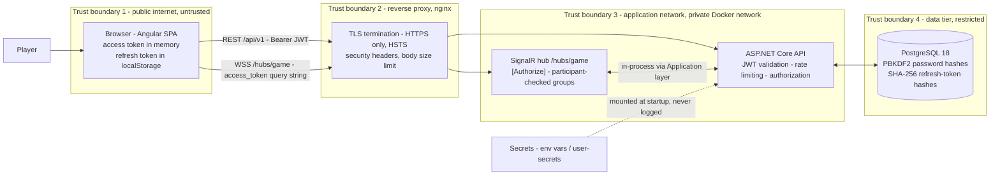

# Security

*The threat model and the complete security control set for the Multiplayer Tic-Tac-Toe MVP — expanding PRD §3.3 and §14 of the [original technical documentation](../00-product/archive/original-technical-documentation.md) into concrete, testable measures, with OWASP mapping, accepted risks and a pre-release checklist.*

Controls are stated so each one is verifiable — by an automated test referenced in [testing-strategy.md](testing-strategy.md), by configuration review, or by the pre-release checklist in §8.

## 1. Scope and Assets

| Asset | Why it matters |
| --- | --- |
| User credentials (password hashes) | Account takeover → identity spoofing |
| Refresh tokens (client + hashed server copies) | Long-lived bearer of identity (7 days) |
| Access tokens (JWT, 15 min) | Short-lived bearer of identity |
| Game state (moves, results) | Integrity of play; server-authoritative by design |
| PII: username, email, login IPs | Privacy obligations; enumerated in §3.11 |
| Availability of API and hub | DoS resistance for lobby and games |

Out of scope: client-device compromise beyond XSS (malware, malicious browser extensions), physical security, and multi-instance deployment hardening (single-node MVP — see §7).

## 2. Threat Model

### 2.1 Data flow and trust boundaries

Boundary rules: nothing outside T2 speaks plaintext or reaches the database; the SPA (T1) is treated as untrusted — every value it sends is re-validated server-side; secrets cross no boundary at runtime (injected at process start).

### 2.2 STRIDE analysis

| # | Category | Threat | Vector | Affected component | Mitigation |
| --- | --- | --- | --- | --- | --- |
| S1 | Spoofing | Replay of stolen access token | XSS or local access exfiltrates JWT | SPA, API | 15-min lifetime, minimal claims, strict CSP (§3.9), tokens never logged (§3.11) |
| S2 | Spoofing | Refresh-token theft and replay | `localStorage` read via XSS | SPA, `refresh_tokens` | Rotation on every use + reuse detection revokes the family (§3.2); HttpOnly cookie planned v1.1 (§7) |
| S3 | Spoofing | Credential stuffing / brute force | Automated login attempts | `/auth/login` | Lockout 5 attempts / 5 min (§3.1); auth rate limit 10/min/IP (§3.8); PBKDF2 hashing |
| T1 | Tampering | Illegal or crafted moves from modified client | Custom client bypassing the UI | `POST /games/{id}/moves` | Server-authoritative aggregate guards: participant + turn + position 0–8 + cell empty + status (§3.7) |
| T2 | Tampering | SQL injection | Crafted username/email/position fields | API, PostgreSQL | EF Core parameterized queries only; FluentValidation allowlists (username regex `^[A-Za-z0-9_]{3,20}$`) (§3.6) |
| T3 | Tampering | JWT forgery | Hand-crafted or `alg: none` tokens | JWT validation | Signed tokens required (`RequireSignedTokens`), issuer/audience/lifetime validated, 256-bit key (§3.2) |
| T4 | Tampering | Double-join / double-move race | Two players join or move simultaneously | `games`/`moves` rows | xmin optimistic concurrency + reload-once re-evaluation + partial unique indexes + `UNIQUE(game_id, position)` — see [concurrency](../03-database/concurrency.md) |
| R1 | Repudiation | Player denies making moves or requests | No attribution | Audit trail | Moves persisted with player id and `played_at_utc` (FR-12); correlation IDs on every request; `created_by_ip` on refresh tokens (§3.11) |
| I1 | Information disclosure | IDOR — reading/playing someone else's game | Guessed or observed `/games/{id}` | Game endpoints | Participant authorization on every command; non-participant reads get 404 (§3.7) |
| I2 | Information disclosure | Secrets or PII in logs | Verbose request logging | Serilog | Never log passwords/tokens/full emails; query strings stripped for `/hubs` (§3.11) |
| I3 | Information disclosure | User enumeration | Register/login error differences | `/auth/*` | Login returns an identical generic 401 for unknown user vs wrong password; register 409 is an accepted UX trade-off, rate-limited (§7) |
| D1 | DoS | Auth endpoint flood | Burst requests per IP | `/auth/register|login|refresh` | Fixed-window limiter 10/min/IP → 429 + `Retry-After` (§3.8) |
| D2 | DoS | Move spam | Macro/automation per user | Moves endpoint | Token-bucket limiter 5/s/user → 429 (§3.8) |
| D3 | DoS | Hub connection exhaustion | Many concurrent connections | SignalR hub | Per-user concurrent connection cap (5), default message-size caps, keep-alive timeouts (§3.8, §4) |
| D4 | DoS | Stale games accumulate | Abandoned Waiting games | Database, lobby | Waiting games older than 15 min auto-cancelled by the janitor service |
| E1 | Elevation of privilege | Non-participant joins a game room | Crafted `JoinGameRoom` invocation | SignalR hub | Server-side participant validation before `Groups.AddToGroupAsync` (§3.7, §4) |
| E2 | Elevation of privilege | Acting on another player's game | IDOR on commands | Command handlers | Every game command resolves the aggregate and checks `ICurrentUser` against `PlayerXId`/`PlayerOId` (§3.7) |

## 3. Security Controls

These tables expand PRD §14 ([original technical documentation](../00-product/archive/original-technical-documentation.md)) row by row.

### 3.1 Identity and passwords

| Control | Specification |
| --- | --- |
| Password hashing | ASP.NET Core Identity `PasswordHasher` — PBKDF2 with HMAC-SHA-256 (Identity V3 format), framework-default iteration count (≥ 100 000), per-password salt |
| Password policy (FR-01) | Minimum 8 characters, at least one upper-case, one lower-case, one digit |
| Uniqueness | Username unique (3–20 chars, `^[A-Za-z0-9_]+$`), email unique and valid, max 256 chars |
| Lockout | 5 failed attempts → locked 5 minutes (`LockoutEnabled`, `MaxFailedAccessAttempts = 5`, `LockoutTimeSpan = 5 min`); locked logins return HTTP 423 |
| Password change/reset | Out of MVP scope (no email verification); documented as roadmap item — see [roadmap](../00-product/roadmap.md) |
| Passwords in transit | Only over HTTPS bodies; never in URLs, never logged |

### 3.2 Token security

| Property | Access token | Refresh token |
| --- | --- | --- |
| Format | Signed JWT (HS-256, 256-bit key) | Opaque 256-bit cryptographically random value |
| Lifetime | 15 minutes | 7 days, sliding via rotation |
| Contents | Minimal claims: `sub`, `name`, `email`, `jti` — no roles/permissions in MVP | No payload; meaningless to read |
| Client storage | Memory only (never `localStorage`) | `localStorage` in MVP (accepted risk, §7) |
| Server storage | None (stateless validation) | SHA-256 hash only, `UNIQUE` on `token_hash` |
| Validation | Issuer, audience, lifetime; clock skew ≤ 30 s; signed tokens required; valid issuer/audience from configuration | Hash lookup + expiry + revoked check on every use |
| Rotation | N/A (expires naturally) | Every use: old token revoked, `replaced_by_token_hash` recorded, new pair issued |
| Reuse detection | N/A | Presenting a revoked token revokes the entire lineage (family) — the attacker's and the victim's sessions both die, forcing re-login |
| Audit | `jti` usable for tracing | `created_at_utc`, `created_by_ip`, `revoked_at_utc`, `replaced_by_token_hash` per token |

Token validation parameters (JwtBearer): `ValidateIssuer = true`, `ValidateAudience = true`, `ValidateLifetime = true`, `ClockSkew = 30 s`, `RequireSignedTokens = true`. Signing key length ≥ 32 bytes, sourced from `Jwt__Key` (§3.10). Full design in [auth-identity-jwt](../02-backend/auth-identity-jwt.md).

### 3.3 Session and logout

| Control | Specification |
| --- | --- |
| Logout | `POST /auth/logout` revokes the presented refresh token and its lineage; client clears memory token + `localStorage`, stops the SignalR connection, navigates to `/login` |
| Post-logout access token | Remains technically valid ≤ 15 min (stateless JWT); accepted, mitigated by short lifetime (§7) |
| Multi-device | Allowed; each login starts an independent token family; reuse detection is per-family, so revoking one device does not kill others |
| Idle behavior | Client silent-refreshes (US-02); after 7 days without use the refresh token expires and the user re-authenticates |
| SignalR session | Hub connections authenticated at connect ([Authorize]); connection dies with the page or on client `Stop` |

### 3.4 Transport security

| Control | Specification |
| --- | --- |
| HTTPS only | All public traffic via the reverse proxy; plain HTTP requests are redirected to HTTPS |
| HSTS | `Strict-Transport-Security: max-age=31536000; includeSubDomains` on all HTTPS responses |
| TLS version | Minimum TLS 1.2, TLS 1.3 preferred; cipher suites per nginx defaults (modern compatibility) |
| Internal traffic | Inside the private Docker network HTTP is accepted (single-host, no untrusted listeners); TLS re-encryption is a scale-out concern, out of MVP scope |
| Forwarded headers | API trusts `X-Forwarded-For`/`X-Forwarded-Proto` only from the proxy (`ForwardedHeaders` with known networks) so client IPs for rate limiting and audit are correct |

### 3.5 CORS

| Control | Specification |
| --- | --- |
| Origins | Exact allowlist from `Cors__Origins` — production: the Angular origin only (e.g. `https://play.tictacttoe.example`); development: `http://localhost:4200`. Wildcards (`*`, subdomain wildcards) prohibited |
| Methods | `GET`, `POST`, `PUT`, `DELETE` — only what the [API spec](../02-backend/api-spec.md) uses |
| Headers | `Authorization`, `Content-Type` |
| Credentials | `AllowCredentials()` is safe because origins are exact (no wildcard) and prepares v1.1's HttpOnly-cookie refresh flow |
| Exposed headers | `X-Correlation-Id` only |
| Preflight | `PreflightMaxAge` 3600 s; unknown origins are rejected before reaching handlers — verified by an integration test asserting no `Access-Control-Allow-Origin` for a foreign origin |

### 3.6 Input validation and output encoding

| Control | Specification |
| --- | --- |
| Command validation | FluentValidation validator per command; validated in `ValidationBehavior` before handlers; failures → HTTP 400 ProblemDetails |
| FR-01 rules | Username `^[A-Za-z0-9_]{3,20}$`; email valid, ≤ 256; password min 8 with upper/lower/digit |
| Game input | `position` integer 0–8 (reject 422); `gameId` non-empty Guid; identifiers never parsed from client claims other than the authenticated `sub` |
| SQL injection | EF Core parameterized queries exclusively; no raw SQL string concatenation; the only raw SQL in tests updates timestamps |
| XSS | Angular default output encoding (contextual escaping); no `bypassSecurityTrust*` calls; no `innerHTML` binding of user data; usernames render as text |
| Model binding | Strict JSON types; malformed bodies → 400 before any handler runs |
| Defense in depth | The Domain aggregate re-validates every rule (turn, bounds, occupancy, status) even for requests that pass validators — clients are untrusted |

### 3.7 Authorization and anti-IDOR

| Surface | Rule |
| --- | --- |
| Default posture | Every endpoint `[Authorize]` except `/auth/register`, `/auth/login`, `/auth/refresh` and `/health` (FR-03) |
| Game commands | `CreateGame`, `JoinGame`, `MakeMove`, `CancelGame`, `ForfeitGame` resolve the aggregate and check `ICurrentUser.UserId` against `PlayerXId`/`PlayerOId`; `CancelGame` additionally requires the caller to be the host (`PlayerXId`) → 403 otherwise |
| Reads | `GET /games/{id}` returns full detail to participants only; outsiders receive 404 (spectators are a non-goal; 404 avoids disclosing existence). The lobby list exposes only summary `LobbyGameDto`s to authenticated users |
| Identity binding | User identity comes exclusively from the validated JWT `sub` — never from request bodies or query strings |
| Hub groups | `JoinGameRoom(gameId)` validates the caller is a participant **server-side** before `Groups.AddToGroupAsync("game-{id}")`; `lobby` group is all authenticated users; group membership cannot be requested for another game |
| Notifications | `game-{id}` broadcasts (board, moves, opponent connection state) only reach group members; lobby broadcasts carry no email or token material |
| One active game | `CreateGame`/`JoinGame` check active-game state in the handler and the database enforces it with partial unique indexes — a forged sequence of calls still cannot produce two active games |

### 3.8 Abuse and denial-of-service controls

| Policy | Partition key | Limit | On breach |
| --- | --- | --- | --- |
| `auth` (register/login/refresh) | Client IP (via forwarded headers) | Fixed window 10 requests/min | 429 + `Retry-After` |
| `moves` | Authenticated user id | Token bucket 5 requests/s | 429 + `Retry-After` |
| Hub connections | User id | Max 5 concurrent connections | Excess connections refused/closed |
| Request body | Global | 128 KB max (`MaxRequestBodySize`) — all payloads are tiny JSON | 413 |
| SignalR messages | Global | Default `MaxIncomingMessageSize` (32 KB) kept; hub is push-only, client invokes limited to room join/leave | Connection terminated |
| Stale resources | Background | Waiting games > 15 min auto-cancelled | Resource reclaimed |

Built with the .NET rate-limiting middleware (`AddRateLimiter` + partitioned limiters); limits are configuration (`RateLimit__*`) and covered by 429 integration tests (see [testing-strategy](testing-strategy.md#6-api-integration-tests-tictactoeapiintegrationtests)).

### 3.9 Security headers

Applied by middleware to every API response, and by nginx to SPA responses:

| Header | Value |
| --- | --- |
| `Content-Security-Policy` | See directives below |
| `X-Content-Type-Options` | `nosniff` |
| `X-Frame-Options` | `DENY` (with CSP `frame-ancestors 'none'`) |
| `Referrer-Policy` | `strict-origin-when-cross-origin` |
| `Permissions-Policy` | `camera=(), microphone=(), geolocation=()` |
| `Strict-Transport-Security` | `max-age=31536000; includeSubDomains` (HTTPS responses only) |

CSP directives for the Angular SPA (AOT build, styles compiled by Tailwind):

| Directive | Value | Reason |
| --- | --- | --- |
| `default-src` | `'self'` | Deny-by-default baseline |
| `script-src` | `'self'` | AOT bundles only; no inline scripts, no `eval` |
| `style-src` | `'self' 'unsafe-inline'` | Angular injects component styles at runtime; scripts stay strictly `'self'` |
| `img-src` | `'self' data:` | Inline SVG avatars/icons |
| `font-src` | `'self'` | Self-hosted Inter/JetBrains Mono |
| `connect-src` | `'self'` | Same-origin REST and SignalR (WS/WSS to the same host, proxied) |
| `object-src` | `'none'` | No plugins |
| `base-uri` | `'self'` | No base hijacking |
| `form-action` | `'self'` | Forms post same-origin only |
| `frame-ancestors` | `'none'` | Clickjacking protection |

### 3.10 Secrets management

| Control | Specification |
| --- | --- |
| Sources | Environment variables or .NET user-secrets in development; GitHub Actions secrets in CI; never `appsettings.json` values that are committed |
| Secrets list | `ConnectionStrings__Default` (DB password), `Jwt__Key` (≥ 32 bytes), `Jwt__Issuer`, `Jwt__Audience`, `Cors__Origins` |
| Never committed | Enforced by gitleaks in CI; `.gitignore` covers user-secrets storage; PR template includes a secrets check |
| Rotation | DB password: rotate during a maintenance window (single node restart). JWT key: rotate by dual-validating old + new keys for one access-token lifetime (≤ 15 min overlap), or force fleet re-login by immediate replacement |
| Least privilege | DB user owns only the application schema; no superuser in production compose |

### 3.11 Privacy and logging

| Control | Specification |
| --- | --- |
| Never logged | Passwords (any field), raw JWTs, refresh tokens (raw or hashed), full emails, Authorization headers |
| Email masking | Logs show at most `j***@example.com` when an identifier must appear |
| Hub query strings | `access_token` appears in the `/hubs/game` query string (§4) — request logging strips query strings for hub paths, and proxy access logs for `/hubs` are disabled/redacted |
| Correlation | Correlation ID generated per request, propagated to responses (`X-Correlation-Id`) and Serilog log context — used instead of logging sensitive identifiers |
| What is logged | Handler name, outcome/status, duration, correlation id, masked identifiers, refresh-token audit (`created_by_ip`) — see Serilog config in [system-architecture](../01-architecture/system-architecture.md) |
| Retention | Console/JSON logs shipped by the platform; no persistent local log files with PII in MVP |

## 4. SignalR-Specific Security

| Concern | Control |
| --- | --- |
| Authentication | Hub is `[Authorize]`; JWT validated at negotiate and connect like any other endpoint |
| Token transport | WebSockets cannot set headers, so the JWT travels as the `access_token` query string — accepted with mitigations: lifetime 15 min, query strings stripped from logs (§3.11), proxy access logs for `/hubs` disabled, HTTPS in transit |
| Group integrity | `JoinGameRoom` validates the caller is a participant server-side before group add (§3.7); the server computes group names — clients never supply them |
| Push-only surface | The hub mutates no game state (except presence); all gameplay flows through validated REST commands — a hostile hub client cannot corrupt a game |
| Message hygiene | Default maximum incoming message size kept (32 KB); client→server methods limited to `JoinGameRoom`/`LeaveGameRoom` — no arbitrary data relayed to other clients |
| Broadcast payloads | Game dtos contain usernames and board state only — never emails, tokens or IPs |
| Presence | In-memory per-user connection sets; presence data (username, count) is non-sensitive; multiple tabs count as one user |
| Connection abuse | Per-user concurrent connection cap (§3.8); keep-alive ping and server timeout disconnect dead connections |

## 5. Dependency Hygiene

| Control | Specification |
| --- | --- |
| NuGet audit | `dotnet audit` (transitive vulnerability audit on restore) runs in CI; direct + transitive advisories fail the build on high/critical |
| npm audit | `npm audit --omit=dev` in CI; fails on high/critical; lockfile committed |
| Dependabot | Weekly dependency updates for NuGet, npm, Docker and GitHub Actions; security alerts immediate |
| Pinning | Docker base images pinned by digest; no floating tags in production compose |
| Review gate | Dependency bumps go through normal PR review; major-version bumps require a smoke run of the E2E suite |

## 6. OWASP Top 10 (2021) Mapping

| Risk | How this project addresses it |
| --- | --- |
| A01 Broken Access Control | `[Authorize]` everywhere except three auth endpoints; participant checks on all game commands and reads (404/403); server-side hub group validation; identity only from JWT `sub` (§3.7) |
| A02 Cryptographic Failures | PBKDF2 password hashing; refresh tokens hashed (SHA-256) at rest; 256-bit random refresh values; signed JWTs with 256-bit key; HTTPS + HSTS + TLS 1.2+ (§3.1–§3.4) |
| A03 Injection | EF Core parameterization; FluentValidation allowlists per command; Angular contextual output encoding; no dynamic SQL, no `innerHTML` (§3.6) |
| A04 Insecure Design | Server-authoritative game rules; race-safe join via xmin + unique indexes; token rotation with family revocation; rate limits on the abuse-prone endpoints (§3.2, §3.7, §3.8) |
| A05 Security Misconfiguration | Exact CORS allowlist; security headers middleware; HSTS; environment-specific config; secrets out of the repo; locked-down DB user (§3.5, §3.9, §3.10) |
| A06 Vulnerable and Outdated Components | `dotnet audit` + `npm audit` gates in CI; Dependabot; digest-pinned images (§5) |
| A07 Identification and Authentication Failures | Identity lockout 5/5 min; generic login errors; strong password policy; rotating refresh tokens with reuse detection; short JWT lifetime (§3.1, §3.2) |
| A08 Software and Data Integrity Failures | Signed tokens only (`RequireSignedTokens`); server-side game-state transitions only; CI pipeline runs on pinned runners with locked-down workflow permissions (§3.2, §5) |
| A09 Logging and Monitoring Failures | Structured Serilog logs with correlation IDs; refresh-token audit trail with IP; health checks; redaction policy prevents the logs themselves becoming a leak (§3.11) |
| A10 SSRF | No endpoint fetches user-supplied URLs; the API performs no outbound HTTP calls in MVP — attack surface absent by design |

## 7. Accepted Risks and Roadmap

| Risk | Exposure | Mitigation now | Roadmap |
| --- | --- | --- | --- |
| Refresh token in `localStorage` | XSS could exfiltrate a 7-day token → account takeover | Strict CSP (§3.9); access token in memory only; rotation + family revocation kills stolen tokens on first legitimate use; 15-min JWT limits replay value | Move refresh to HttpOnly + Secure + SameSite=Strict cookie in v1.1 ([roadmap](../00-product/roadmap.md)) |
| In-memory presence (and hub groups) | Multiple API instances would split presence and broadcasts — silent misses, not corruption | Single-node MVP constraint (PRD NFR: 500 concurrent games on one node); documented deployment boundary | Redis backplane + shared presence store before any scale-out |
| Registration 409 reveals existing username/email | Account enumeration by scripted registration | Rate-limited to 10/min/IP; generic login errors limit the more damaging login oracle | Acceptable for MVP; verify-email flow post-MVP |
| Access token valid until expiry after logout | Up to 15 min of API use with a captured token | Short lifetime; logout revokes refresh family so no renewal is possible | Server-side token blacklist / reference tokens if required later |
| No email verification | Accounts can register addresses they do not own | No password reset exists, so unverified email grants nothing beyond the username | Email verification + reset flow post-MVP |

## 8. Pre-Release Security Checklist

Run against the release candidate in the staging Docker environment; every item must pass before shipping.

| # | Check | Verification |
| --- | --- | --- |
| 1 | Only `/auth/register`, `/auth/login`, `/auth/refresh`, `/health` are anonymous | OpenAPI scan + unauthorized request sweep returns 401 elsewhere |
| 2 | Lockout: 5 failed logins → 423 for 5 min | Integration test `Login_FifthFailedAttempt_Returns423` green |
| 3 | Refresh rotation + reuse detection revokes family | Integration tests §6.2 in [testing-strategy](testing-strategy.md) green |
| 4 | Rate limits return 429 with `Retry-After` (auth 10/min/IP, moves 5/s/user) | Integration tests green + manual burst against staging |
| 5 | Security headers present on API and SPA (CSP, nosniff, X-Frame-Options DENY, Referrer-Policy, Permissions-Policy, HSTS) | `curl -I` checklist against staging |
| 6 | HTTPS enforced; HTTP redirects; no mixed content | Browser devtools + redirect check |
| 7 | CORS rejects foreign origins (no ACAO header) | Integration test + manual cross-origin probe |
| 8 | IDOR: user C gets 404 on `/games/{id}` of A-vs-B and 403 on moves | Integration tests green |
| 9 | Hub rejects non-participant `JoinGameRoom` | Hub test green |
| 10 | No secrets in repository or images; gitleaks clean | CI security-audit job green |
| 11 | `dotnet audit` and `npm audit` clean (no high/critical) | CI gates green |
| 12 | Logs contain no passwords, tokens or full emails; hub query strings redacted | Grep staging logs during an auth + hub session |
| 13 | Docker images pinned by digest; app runs as non-root user | Inspect image metadata in [docker-and-environments](../06-devops/docker-and-environments.md) |
| 14 | Test-only lifetimes (short tokens/grace/rate windows) absent from production config | Config diff between test and production profiles |

## Assumptions

- TLS is terminated at the nginx reverse proxy in production; traffic inside the single-host Docker network is plaintext and private, which is the documented single-node MVP boundary.
- The JWT is signed with HMAC-SHA-256 and a 256-bit key (`Jwt__Key`); switching to asymmetric signing keys is a configuration change if cross-service validation is ever needed.
- CSP `style-src 'unsafe-inline'` is required by Angular's runtime component-style injection; script sources remain strictly `'self'`.
- `connect-src 'self'` assumes production serves the SPA and proxies `/api` and `/hubs` from the same origin; the development profile additionally allows `http://localhost:4200`.
- The refresh-token "family" is the replacement chain (`replaced_by_token_hash` lineage) rooted at the token issued by login.
- Rate-limit partitioning trusts `X-Forwarded-For` only from the reverse proxy; behind additional CDN/proxy layers the partition key must be revisited.
- Production origins cited in examples (`https://play.tictacttoe.example`) are illustrative values; the real origin is set at deployment time via `Cors__Origins`, which is environment configuration, not code.
