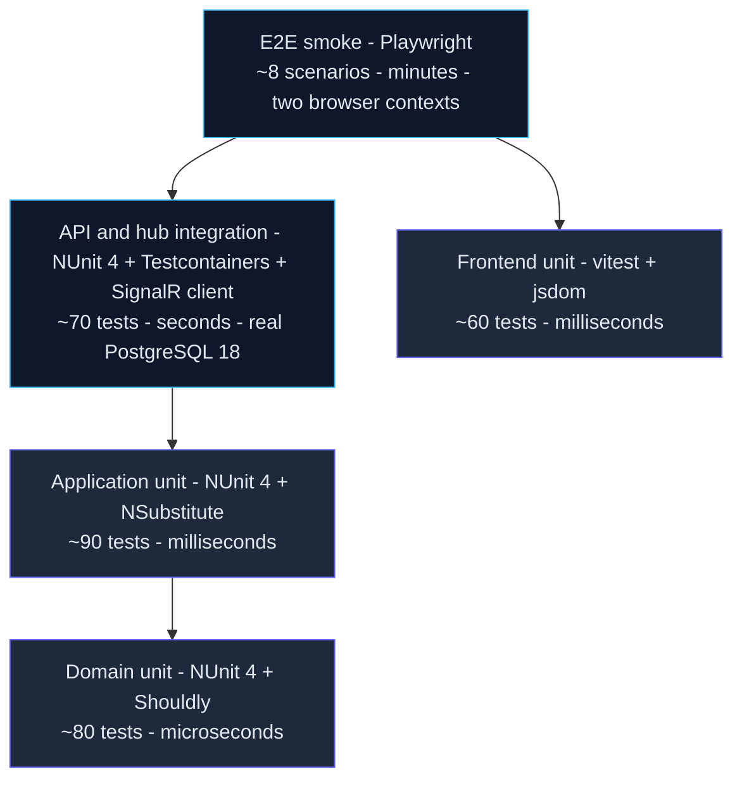

# Testing Strategy

*The complete verification plan for the Multiplayer Tic-Tac-Toe MVP — test pyramid, toolchain, concrete per-suite test-case catalogs, isolation and parallelization strategy, coverage gates, accessibility checks and the Definition of Done.*

Everything here traces back to the [PRD](../00-product/PRD.md) (acceptance criteria §5, NFRs §3.3) and the [user stories](../00-product/user-stories.md). Security-focused test cases (rate limits, headers, IDOR) are specified here and cross-referenced from [security.md](security.md).

## 1. Principles

1. **Test at the lowest layer that can fail.** Game rules are proven in the Domain aggregate before they are proven through HTTP; HTTP tests exist to verify wiring, not arithmetic.
2. **Server-authoritative means server-tested.** Every client-side convenience (disabled cells, turn highlight) has a matching server-side rejection test.
3. **The four key acceptance criteria are automated end-to-end:** US-07 (simultaneous join), US-08 (move out of turn), US-10 (disconnect forfeit), US-02 (silent refresh).
4. **Real database for integration truth.** Concurrency behavior (xmin, partial unique indexes — see [concurrency](../03-database/concurrency.md)) is only honestly testable against PostgreSQL 18, hence Testcontainers.
5. **NUnit 4 for every .NET test project** — no mixing of frameworks (decision recorded in [ADR-0012](../01-architecture/adr/0012-nunit-test-framework.md)).
6. **Fast by default:** the full backend unit suite runs in seconds; slow paths (containers, browsers) are isolated to their own suites and CI jobs.

## 2. Test Pyramid and Layer Targets

| Layer | Location | Target / gate | Time budget |
| --- | --- | --- | --- |
| Domain unit | `tests/TicTacToe.Domain.UnitTests` | ≥ 90% line coverage; all aggregate guards and all 8 win lines covered | < 10 s |
| Application unit | `tests/TicTacToe.Application.UnitTests` | ≥ 80% line coverage; every command/query handler, validator and pipeline behavior | < 30 s |
| API + hub integration | `tests/TicTacToe.Api.IntegrationTests` | every endpoint and hub event at least once (counts toward backend overall gate) | < 5 min |
| Backend overall | all three .NET projects combined | ≥ 70% line coverage | — |
| Frontend unit | `client/` (vitest, jsdom) | core logic ≥ 70% statements: `core/` (auth, interceptor, guards, SignalR wrapper, token storage), feature stores, shared validators, board logic | < 60 s |
| E2E smoke | `client/e2e` (Playwright) | ~8 scenarios, 100% pass, no coverage gate | < 10 min |

The PRD-mandated **80%+ unit coverage on Domain and Application** is enforced per project (Domain is pushed to 90% because it is pure, cheap to test, and carries all game rules). Test counts in the pyramid are planning guidelines, not gates.

## 3. Toolchain

| Tool | Scope | Role |
| --- | --- | --- |
| **NUnit 4** | all .NET test projects | Mandated test framework: `[Test]`, `[TestCase]`, `[SetUp]`/`[OneTimeSetUp]`, `SetUpFixture`, parallelization attributes |
| **Shouldly** ([ADR-0014](../01-architecture/adr/0014-shouldly-assertions.md)) | all .NET tests | Sole assertion library: `x.ShouldBe(y)`, `ShouldNotBeNull()`, `ShouldContain(item)`, `await Should.ThrowAsync<GameFullException>(act)`, `Should.NotThrow(act)` — `Assert.That` appears nowhere |
| **NSubstitute** | Application unit tests | Mocks for `IGameRepository`, `IIdentityService`, `ITokenService`, `ICurrentUser`, `IPresenceTracker`, `IGameNotifier`, `IUnitOfWork`, `IDateTimeProvider`, `IReadDbContext`; `.Received()` / `.DidNotReceive()` verification |
| **Testcontainers for .NET** (PostgreSQL 18 module) | integration tests | Real PostgreSQL 18 container per test run; no shared external DB, no in-memory substitute |
| **Respawn** | integration tests | Deletes all table data between tests (schema intact) — fast, reliable reset without re-migrating |
| **WebApplicationFactory** (`Microsoft.AspNetCore.Mvc.Testing`) | integration tests | Boots the real API in-memory with overridden configuration (connection string, short token/grace lifetimes, rate limits) |
| **Microsoft.AspNetCore.SignalR.Client** | hub tests | Two real hub connections per test exercising `GameStarted` / `MoveMade` / `GameFinished` / presence events |
| **coverlet.collector + ReportGenerator** | all .NET tests | Coverage collection (`XPlat Code Coverage`) and merged HTML + summary reports for CI gates |
| **vitest + jsdom** | frontend unit | Unit tests for stores, guards, interceptor, services, validators with a DOM environment |
| **@vitest/coverage-v8** | frontend unit | Statement/branch coverage with thresholds on `client/src/app/core` and stores |
| **Playwright** | E2E | Cross-browser smoke suite driving **two browser contexts** as the two players; includes axe-core accessibility scan |
| **k6** | load verification | Performance NFR verification (p95 move latency, lobby load, 500 concurrent games) — nightly/pre-release job, not per-PR |

## 4. Domain Unit Tests (`TicTacToe.Domain.UnitTests`)

No mocks — the aggregate is exercised directly with deterministic builders and an `IDateTimeProvider` stub. One fixture per aggregate behavior group.

### 4.1 `Game.Create`

| Test | Asserts |
| --- | --- |
| `Create_WithHostId_ReturnsWaitingGameWithHostAsX` | Status `Waiting`, `CurrentTurn = X`, `PlayerXId = hostId`, `PlayerOId` null, board (derived from Moves) is nine empty cells |
| `Create_RaisesGameCreatedEvent` | Exactly one `GameCreated` domain event carrying the game id and host id |
| `Create_SetsCreatedAtUtcFromClock` | `CreatedAtUtc` equals the stubbed time (no hidden `DateTime.UtcNow` calls) |

### 4.2 `Game.Join`

| Test | Asserts |
| --- | --- |
| `Join_WhenWaiting_SetsPlayerOAndInProgress` | `PlayerOId` set, Status `InProgress`, `StartedAtUtc` set, `GameStarted` event raised |
| `Join_ByHost_ThrowsCannotJoinOwnGameException` | FR-07: creator cannot join own game; state unchanged, no event |
| `Join_WhenInProgress_ThrowsGameFullException` | US-07 domain side: second joiner after transition gets "Game is already full" semantics |
| `Join_WhenFinished_ThrowsGameFullException` | Terminal games reject joiners |
| `Join_WhenCancelled_ThrowsGameNotInProgressException` | Cancelled game is no longer joinable |

### 4.3 `Game.MakeMove` — guards

| Test | Asserts |
| --- | --- |
| `MakeMove_ByXWhenTurnIsX_AppendsMoveAndFlipsTurnToO` | Move appended with `Mark = X`, `MoveNumber = 1`, `CurrentTurn` flips to O |
| `MakeMove_ByOWhenTurnIsO_AppendsMoveAndFlipsTurnToX` | Alternation continues (FR-08) |
| `MakeMove_ByOWhenTurnIsX_ThrowsNotYourTurnException` | US-08: move rejected, board and turn unchanged |
| `MakeMove_ByXWhenTurnIsO_ThrowsNotYourTurnException` | Symmetric guard for X |
| `MakeMove_FirstMoveByO_ThrowsNotYourTurnException` | X always moves first |
| `MakeMove_ByUserOutsideTheGame_ThrowsNotYourTurnException` | Defense-in-depth participant guard (Application rejects non-participants earlier with 403) |
| `MakeMove_PositionBelowZero_ThrowsInvalidPositionException` | `[TestCase(-1)]`, `[TestCase(-100)]` |
| `MakeMove_PositionAboveEight_ThrowsInvalidPositionException` | `[TestCase(9)]`, `[TestCase(42)]` |
| `MakeMove_OnOccupiedCell_ThrowsCellOccupiedException` | Cell already marked, regardless of mark |
| `MakeMove_WhenWaiting_ThrowsGameNotInProgressException` | No moves before opponent joins |
| `MakeMove_WhenFinished_ThrowsGameNotInProgressException` | Finished game immutable |
| `MakeMove_WhenCancelled_ThrowsGameNotInProgressException` | Cancelled game immutable |
| `MakeMove_RaisesMoveMadeEvent` | One `MoveMade` per accepted move |

### 4.4 `Game.MakeMove` — win, loss and draw evaluation

| Test | Asserts |
| --- | --- |
| `MakeMove_CompletingLine_SetsOutcomeAndWinningLine` | 8 `[TestCase]`s — rows `(0,1,2)`, `(3,4,5)`, `(6,7,8)`; columns `(0,3,6)`, `(1,4,7)`, `(2,5,8)`; diagonals `(0,4,8)`, `(2,4,6)` — each run for X and for O (16 cases): Status `Finished`, `Result.Outcome` `XWins`/`OWins`, `Reason Normal`, `WinningLine` equals the line, `GameFinished` raised, `FinishedAtUtc` set |
| `MakeMove_WinningNinthMove_PrefersWinOverDraw` | Win check runs before draw check |
| `MakeMove_NinthMoveWithoutLine_EndsInDraw` | 9 moves, no line: `Outcome Draw`, `Reason Normal`, `WinningLine` null |
| `MakeMove_WinningMove_DoesNotFlipTurn` | Turn frozen once finished |

### 4.5 `Game.Forfeit` and `Game.Cancel`

| Test | Asserts |
| --- | --- |
| `Forfeit_ByPlayerX_SetsOWinsWithReasonForfeit` | Opponent crowned, `Reason Forfeit` (US-10) |
| `Forfeit_ByPlayerO_SetsXWinsWithReasonForfeit` | Symmetric |
| `Forfeit_RaisesGameFinishedEvent` | Single event with result |
| `Forfeit_WhenNotInProgress_ThrowsGameNotInProgressException` | Waiting/Finished/Cancelled reject forfeit |
| `Cancel_ByHostWhenWaiting_SetsCancelledAndRaisesGameCancelled` | US-12 happy path |
| `Cancel_WhenInProgress_ThrowsGameNotInProgressException` | Must use forfeit/leave instead |
| `Cancel_WhenFinished_ThrowsGameNotInProgressException` | Terminal state immutable |

The *host-only* rule of `Cancel` is an authorization concern: `CancelGameCommand` checks `ICurrentUser` against `PlayerXId` and returns the `Games.NotHost` error (HTTP 403) before touching the aggregate — see §5.3.

### 4.6 Immutability and invariants

| Test | Asserts |
| --- | --- |
| `FinishedGame_AllMutations_Throw` | `MakeMove`, `Join`, `Forfeit`, `Cancel` on a finished game all throw `GameNotInProgressException` |
| `CancelledGame_AllMutations_Throw` | Same for cancelled games |
| `Finalize_ResultSetExactlyOnce` | A second finalization attempt is rejected — result set exactly once (invariant 6) |
| `Moves_AlternateStrictlyFromX` | Any insertion of two consecutive same-mark moves is impossible via the public API (property-style check over several random move sequences) |

## 5. Application Unit Tests (`TicTacToe.Application.UnitTests`)

All dependencies are NSubstitute mocks; handlers are tested in isolation. Expected failures are `Result` errors, never exceptions (see [CQRS & Mediator](../01-architecture/cqrs-and-mediator.md)).

### 5.1 Auth command handlers

| Test | Asserts |
| --- | --- |
| `RegisterCommandHandler_Valid_CreatesUserAndProfileAndReturnsTokens` | `IIdentityService.CreateUserAsync` called once, `PlayerProfile` added, `AuthResponse` with token pair |
| `RegisterCommandHandler_DuplicateUsername_ReturnsUsersUsernameTaken` | No profile created, no tokens |
| `RegisterCommandHandler_DuplicateEmail_ReturnsUsersEmailTaken` | Distinct error code from username clash |
| `LoginCommandHandler_Valid_ReturnsAuthResponse` | Tokens issued, no lockout increment |
| `LoginCommandHandler_WrongPassword_ReturnsAuthInvalidCredentials` | Failure count incremented via identity service |
| `LoginCommandHandler_UnknownIdentifier_ReturnsAuthInvalidCredentials` | Same error text as wrong password (no user enumeration) |
| `LoginCommandHandler_LockedOut_ReturnsAuthLockedOut` | Maps to HTTP 423 |
| `RefreshTokenCommandHandler_ValidRotatesToken_ReturnsNewPair` | Old token marked revoked, replacement stored hashed, new pair returned |
| `RefreshTokenCommandHandler_UnknownToken_ReturnsAuthInvalidToken` | Hash not found |
| `RefreshTokenCommandHandler_ExpiredToken_ReturnsAuthInvalidToken` | Expiry checked before anything else |
| `RefreshTokenCommandHandler_RevokedTokenReuse_RevokesEntireFamily` | Reuse detection walks `replaced_by_token_hash` lineage and revokes every descendant token |
| `LogoutCommandHandler_Valid_RevokesPresentedToken` | Token marked revoked; idempotent for already-revoked tokens |

### 5.2 Game command handlers

| Test | Asserts |
| --- | --- |
| `CreateGameCommandHandler_Valid_CreatesGameAsHostX` | Repository `AddAsync` receives a Waiting game with `PlayerXId = currentUser` |
| `CreateGameCommandHandler_AlreadyInActiveGame_ReturnsGamesBusy` | Repository reports existing active game → error, no add |
| `JoinGameCommandHandler_Valid_ReturnsInProgressGameDto` | Game joined, dto mapped via Mapster config |
| `JoinGameCommandHandler_OwnGame_ReturnsGamesCannotJoinOwn` | `CannotJoinOwnGameException` mapped to error |
| `JoinGameCommandHandler_FullGame_ReturnsGamesFull` | `GameFullException` → `Games.Full` (HTTP 409) |
| `JoinGameCommandHandler_AlreadyInActiveGame_ReturnsGamesBusy` | FR-07 second half |
| `JoinGameCommandHandler_MissingGame_ReturnsGamesNotFound` | Repository returns null |
| `JoinGameCommandHandler_ConcurrencyConflictOnce_ReloadsAndReturnsGamesFull` | Repository throws `DbUpdateConcurrencyException`; after single reload the re-evaluated rules produce the domain error ([concurrency](../03-database/concurrency.md)) |
| `MakeMoveCommandHandler_Valid_ReturnsUpdatedGameDto` | Aggregate called with (userId, position); dto reflects the move |
| `MakeMoveCommandHandler_NotYourTurn_ReturnsGamesNotYourTurn` | `NotYourTurnException` → HTTP 409 error code |
| `MakeMoveCommandHandler_CellOccupied_ReturnsGamesCellOccupied` | `CellOccupiedException` → HTTP 422 error code |
| `MakeMoveCommandHandler_InvalidPosition_ReturnsGamesInvalidPosition` | `InvalidPositionException` → HTTP 422 error code |
| `MakeMoveCommandHandler_NotInProgress_ReturnsGamesNotInProgress` | `GameNotInProgressException` → HTTP 409 error code |
| `MakeMoveCommandHandler_CallerNotParticipant_ReturnsGamesForbidden` | HTTP 403 path — never reaches the aggregate |
| `MakeMoveCommandHandler_ConcurrencyConflictOnce_ReloadsAndReevaluates` | Same reload-once pattern as join |
| `CancelGameCommandHandler_ByHostWhileWaiting_ReturnsSuccess` | Aggregate `Cancel` invoked |
| `CancelGameCommandHandler_ByNonHost_ReturnsGamesNotHost` | HTTP 403; aggregate untouched |
| `CancelGameCommandHandler_NotWaiting_ReturnsGamesNotInProgress` | HTTP 409 |
| `ForfeitGameCommandHandler_ByParticipantInProgress_ReturnsSuccess` | Opponent wins with `Reason Forfeit` |
| `ForfeitGameCommandHandler_ByNonParticipant_ReturnsGamesForbidden` | HTTP 403 (also covers the disconnect-grace service invoking forfeit) |

### 5.3 Query handlers

| Test | Asserts |
| --- | --- |
| `GetLobbyGamesQueryHandler_ReturnsWaitingAndInProgressOrderedNewestFirst` | Read-side projection used, `AsNoTracking` substitute verified |
| `GetLobbyGamesQueryHandler_StatusFilter_ReturnsOnlyRequestedStatuses` | `?status=waiting` excludes InProgress |
| `GetGameByIdQueryHandler_Found_ReturnsGameDto` | Full dto with board array and result |
| `GetGameByIdQueryHandler_Missing_ReturnsGamesNotFound` | |
| `GetGameByIdQueryHandler_NonParticipant_ReturnsGamesNotFound` | IDOR guard: user C cannot read A-vs-B game detail |
| `GetMyActiveGameQueryHandler_WithActiveGame_ReturnsDto` | US-13 resync source |
| `GetMyActiveGameQueryHandler_WithoutActiveGame_ReturnsNull` | API translates to 204 |
| `GetOnlinePlayersQueryHandler_MapsPresenceToDtos` | Only username/display fields — never email |

### 5.4 Validators (FR-01 and friends)

| Test | Asserts |
| --- | --- |
| `RegisterCommandValidator_UsernameRules` | `[TestCase]` matrix: empty, 2 chars, 21 chars, `"ab-cd"`, `"ab cd"`, `"ab.cd"`, `"üser"` → invalid; `"ab_cD9"`, 3 and 20 chars → valid (regex `^[A-Za-z0-9_]{3,20}$`) |
| `RegisterCommandValidator_EmailRules` | `"not-an-email"`, missing `@`, 257 chars → invalid; normal address → valid |
| `RegisterCommandValidator_PasswordRules` | `"Ab1"` (too short), `"abcdefg1"` (no upper), `"ABCDEFG1"` (no lower), `"Abcdefgh"` (no digit) → invalid; `"Abcdefg1"` → valid |
| `LoginCommandValidator_EmptyIdentifierOrPassword_Fails` | Both required |
| `MakeMoveCommandValidator_PositionBounds` | `[TestCase(-1)]`, `[TestCase(9)]` invalid; `[TestCase(0)]`, `[TestCase(8)]` valid; empty `gameId` invalid |
| `JoinGameCommandValidator_EmptyGameId_Fails` | |
| `RefreshTokenCommandValidator_EmptyToken_Fails` | |

Validators must mirror — not replace — the Domain guards: validators reject malformed input cheaply (400), the aggregate remains the authority (409/422).

### 5.5 Cortex.Mediator pipeline behaviors

| Test | Asserts |
| --- | --- |
| `ValidationCommandBehavior_InvalidCommand_ShortCircuitsWithoutCallingHandler` | `ValidationException` thrown; handler substitute `DidNotReceive()` any call |
| `ValidationCommandBehavior_ValidCommand_CallsHandlerOnce` | Pass-through verified |
| `UnitOfWorkCommandPipelineBehavior_CommandSuccess_SavesThenDispatchesDomainEvents` | `SaveChangesAsync` happens **before** `PublishAsync` of domain events; both received once |
| `UnitOfWorkCommandPipelineBehavior_HandlerFailure_DoesNotSaveOrDispatch` | No commit on error result or exception |
| `UnitOfWorkCommandPipelineBehavior_Query_DoesNotSaveOrDispatch` | The behavior is registered on the command pipeline only — a query dispatch never invokes it |
| `PerformanceCommandPipelineBehavior_HandlerAboveThreshold_LogsWarning` | Slow-handler substitute; warning contains handler name, no payload |
| `LoggingCommandBehavior_CorrelationId_PropagatedToLogContext` | Log scope carries the correlation id; payload properties never include password or token fields |

## 6. API Integration Tests (`TicTacToe.Api.IntegrationTests`)

### 6.1 Fixture design

- **One PostgreSQL 18 container per test assembly** (Testcontainers), started in a NUnit `SetUpFixture` one-time setup; EF migrations applied once at start.
- **WebApplicationFactory** hosts the API with the container's connection string plus test-only configuration: `GameRules__DisconnectGraceSeconds=2`, `GameRules__StaleWaitingMinutes=15` (time-travelled via SQL, never waited out), short JWT lifetime (60 s), tightened rate limits for fast 429 assertions.
- **Respawn** `Respawner` created once (Postgres adapter, `__EFMigrationsHistory` ignored); each test starts with `ResetAsync` in `[SetUp]` — see §10.2.
- **Hub connection helper** builds `HubConnection` instances wired through the factory's HTTP handler, so REST and SignalR share the same in-memory server.
- **Test users** are created through the real `/auth/register` endpoint with Guid-suffixed usernames (`alice-{guid:N}`) — unique after every reset.

### 6.2 Auth flow

| Test | Asserts |
| --- | --- |
| `Register_Valid_Returns201AuthResponse` | Tokens + user payload; `PlayerProfile` row exists |
| `Register_DuplicateUsername_Returns409` | ProblemDetails with the `Users.UsernameTaken` code |
| `Register_DuplicateEmail_Returns409` | `Users.EmailTaken` code |
| `Register_InvalidPayload_Returns400` | ProblemDetails lists each violated FR-01 rule |
| `Login_Valid_Returns200AuthResponse` | |
| `Login_WrongPassword_Returns401` | Generic message identical to unknown-identifier case |
| `Login_FifthFailedAttempt_Returns423` | Locked out; lockout end time-travelled via SQL update instead of waiting 5 minutes |
| `Refresh_Valid_Returns200AndRotatesTokens` | New pair; old refresh token now rejected |
| `Refresh_ReusedRevokedToken_Returns401AndRevokesFamily` | Replaying the original token kills the lineage: the *newest* descendant also returns 401 |
| `Refresh_ExpiredToken_Returns401` | |
| `Logout_Returns204_ThenRefreshReturns401` | Presented token revoked |
| `Me_WithExpiredAccessToken_Returns401` | 60 s test lifetime, clock advanced by waiting the configured window in a background task |

### 6.3 Games lifecycle

| Test | Asserts |
| --- | --- |
| `CreateGame_Valid_Returns201WaitingHostIsX` | FR-05 |
| `CreateGame_WhenAlreadyInActiveGame_Returns409` | `Games.Busy` (FR-07) |
| `JoinGame_Valid_Returns200InProgressAndLobbyListUpdated` | FR-06: game leaves the waiting list |
| `JoinGame_OwnGame_Returns409` | |
| `JoinGame_ThirdPlayer_Returns409GameAlreadyFull` | Message body contains "Game is already full" (US-07) |
| `JoinGame_UnknownId_Returns404` | |
| `SimultaneousJoin_ExactlyOneSucceeds` | **US-07:** two users issue `POST /games/{id}/join` inside `Task.WhenAll`; assert exactly one 200 and exactly one 409; DB shows one `PlayerOId` |
| `FullPlaythrough_XWinsTopRow` | X:0 → O:4 → X:1 → O:5 → X:2; each move 200; final dto: `XWins`, `Normal`, `WinningLine [0,1,2]`; all 5 moves persisted with timestamps (FR-12) |
| `FullPlaythrough_Draw` | 9 alternating moves ending 0–8 coverage of no-line path: `Draw`/`Normal` |
| `Move_NotYourTurn_Returns409` | US-08 server side |
| `Move_OccupiedCell_Returns422` | |
| `Move_PositionNine_Returns422` | Body `{"position": 9}` |
| `Move_OnWaitingGame_Returns409` | |
| `Move_AfterGameFinished_Returns409` | Immutability over HTTP |
| `Move_ByNonParticipant_Returns403` | User C moving in A-vs-B game |
| `Cancel_ByHostWhileWaiting_Returns204` | Game removed from lobby list |
| `Cancel_ByNonHost_Returns403` | |
| `Cancel_WhileInProgress_Returns409` | |
| `Leave_WhileInProgress_Returns204OpponentWinsReasonForfeit` | Explicit forfeit path (US-10) |
| `GetActiveGame_WhenInGame_Returns200Dto` | US-13 resync after refresh |
| `GetActiveGame_WhenFree_Returns204` | Also after game finish |
| `GetGameById_NonParticipant_Returns404` | IDOR: existence not disclosed to outsiders |
| `GetLobbyGames_StatusFilter_ReturnsOnlyMatching` | `?status=waiting,inprogress` |
| `Unauthenticated_Request_Returns401` | `[TestCase]` across every protected endpoint (FR-03) |
| `RateLimit_AuthEndpoints_EleventhRequestPerMinutePerIp_Returns429` | Test-tightened window |
| `RateLimit_Moves_SixthRequestPerSecondPerUser_Returns429` | |

### 6.4 Hub tests (SignalR client)

| Test | Asserts |
| --- | --- |
| `Hub_Connect_JoinsLobbyAndBroadcastsPresenceChanged` | Second client observes `onlineCount` increment with both usernames (FR-04) |
| `Hub_GameCreated_BroadcastToLobbyGroup` | Lobby clients receive `GameCreated` with `LobbyGameDto` |
| `Hub_Join_BothPlayersReceiveGameStarted` | Both game-group clients get `GameStarted`; lobby gets `GameRemoved` (FR-10) |
| `Hub_MoveMade_BroadcastToBothPlayers` | REST move → both clients receive `MoveMade` with updated board and turn |
| `Hub_GameFinished_BroadcastWithResultAndWinningLine` | |
| `Hub_Disconnect_EmitsOpponentConnectionFalse` | Opponent receives `OpponentConnection { connected: false, graceSecondsLeft }` |
| `Hub_DisconnectBeyondGrace_ForfeitsGame` | **US-10:** grace = 2 s in tests; opponent then receives `GameFinished` with `Reason Forfeit` and their win |
| `Hub_ReconnectWithinGrace_CancelsForfeit` | Reconnect → `OpponentConnection { connected: true }`; no `GameFinished` follows |
| `Hub_JoinGameRoom_NonParticipant_Denied` | Third user invoking `JoinGameRoom` receives an error / is not added — verified by absence of `GameStarted` and group messages |
| `Hub_StaleWaitingGame_AfterFifteenMinutes_CancelledAndBroadcastRemoved` | `created_at_utc` set 16 minutes in the past via SQL; janitor cancels; lobby receives `GameRemoved` |

## 7. Frontend Unit Tests (vitest + jsdom)

Naming: `describe('<unit>')` with `it('should <expected> when <scenario>')`. Files co-located as `*.spec.ts`.

### 7.1 Stores

| Unit | Test | Asserts |
| --- | --- | --- |
| `lobby.store` | `GameCreated` event → new card added at top | signal updated; no duplicated entries |
| `lobby.store` | `GameRemoved` event → card removed (started/cancelled/finished) | list shrinks; US-07 loser's list drops the game |
| `lobby.store` | `PresenceChanged` event → count and player list updated | |
| `game.store` | `GameStarted` event → board initialized, turn = X | |
| `game.store` | `MoveMade` event → board cell filled, turn flips | |
| `game.store` | `GameFinished` event → result set, modal opened | outcome/reason/winningLine mapped |
| `game.store` | `OpponentConnection` event → connection badge and grace countdown | `graceSecondsLeft` drives UI state |

### 7.2 Guards (redirect matrix)

| Guard | State | Expected |
| --- | --- | --- |
| `authGuard` | no access token in memory | redirect `/login?returnUrl=<url>` |
| `authGuard` | token present | route activated |
| `guestGuard` | token present | redirect `/lobby` |
| `guestGuard` | no token | route activated |

### 7.3 `authInterceptor`

| Test | Asserts |
| --- | --- |
| `401 queues parallel requests behind a single refresh` | Three simultaneous 401 responses → exactly one `POST /auth/refresh`; all three retried with the new access token (US-02) |
| `refresh failure logs out and redirects` | Refresh 401 → storage cleared, navigation to `/login`, SignalR stopped |
| `401 from the refresh endpoint itself does not recurse` | No infinite loop |
| `attaches bearer token to outgoing requests` | `Authorization` header present when a token is in memory |

### 7.4 Board, validators, token storage

| Test | Asserts |
| --- | --- |
| board renders 9 cells from `GameDto.board` | marks mapped to X/O/null |
| winning line cells receive highlight class | `result.winningLine` indices |
| cell `aria-label` reflects state | `"Row 1, Column 2, empty"` → `"Row 1, Column 2, X"` after a move |
| cell disabled when not player's turn or game finished | click ignored |
| register form validators mirror FR-01 | Same username/email/password matrices as §5.4 |
| token storage: access token never written to `localStorage` | memory only; refresh token persisted |

## 8. E2E Smoke Suite (Playwright)

Two browser contexts (`hostContext`, `opponentContext`) drive the two players against a running `docker compose` stack (or CI services). Test configuration shortens the access token to 60 s and the disconnect grace to 5 s. Specs live in `client/e2e`; workers limited to keep game flows deterministic.

| Spec | Flow | Acceptance |
| --- | --- | --- |
| `auth.spec.ts` | register → auto-login → lobby; logout → guarded route redirects to login | US-01, US-02, US-03 |
| `full-game.spec.ts` | register both users in two contexts → create game → join → alternate 5 moves → result modal | Host sees "Victory", opponent sees "Defeat", win line drawn, both can return to lobby (US-06, US-07, US-08, US-09, US-11) |
| `invalid-move.spec.ts` | O clicks a cell during X's turn | Cell shows shake animation class; board unchanged (US-08) |
| `forfeit-on-disconnect.spec.ts` | `opponentContext.close()` → wait grace (5 s) | Remaining player sees victory modal labelled opponent-left; result reason Forfeit (US-10) |
| `silent-refresh.spec.ts` | Token lifetime 60 s; idle past expiry; create a game | Request succeeds after in-app refresh; user never lands on `/login` (US-02) |
| `reconnect-refresh.spec.ts` | Reload the game page mid-game | Board and turn restored via `GET /games/active` (US-13) |
| `lobby-realtime.spec.ts` | Third context watches lobby while others act | Online count changes; game cards appear/disappear live (US-04, US-05, FR-10) |
| `accessibility-smoke.spec.ts` | axe-core scan of login, lobby and game pages | Zero serious/critical violations |

## 9. Conventions and Test Engineering

### 9.1 Naming

| Suite | Convention | Example |
| --- | --- | --- |
| .NET tests | `MethodName_Scenario_ExpectedResult` | `JoinGameCommandHandler_AlreadyInActiveGame_ReturnsGamesBusy` |
| Frontend tests | `describe(unit)` + `it('should …')` | `it('should remove the game when GameRemoved fires')` |
| E2E specs | kebab-case file per flow | `forfeit-on-disconnect.spec.ts` |

### 9.2 Structure — AAA

Every test has three visibly separated regions, in order: **Arrange** (build data via builders/stubs), **Act** (one operation), **Assert** (Shouldly assertions on outcome *and* on state side effects/events where relevant). One behavior per test; no conditional assertions.

### 9.3 Test data builders

Immutable builders keep arrangements declarative; one-line examples:

- `var game = new GameBuilder().InProgress().WithMoves((Mark.X, 0), (Mark.O, 4)).Build();`
- `var cmd = new RegisterCommandBuilder().WithUsername("bob").Build();`
- `var user = await TestUser.RegisterAsync(client); // Guid-suffixed, returns id + tokens`

Builders live in a shared `tests/TicTacToe.Api.IntegrationTests/Support/` (and a `Testing` folder inside unit projects); they are the only place test data shape knowledge is duplicated.

### 9.4 Parallelization

| Suite | Setting | Effect |
| --- | --- | --- |
| Domain + Application unit | `[assembly: Parallelizable(ParallelScope.Fixtures)]` | Fixtures run in parallel, tests within a fixture sequentially (safe default, no shared state) |
| API integration + hub | `[assembly: LevelOfParallelism(1)]` | Sequential: single shared container + Respawn reset per test |
| Frontend unit | vitest defaults | File-level parallelism, jsdom per file |
| Playwright | `workers: 2`, game specs `fullyParallel: false` | Two-context flows stay deterministic |

### 9.5 Database isolation (Respawn)

1. Container starts once per assembly; migrations run once.
2. Before **every** test, Respawn deletes all rows (all tables including Identity) except `__EFMigrationsHistory` — schema survives, data does not.
3. Uniqueness after reset is guaranteed by Guid-suffixed usernames/emails from `TestUser`; no test depends on rows from another test.
4. Time-dependent cases (lockout window, stale waiting games) manipulate timestamps with direct SQL updates rather than sleeping.

## 10. Coverage and Reporting

### 10.1 Measurement

- .NET: coverlet via `dotnet test --collect:"XPlat Code Coverage"` (RunSettings pins the format); ReportGenerator merges the three projects into one HTML report uploaded as a CI artifact.
- Frontend: `@vitest/coverage-v8` with `coverage.thresholds.statements: 70` scoped to `client/src/app/core/**`, stores and shared validators.

### 10.2 Gates (CI fails below)

| Scope | Metric | Gate |
| --- | --- | --- |
| `TicTacToe.Domain` | line | ≥ 90% |
| `TicTacToe.Application` | line | ≥ 80% |
| Backend combined (Domain + Application + Infrastructure + Api) | line | ≥ 70% |
| Frontend core (`core/`, stores, validators) | statements | ≥ 70% |

## 11. Performance and Load Verification

Load tests run as a nightly/pre-release CI job (k6 against a Docker stack), never as per-PR gates; integration tests additionally assert a soft per-request upper bound (2 s) to catch accidental regressions.

| NFR (PRD §3.3) | Scenario | Gate |
| --- | --- | --- |
| Move round trip < 200 ms p95 | k6: 500 virtual user pairs playing full games via REST + SignalR | p95 < 200 ms, error rate < 1% |
| Lobby load < 1 s | k6: `GET /api/v1/games` with 500 open/active games | p95 < 1000 ms |
| 500 concurrent games, single node | k6 soak: 1 000 users, 500 simultaneous InProgress games, 10 min | zero 5xx, stable memory |

## 12. CI Integration

Pipeline summary — full definition in [ci-cd](../06-devops/ci-cd.md):

| Job | Runs | Blocking |
| --- | --- | --- |
| `backend-unit` | Domain + Application unit tests, coverage gates (§10.2), `dotnet format --verify-no-changes` | yes |
| `backend-integration` | Testcontainers suite (needs Docker), hub tests, rate-limit and race tests | yes |
| `frontend-unit` | vitest + coverage thresholds | yes |
| `e2e` | Playwright suite against compose stack | yes |
| `load` | k6 scenarios (§11) | nightly + pre-release |
| `security-audit` | `dotnet audit`, `npm audit`, gitleaks | yes |

## 13. Manual Accessibility Test Checklist

Executed per milestone on the produced build (in addition to the automated axe scan); keyboard-only testing uses Tab / Shift+Tab / Enter / Space / Arrow keys.

| # | Check | Pass criteria (WCAG 2.1 AA) |
| --- | --- | --- |
| 1 | Complete login → create → play → result flow keyboard-only | Every control reachable, visible focus ring (`focus-visible` styles), logical tab order; board is a 3×3 button grid |
| 2 | Board cell announcements | Each cell exposes `aria-label` like "Row 1, Column 2, empty", updated to the placed mark |
| 3 | Turn and move announcements | `aria-live="polite"` region announces whose turn it is, opponent moves, and the final result |
| 4 | Color contrast | Text ≥ 4.5:1 (slate-200 on slate-950, white on indigo-500); UI component borders/focus ≥ 3:1 |
| 5 | `prefers-reduced-motion` | Mark draw, win line, shake, pulse and confetti replaced by instant state changes; no motion-only information |
| 6 | Result modal | Focus trapped while open, closes to a sensible target, "Back to Lobby" restores focus to the lobby heading |
| 7 | Screen reader spot check (NVDA + VoiceOver) | Online count, game list, board state and result read correctly |
| 8 | Zoom and viewport | 200% zoom and 360 px width keep all functionality usable (no clipped controls) |
| 9 | Marks not color-only | X and O distinguished by shape/glyph, not color alone |

## 14. Definition of Done

From the PRD/DoD — a unit of work is done only when every row is satisfied:

| Criterion | Evidence |
| --- | --- |
| Code reviewed | Pull request approved by at least one reviewer; no self-merge |
| Tests passing | All suites green in CI: unit, integration (Testcontainers), frontend unit, E2E smoke |
| Coverage gates met | §10.2 thresholds hold for the change's projects |
| No analyzer warnings | `TreatWarningsAsErrors` build clean, `dotnet format` clean, ESLint clean |
| API documented | New/changed endpoints and DTOs reflected in built-in OpenAPI + Scalar UI (see [api-spec](../02-backend/api-spec.md)) |
| Accessibility checked | §13 checklist executed for touched screens + axe scan clean |
| Works in Docker | Feature verified on `docker compose up` stack (see [docker-and-environments](../06-devops/docker-and-environments.md)) |
| Security checklist | Relevant items of the [security pre-release checklist](security.md#8-pre-release-security-checklist) re-verified |

## Assumptions

- Test-only configuration overrides (60 s access token, 2–5 s disconnect grace, tightened rate-limit windows) apply exclusively to test profiles and never change shipped defaults (15 min, 30 s, 10/min and 5/s).
- The exact domain-exception mapping for edge joins is: `Join` on `InProgress`/`Finished` throws `GameFullException`, on `Cancelled` throws `GameNotInProgressException`; both surface as HTTP 409. Implementation detail lives in [coding-standards](../02-backend/coding-standards.md).
- The host-only cancel rule and participant checks on commands are Application-level authorization checks (`Games.NotHost` / `Games.Forbidden` → 403/404) rather than new domain exceptions.
- Hub tests share the integration test project, its container and its Respawn reset rather than a separate project.
- Estimated test counts in the pyramid are planning guidelines, not gates; coverage percentages are the enforced measure.
- k6 is chosen for load verification (NBomber is an acceptable .NET-native substitute); it runs nightly and pre-release only.
- Integration "expired token" tests wait out the 60 s test lifetime in a background task rather than fabricating tokens offline, so signing configuration stays exercised.
