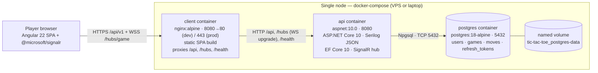

# Docker & Environments

*How the Multiplayer Tic-Tac-Toe MVP runs everywhere: local development workflows, the docker-compose topology, the api and client Dockerfiles, per-environment configuration, migration and health-check strategy, logging, backups and day-to-day operational tasks.*

Everything here implements the deployment view of the [system architecture](../01-architecture/system-architecture.md#6-deployment-view-summary) and the fixed deployment facts of the [PRD](../00-product/PRD.md#7-technical-blueprint-summary): three compose services (`postgres`, `api`, `client`), EF migrations on startup in Development and as a CI/CD step elsewhere, health checks at `/health`, and Serilog logging to console **and file** (compact JSON, `Logs/tictactoe-YYYYMMDD.log`, daily rolling, 14 retained) with correlation IDs — compose persists `/app/Logs` in the `tictactoe-logs` volume. The pipeline that builds and ships these images is covered in [ci-cd.md](ci-cd.md).

## 1. Local Development Options

Two supported workflows. Both end at the same code paths; they differ in how much of the production topology runs on your machine.

### 1.1 Option A — `dotnet run` + `ng serve` (fastest inner loop)

Only PostgreSQL runs in Docker; the API and the Angular dev server run as plain processes with hot reload and debugger support.

```bash
# 1. Database (the only container)
docker compose up -d postgres

# 2. One-time: store dev secrets outside the repo
dotnet user-secrets init --project src/TicTacToe.Api
dotnet user-secrets set "ConnectionStrings__Default" \
  "Host=localhost;Port=5432;Database=tictactoe;Username=tictactoe;Password=tictactoe" \
  --project src/TicTacToe.Api
dotnet user-secrets set "Jwt__Key" "dev-only-signing-key-0123456789abcdef0123456789abcdef" \
  --project src/TicTacToe.Api
dotnet user-secrets set "Cors__Origins" "http://localhost:4200" --project src/TicTacToe.Api

# 3. API on http://localhost:8080 (launchSettings.json); migrations auto-apply on startup (Development)
dotnet run --project src/TicTacToe.Api

# 4. Angular dev server on http://localhost:4200, proxying /api and /hubs to :8080
cd client && npm ci && npm start
```

The dev proxy (`client/proxy.conf.json`, defined in [angular-architecture](../04-frontend/angular-architecture.md)) forwards same-origin calls to the local API — including WebSocket upgrade for the [SignalR hub](../02-backend/realtime-signalr.md):

```json
{
  "/api":  { "target": "http://localhost:8080", "secure": false, "changeOrigin": true },
  "/hubs": { "target": "http://localhost:8080", "secure": false, "changeOrigin": true, "ws": true }
}
```

### 1.2 Option B — full `docker compose up` (closest to production)

Builds both images and runs the exact production topology — nginx-served SPA, API container, linked postgres, `/health` wiring — on one Docker network:

```bash
docker compose up -d --build          # add --profile tools to also start pgadmin
```

Browse the app at `http://localhost:8080`; the API is additionally published directly at `http://localhost:8081` for Scalar/Postman (`http://localhost:8081/scalar/v1`, [api-spec §4](../02-backend/api-spec.md#4-openapi-tooling)).

### 1.3 Which option when

| Situation | Use | Why |
| --- | --- | --- |
| Day-to-day feature work, debugging C# or TS with breakpoints | A | Sub-second hot reload on both sides; no image rebuild on every change |
| Working on `Program.cs`, Dockerfiles, nginx.conf, health checks, compose, env config | B | Exercises the real production artifacts |
| Reproducing a "works on my machine" deployment bug | B | Same images, same network, same proxy path as staging/production |
| Running the Playwright E2E suite locally | B (scripted by the e2e job) | The suite expects the compose stack at `http://localhost:8080` ([testing-strategy §8](../05-quality/testing-strategy.md#8-e2e-smoke-suite-playwright)) |
| Onboarding / first clone | B | One command to a fully working system |
| Backend unit tests | Neither — the single unit suite (ADR-0015) is containerless and never touches any database | Suite runs anywhere `dotnet test` runs |

### 1.4 Canonical local port map

| Host port | Serves | Option A | Option B |
| --- | --- | --- | --- |
| 4200 | `ng serve` dev server | client | not running |
| 8080 | API (`dotnet run`) / client nginx | API | client |
| 8081 | API container (direct tooling access) | — | API |
| 5432 | `postgres` container | postgres | postgres |
| 5050 | pgadmin (profile `tools` only) | — | optional |

The API's host port intentionally differs between options: in Option A the proxy targets `http://localhost:8080` (the `dotnet run` process); in Option B host port 8080 belongs to the client container, the SPA talks to the API same-origin through nginx, and 8081 is the direct window into the API container.

## 2. docker-compose.yml Specification

`docker-compose.yml` lives at the repository root. Default invocation is Development mode; Staging/Production merge `docker-compose.prod.yml` over it (§4).

| Service | Image / build | Ports (host:container) | Environment | Volumes | Healthcheck | depends_on |
| --- | --- | --- | --- | --- | --- | --- |
| `postgres` | `postgres:18-alpine` | 5432:5432 | `POSTGRES_USER`, `POSTGRES_PASSWORD`, `POSTGRES_DB` | `postgres-data:/var/lib/postgresql/data` | `pg_isready` every 5 s, 10 retries | — |
| `api` | build `src/TicTacToe.Api/Dockerfile` (context = repo root) | 8081:8080 | `ASPNETCORE_ENVIRONMENT`, `ConnectionStrings__Default`, `Jwt__*`, `Cors__Origins`, `RateLimit__*`; optional `.env` file | none (stateless) | `curl http://localhost:8080/health` every 10 s | `postgres: service_healthy` |
| `client` | build `client/Dockerfile` (nginx serving the Angular build) | 8080:80 | none (static build; proxy target `api` resolved by Docker DNS) | none | none (nginx is up when it serves) | `api: service_healthy` |
| `pgadmin` (optional) | `dpage/pgadmin4:9.19`, profile `tools` | 5050:80 | `PGADMIN_DEFAULT_EMAIL`, `PGADMIN_DEFAULT_PASSWORD` | `pgadmin-data:/var/lib/pgadmin` | none (local tooling) | `postgres: service_healthy` |

```yaml
name: tic-tac-toe

services:
  postgres:
    image: postgres:18-alpine              # pinned by digest in Staging/Production
    environment:
      POSTGRES_USER: tictactoe
      POSTGRES_PASSWORD: tictactoe         # dev default; VPS .env overrides elsewhere
      POSTGRES_DB: tictactoe
    ports:
      - "5432:5432"
    volumes:
      - postgres-data:/var/lib/postgresql/data
    healthcheck:
      test: ["CMD-SHELL", "pg_isready -U $$POSTGRES_USER -d $$POSTGRES_DB"]
      interval: 5s
      timeout: 3s
      retries: 10
      start_period: 10s
    restart: unless-stopped

  api:
    build:
      context: .
      dockerfile: src/TicTacToe.Api/Dockerfile
    env_file:
      - path: .env                         # optional locally; always present on the VPS
        required: false
    environment:
      ASPNETCORE_ENVIRONMENT: Development
      ConnectionStrings__Default: "Host=postgres;Port=5432;Database=tictactoe;Username=tictactoe;Password=tictactoe"
      Jwt__Key: "dev-only-signing-key-0123456789abcdef0123456789abcdef"
      Jwt__Issuer: "http://localhost:8080"
      Jwt__Audience: "tic-tac-toe-client"
      Jwt__AccessTokenMinutes: "15"
      Cors__Origins: "http://localhost:8080,http://localhost:4200"
    ports:
      - "8081:8080"
    depends_on:
      postgres:
        condition: service_healthy
    healthcheck:
      test: ["CMD-SHELL", "curl -fsS http://localhost:8080/health || exit 1"]
      interval: 10s
      timeout: 3s
      retries: 5
      start_period: 15s
    restart: unless-stopped

  client:
    build:
      context: ./client
      dockerfile: Dockerfile
    ports:
      - "8080:80"
    depends_on:
      api:
        condition: service_healthy
    restart: unless-stopped

  pgadmin:
    image: dpage/pgadmin4:9.19             # local tooling only, never on a public host
    profiles: ["tools"]
    environment:
      PGADMIN_DEFAULT_EMAIL: admin@tictacttoe.local
      PGADMIN_DEFAULT_PASSWORD: admin
    ports:
      - "5050:80"
    volumes:
      - pgadmin-data:/var/lib/pgadmin
    depends_on:
      postgres:
        condition: service_healthy

volumes:
  postgres-data:
  pgadmin-data:
```

Image policy: tags above keep the file readable; Staging/Production pin every image by digest (recorded at upgrade time) so a rebuilt tag can never silently change under a release — item 13 of the [security checklist](../05-quality/security.md#8-pre-release-security-checklist).

## 3. Dockerfiles

### 3.1 `src/TicTacToe.Api/Dockerfile`

Multi-stage: the SDK image builds a Release publish; the ASP.NET runtime image runs it as the built-in non-root `app` user. Build context is the repository root because the publish must compile all four solution layers.

```dockerfile
# --- build ---
FROM mcr.microsoft.com/dotnet/sdk:10.0 AS build
WORKDIR /src

# Project files first so the restore layer caches independently of source edits
COPY ["src/TicTacToe.Domain/TicTacToe.Domain.csproj", "src/TicTacToe.Domain/"]
COPY ["src/TicTacToe.Application/TicTacToe.Application.csproj", "src/TicTacToe.Application/"]
COPY ["src/TicTacToe.Infrastructure/TicTacToe.Infrastructure.csproj", "src/TicTacToe.Infrastructure/"]
COPY ["src/TicTacToe.Api/TicTacToe.Api.csproj", "src/TicTacToe.Api/"]
RUN dotnet restore "src/TicTacToe.Api/TicTacToe.Api.csproj"

COPY . .
RUN dotnet publish "src/TicTacToe.Api/TicTacToe.Api.csproj" \
    -c Release -o /app --no-restore

# --- runtime ---
FROM mcr.microsoft.com/dotnet/aspnet:10.0 AS final
WORKDIR /app

# curl is needed by the container healthcheck; the aspnet base image ships neither curl nor wget
RUN apt-get update \
    && apt-get install -y --no-install-recommends curl \
    && rm -rf /var/lib/apt/lists/*

COPY --from=build /app .
ENV ASPNETCORE_URLS=http://+:8080

EXPOSE 8080
USER app                                # built-in non-root user (UID 1654)
ENTRYPOINT ["dotnet", "TicTacToe.Api.dll"]
```

Notes:

- No secrets in the image: committed `appsettings.json` / `appsettings.Production.json` contain only non-secret defaults; `Jwt__Key` and the connection string arrive as environment variables at container start (§5, [security §3.10](../05-quality/security.md#310-secrets-management)).
- The dev container (Option B) runs the same image with `ASPNETCORE_ENVIRONMENT=Development`, which turns on startup migrations, OpenAPI + Scalar and relaxed rate limits.

### 3.2 `client/Dockerfile`

Node builds the production bundle; nginx serves it and reverse-proxies the API and the SignalR hub.

```dockerfile
# --- build ---
FROM node:24-alpine AS build
WORKDIR /app
COPY package.json package-lock.json ./
RUN npm ci
COPY . .
# Angular 22 application-builder output: dist/client/browser
RUN npm run build -- --configuration production

# --- runtime ---
FROM nginx:alpine
COPY nginx.conf /etc/nginx/conf.d/default.conf
COPY --from=build /app/dist/client/browser /usr/share/nginx/html
EXPOSE 80
```

`client/nginx.conf` — the WebSocket upgrade headers on `/hubs` are mandatory, or SignalR negotiation silently falls back (or fails):

```nginx
server {
    listen 80;
    server_name _;
    root /usr/share/nginx/html;
    index index.html;

    # Security headers per security.md §3.9 (CSP is set by index.html meta tag)
    add_header X-Content-Type-Options nosniff always;
    add_header X-Frame-Options DENY always;
    add_header Referrer-Policy strict-origin-when-cross-origin always;
    add_header Permissions-Policy "camera=(), microphone=(), geolocation=()" always;

    gzip on;
    gzip_types text/css application/javascript application/json image/svg+xml;

    # REST API
    location /api/ {
        proxy_pass http://api:8080;
        proxy_set_header Host $host;
        proxy_set_header X-Forwarded-For $proxy_add_x_forwarded_for;
        proxy_set_header X-Forwarded-Proto $scheme;
    }

    # SignalR hub — upgrade to WebSocket, keep long-lived connections open
    location /hubs/ {
        proxy_pass http://api:8080;
        proxy_http_version 1.1;
        proxy_set_header Upgrade $http_upgrade;
        proxy_set_header Connection "upgrade";
        proxy_set_header Host $host;
        proxy_set_header X-Forwarded-For $proxy_add_x_forwarded_for;
        proxy_set_header X-Forwarded-Proto $scheme;
        proxy_read_timeout 3600s;
        proxy_send_timeout 3600s;
    }

    # API health endpoint passthrough so external probes need no direct API port
    location = /health {
        proxy_pass http://api:8080/health;
        proxy_set_header Host $host;
    }

    # Hashed Angular build outputs are immutable
    location ~* \.(js|css|svg|woff2|png)$ {
        expires 1y;
        add_header Cache-Control "public, immutable";
    }

    # SPA fallback — client-side routes (/lobby, /game/:id) must serve index.html
    location / {
        try_files $uri $uri/ /index.html;
    }
}
```

`api` resolves via Docker's embedded DNS to the api container on the shared compose network; no hardcoded IP or host port is involved.

## 4. Environment Matrix

| Aspect | Development | Staging | Production |
| --- | --- | --- | --- |
| How it runs | Option A processes / Option B compose | `docker-compose.yml` + `docker-compose.prod.yml` on the staging VPS | same files on the production VPS |
| EF migrations | applied on API startup (`Database.Migrate()`, Development only) | CI/CD step: idempotent script applied before rollout ([ci-cd §5](ci-cd.md#5-cd-pipeline)) | same as Staging; script archived as an artifact |
| OpenAPI + Scalar UI | on (`/openapi/v1.json`, `/scalar/v1`) | on (staging host is internal; eases verification) | **off** (document generation and UI are `IsDevelopment()`-gated) |
| Serilog minimum level | `Debug` (app), `Information` (Microsoft) | `Information` | `Information` (app), `Warning` (Microsoft.AspNetCore) |
| CORS `Cors__Origins` | `http://localhost:4200,http://localhost:8080` | `https://staging.play.tictacttoe.example` | `https://play.tictacttoe.example` |
| TLS / HSTS | none (plain HTTP inside Docker) | nginx terminates TLS (443), HSTS on | nginx terminates TLS (443), HTTP→HTTPS redirect, HSTS `max-age=31536000; includeSubDomains` |
| Rate limits (`RateLimit__*`) | relaxed (e.g. `RateLimit__AuthPerMinute=60`) so local load tests are not throttled | production values | strict values per [security §3.8](../05-quality/security.md#38-abuse-and-denial-of-service-controls) (auth 10/min/IP, moves 5/s/user) |
| Published host ports | 5432, 8081, 8080 (5050 with profile `tools`) | 80, 443 only | 80, 443 only |
| DB credentials | compose defaults (`tictactoe`/`tictactoe`) | VPS `.env`, generated password | VPS `.env`, generated password, least-privilege app user |
| API replicas | 1 | 1 | 1 — single node is an MVP constraint (in-memory presence, [ADR-0008](../01-architecture/adr/0008-in-memory-presence-tracker.md)) |

The production override (merged with `docker compose -f docker-compose.yml -f docker-compose.prod.yml ...`) unpublishes the database and API, pulls pre-built images from GHCR instead of building, and mounts TLS certificates:

```yaml
# docker-compose.prod.yml (Compose v2.24+ for !override)
services:
  postgres:
    ports: !override []                      # never expose the DB on the host
    environment:
      POSTGRES_PASSWORD: ${POSTGRES_PASSWORD}
  api:
    image: ghcr.io/${GHCR_OWNER}/tictactoe-api:${API_TAG:-latest}   # no build: in prod
    env_file: [.env]
    environment:
      ASPNETCORE_ENVIRONMENT: Production
    ports: !override []                      # only nginx is public
  client:
    image: ghcr.io/${GHCR_OWNER}/tictactoe-client:${CLIENT_TAG:-latest}
    ports: !override
      - "80:80"
      - "443:443"
    volumes:
      - ./certs:/etc/nginx/certs:ro          # plus an extended nginx.conf with the 443 server block
```

## 5. Configuration and Secrets

Configuration layers, later wins: `appsettings.json` → `appsettings.{Environment}.json` → user-secrets (Development only) → environment variables. Environment variable names use `__` (double underscore) as the section separator.

| Key | Example / default | Notes |
| --- | --- | --- |
| `ConnectionStrings__Default` | `Host=postgres;Port=5432;Database=tictactoe;Username=tictactoe;Password=…` | `Host=localhost` under Option A, `Host=postgres` inside the compose network |
| `Jwt__Key` | dev: user-secrets; prod: VPS `.env` | ≥ 32 bytes ([auth-identity-jwt](../02-backend/auth-identity-jwt.md)) |
| `Jwt__Issuer` | `https://play.tictacttoe.example` | must match the token issuer claim |
| `Jwt__Audience` | `tic-tac-toe-client` | single first-party SPA audience |
| `Jwt__AccessTokenMinutes` | `15` | default 15; tests use 60 s locally |
| `Jwt__RefreshTokenDays` | `7` | rotation makes the session "7 days since last use" |
| `Cors__Origins` | comma-separated exact origins | wildcards prohibited ([security §3.5](../05-quality/security.md#35-cors)) |
| `RateLimit__*` | e.g. `RateLimit__AuthPerMinute` | strictness varies per environment (§4) |

Rules, enforced by gitleaks in CI ([security §3.10](../05-quality/security.md#310-secrets-management)):

- Nothing secret is ever committed — not in `appsettings.*.json`, not in compose files, not in shell history committed to the repo.
- Development secrets live in `dotnet user-secrets` (Option A) or the values shown in §2 (Option B — local-only dev values, clearly marked).
- Staging/Production secrets live in `/opt/tictactoe/.env` on the VPS (`chmod 600`, owned by the deploy user), provisioned manually at setup; GitHub Actions holds only SSH coordinates (see [ci-cd §6](ci-cd.md#6-environment-secrets)).
- `Jwt__Key` rotation is a documented dual-validation procedure ([auth-identity-jwt](../02-backend/auth-identity-jwt.md)); it is not done casually.

## 6. Database Migration Strategy per Environment

| Environment | Mechanism | Command / trigger | Why |
| --- | --- | --- | --- |
| Development (Option A and B) | on API startup | `db.Database.Migrate()` in `Program.cs`, guarded by `env.IsDevelopment()` | zero-friction inner loop against a disposable volume (PRD fixed fact) |
| Staging | CI/CD deploy step, before containers roll | `dotnet ef migrations script --idempotent` in the deploy job → applied via `psql` ([ci-cd §5](ci-cd.md#5-cd-pipeline)) | no SDK or EF tooling on the server; the script is a reviewable, archived artifact; idempotent so re-runs are safe |
| Production | identical to Staging | same generated script | applied *before* the new API starts; new code always finds the schema it expects |

Supporting rules (details in [migrations-and-indexes](../03-database/migrations-and-indexes.md#1-migrations-workflow)):

- CI runs `dotnet ef migrations has-pending-model-changes` so a model change without a committed migration fails the build.
- Migrations must be backwards compatible with the previously deployed API version (expand/contract); destructive operations ship in a later release than the code that stops using the object — this is what makes rollback safe ([ci-cd §5](ci-cd.md#5-cd-pipeline)).
- Manual commands for local use are in the cheat-sheet (§11).

## 7. Health Checks and Readiness

`GET /health` is an anonymous, non-versioned endpoint on the API that verifies the process is up **and** the database answers:

```csharp
// Program.cs (TicTacToe.Api)
builder.Services.AddHealthChecks()
    .AddNpgSql(builder.Configuration.GetConnectionString("Default")!,
               name: "postgresql", failureStatus: HealthStatus.Unhealthy);
...
app.MapHealthChecks("/health", new HealthCheckOptions { Predicate = _ => true });
```

`AddNpgSql` executes `SELECT 1` against PostgreSQL 18, so a full health report is `200` only when the app can actually serve game traffic; otherwise `503` with the degraded check. Consumers:

| Consumer | Behavior |
| --- | --- |
| compose `depends_on` | `api` starts only after `postgres` reports `pg_isready`-healthy; `client` starts only after `api` passes `/health` |
| deploy verification | the CD job polls `/health` (through the client container's `/health` passthrough) before rolling the client and after the rollout ([ci-cd §5](ci-cd.md#5-cd-pipeline)) |
| operators | `curl -fsS https://play.tictacttoe.example/health` is the first command in any incident triage |

If the MVP later moves to an orchestrator, the same endpoint maps directly: readiness probe = `/health` (gates traffic), liveness = process-level (the container is restarted only if Kestrel itself dies) — no code change required.

## 8. Logging and Observability

- **Sinks:** Serilog → console **and file** in compact JSON (`Logs/tictactoe-YYYYMMDD.log`, daily rolling, 14 files retained — `retainedFileCountLimit`); Docker's `json-file` driver ships console events to `docker compose logs`, while the `tictactoe-logs` volume keeps the files across container restarts. Host-level rotation (e.g. `max-size: 50m`, `max-file: 5`) can additionally be set in the VPS daemon.json.
- **Correlation IDs:** middleware assigns or accepts an `X-Correlation-ID` per request and pushes it into the Serilog `LogContext`; every log line inside that request — including SignalR hub invocations — carries it, and the header is echoed on the response.
- **Event shape** (one move, one line):

```json
{"@t":"2026-11-04T09:14:22.183Z","@m":"Move accepted","GameId":"0192f0aa-…","Position":4,"PlayerId":"8c1f…","CorrelationId":"0hn8b2kq","SourceContext":"TicTacToe.Application.Games.MakeMoveHandler"}
```

- **Levels per environment** (configured in `appsettings.{Environment}.json` under `Serilog:MinimumLevel`):

| Namespace | Development | Staging / Production |
| --- | --- | --- |
| `Default` (app code) | `Debug` | `Information` |
| `Microsoft.AspNetCore` | `Information` | `Warning` (hides per-request noise; health-check polls stay quiet) |
| `Microsoft.EntityFrameworkCore.Database.Command` | `Information` (see generated SQL while developing) | `Warning` |

- **Never logged:** passwords, tokens, full emails, SignalR query strings carrying `access_token` ([security §3.11](../05-quality/security.md#311-privacy-and-logging)).
- **NFR hooks:** p95 move round-trip < 200 ms and lobby < 1 s are verified by the k6 load job against this exact topology ([testing-strategy §11](../05-quality/testing-strategy.md#11-performance-and-load-verification)).

## 9. Deployment Topology



The database persists entirely in the `tic-tac-toe_postgres-data` volume; both images are stateless and disposable, which is what the rollback procedure in [ci-cd.md](ci-cd.md#5-cd-pipeline) relies on.

## 10. PostgreSQL Backups

- **Nightly dump** on the VPS (systemd timer or cron), custom format for parallel restore:

```bash
docker compose exec -T postgres pg_dump -U tictactoe -Fc tictactoe \
  > /var/backups/tictactoe/tictactoe-$(date +%F).dump
```

- **Retention:** 14 daily + 8 weekly dumps on the VPS, synced off-node (rsync to object storage) the same night — a backup that only exists on the machine it protects is not a backup.
- **Restore drill** (monthly, into a scratch container — never the live volume):

```bash
cat tictactoe-2026-11-03.dump | docker run --rm -i \
  -e POSTGRES_USER=tictactoe -e POSTGRES_PASSWORD=tictactoe -e POSTGRES_DB=tictactoe \
  postgres:18-alpine pg_restore -U tictactoe -d tictactoe --clean --if-exists
```

- **Rules:** `pg_dump` major version must match the server (18); dumps are taken before every production migration run in the deploy job ([ci-cd §5](ci-cd.md#5-cd-pipeline)); restoring the live volume = stop api, `docker compose down` (keep volume), restore into a fresh volume, `up -d` — expect minutes of downtime, this is the last-resort path, not the routine one (routine rollback redeploys images, §6 rule on backwards-compatible migrations).

## 11. Common Tasks Cheat-Sheet

```bash
# --- lifecycle ---
docker compose up -d                       # start postgres, api, client
docker compose up -d --build               # rebuild changed images first
docker compose --profile tools up -d       # include pgadmin (http://localhost:5050)
docker compose ps                          # status + health (healthy/starting/unhealthy)
docker compose down                        # stop, keep data
docker compose down -v                     # stop AND DELETE THE DATABASE VOLUME — full reset

# --- logs ---
docker compose logs -f api                 # follow API JSON logs
docker compose logs -f --tail 100 client   # last 100 nginx lines, follow
docker compose logs api | grep 0hn8b2kq    # filter by correlation ID

# --- rebuild after code changes ---
docker compose up -d --build api           # backend change
docker compose up -d --build client        # frontend change

# --- reset the database (Option A) ---
docker compose down -v && docker compose up -d postgres
dotnet ef database update \
  --project src/TicTacToe.Infrastructure --startup-project src/TicTacToe.Api
# or simply restart the API in Development — startup migration does it for you

# --- migrations, manual forms ---
dotnet ef migrations add <Name> \
  --project src/TicTacToe.Infrastructure --startup-project src/TicTacToe.Api \
  --output-dir Persistence/Migrations
dotnet ef migrations script --idempotent \
  --project src/TicTacToe.Infrastructure --startup-project src/TicTacToe.Api \
  --output artifacts/migrations.sql       # review + apply elsewhere (the CI/CD artifact)

# --- inspect ---
docker compose exec postgres psql -U tictactoe -d tictactoe -c '\dt'
curl -fsS http://localhost:8081/health     # direct API health
curl -fsS http://localhost:8080/health     # through nginx (exercises the proxy path)
```

Seeding: the MVP ships no seeder — the schema is empty on first boot. Test users are created through `POST /api/v1/auth/register` (the backend suite is containerless, ADR-0015, and never touches any database). For a demo dataset, register two users via the UI and open a game; everything else (lobby, presence) derives live.

## Assumptions

- Host port allocation: the client container owns 8080 (matching the [angular-architecture](../04-frontend/angular-architecture.md) same-origin proxying story and the E2E base URL), so the API container is published at 8081 in compose; under Option A the API (`dotnet run`) keeps localhost:8080 as that doc states — both options are internally consistent and never conflict.
- `docker-compose.prod.yml` uses the `!override` merge tag (Compose v2.24+) and assumes certificates plus an extended nginx.conf with a 443 server block are provisioned on the VPS; TLS material management is out of scope for this doc beyond the mount shown.
- The VPS runs a single compose stack at `/opt/tictactoe` with `/opt/tictactoe/.env`; one staging and one production node (they may be the same box in the internship setting, with a `staging` Compose project name to keep volumes separate).
- Backup tooling is cron/systemd-based shell scripting rather than a managed service, and the nightly k6/load and backup schedules are documented in [ci-cd.md](ci-cd.md) and [testing-strategy](../05-quality/testing-strategy.md) respectively.
- Image tags are shown unpinned in compose for readability; digest pinning (production policy) is applied at deploy time by the CD job's image references.
- pgAdmin is pinned to `dpage/pgadmin4:9.19` (current release line); it exists only behind the local `tools` profile and is never deployed publicly.
