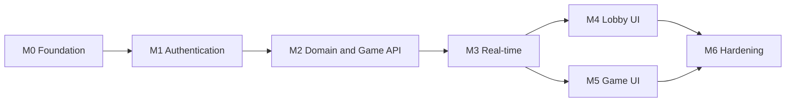

# AGENTS.md — Operating Manual for This Repository

*The operating manual for any coding agent — human or AI — contributing code, tests, or documentation to Multiplayer Tic-Tac-Toe; read it in full before touching anything.*

## Purpose & How to Use This File

This file converts the PRD and the docs tree into a safe, repeatable workflow:

1. Read the [PRD](../00-product/PRD.md) first — it is the product source of truth and wins over every other document, including this one.
2. Read this manual, especially the [Golden Rules](#golden-rules) and the [Build Order (M0 → M6)](#build-order-m0--m6).
3. Locate your milestone in the build order, re-read the docs listed for it, then implement.
4. If you own a discipline (product, architecture, database, UI/UX, frontend, QA/security, DevOps), also load your role prompt from [prompts/](prompts/).
5. Before every commit and PR: run **Verify all** from the [Commands Cheat Sheet](#commands-cheat-sheet) and walk the [Working Agreements](#working-agreements).

If this file and the PRD disagree, the PRD wins and this file gets corrected.

## Project Overview

Multiplayer Tic-Tac-Toe is a real-time, two-player Tic-Tac-Toe platform with a chess.com-inspired lobby: users register in seconds, see who is online, create or join a game (host is X, joiner is O), and play server-authoritative matches with an animated UI. The backend is .NET 10 / ASP.NET Core (Clean Architecture + DDD + CQRS via MediatR) on PostgreSQL 18 via EF Core, with SignalR pushing game events and Serilog logging. The frontend is an Angular 22 app (standalone components, signals, zoneless) styled with Tailwind CSS 4 in `client/`. Everything runs under Docker Compose and is verified in GitHub Actions. The complete product definition — vision, scope, user stories, requirements, delivery plan — lives in the [PRD](../00-product/PRD.md).

## Golden Rules

1. **The PRD is the source of truth.** If code and docs disagree, fix the code to match the PRD — or, if the PRD itself must change, record the decision in a new ADR in [01-architecture/adr/](../01-architecture/adr/) and update the PRD. Never drift silently.
2. **Respect the dependency rule:** Domain ← Application ← Infrastructure ← Api. `TicTacToe.Domain` references nothing; `TicTacToe.Application` references only Domain; `TicTacToe.Infrastructure` implements Application abstractions; `TicTacToe.Api` does DI composition and transport only. See [clean architecture & DDD](../01-architecture/clean-architecture-ddd.md).
3. **Controllers are thin.** Send a MediatR request, map `Result<T>` to HTTP through the shared ProblemDetails mapping — no business or orchestration logic in controllers.
4. **No business logic outside Domain aggregates.** `Game.Create/Join/MakeMove/Forfeit/Cancel` and the invariants live in the aggregate; handlers orchestrate, they never decide.
5. **All backend tests use NUnit** ([ADR-0012](../01-architecture/adr/0012-nunit-test-framework.md)) with FluentAssertions and NSubstitute; integration tests run against real PostgreSQL 18 via Testcontainers with Respawn resets.
6. **Every command has a FluentValidation validator**, executed by the validation pipeline behavior. Validators check input shape; aggregates enforce domain rules.
7. **Queries never load aggregates.** The read side goes through `IReadDbContext` `AsNoTracking` projections straight to DTOs. See [CQRS & MediatR](../01-architecture/cqrs-and-mediatr.md).
8. **Expected failures are `Result<T>`, not exceptions** ([ADR-0009](../01-architecture/adr/0009-result-pattern-expected-failures.md)): invalid credentials, game full, not your turn, cell occupied.
9. **Optimistic concurrency via `xmin`.** On `DbUpdateConcurrencyException`, reload once, re-evaluate the domain rules, and return the proper result (for example "Game is already full"). See [concurrency](../03-database/concurrency.md).
10. **The SignalR hub is push-only** ([ADR-0005](../01-architecture/adr/0005-rest-moves-signalr-broadcasts.md)): moves are submitted over REST; the hub broadcasts results and never mutates game state — presence tracking is the only exception.
11. **Domain events dispatch after `SaveChanges`** → MediatR notifications → `IGameNotifier` pushes SignalR messages. Command handlers never broadcast directly.
12. **snake_case database naming via convention** (`UseSnakeCaseNamingConvention`) — never hand-name tables or columns in mappings. See [schema & ERD](../03-database/schema-and-erd.md).
13. **No secrets in code, config, or docs.** JWT key, DB password, and connection strings come from environment variables or user-secrets; never commit them; never log passwords, tokens, or full emails.
14. **Adding a cross-cutting decision? Write a new ADR** in [01-architecture/adr/](../01-architecture/adr/) following the existing numbering and format, and link it from the affected docs.

## Conventions Quick Reference

| Area | Rule | Authoritative doc |
| --- | --- | --- |
| C# naming | PascalCase types, methods, properties; camelCase locals and parameters; `_camelCase` private fields; `I`-prefixed interfaces; async methods end with `Async`; file-scoped namespaces. | [coding-standards.md](../02-backend/coding-standards.md) |
| C# file placement | Domain: feature folders (`Games/`, `Players/`) with aggregates, value objects, events, repository interfaces. Application: feature folders with `Commands/`, `Queries/`, DTOs, validators. Infrastructure: `Persistence/`, `Identity/`, `Realtime/`. Api: `Controllers/`, `Hubs/`, `Middleware/`, `Program.cs`. | [system-architecture.md](../01-architecture/system-architecture.md) |
| Tests | NUnit; one project per layer under `tests/`; names follow `Method_Scenario_Expectation`. | [testing-strategy.md](../05-quality/testing-strategy.md) |
| TypeScript / Angular | Kebab-case file names with type suffixes (`.page.ts`, `.component.ts`, `.service.ts`, `.store.ts`, `.guard.ts`, `.interceptor.ts`); PascalCase classes; camelCase members; state in signals; zoneless discipline — never rely on Zone.js change detection. | [angular-architecture.md](../04-frontend/angular-architecture.md) |
| Styling | Tailwind CSS 4 CSS-first `@theme` tokens in the stylesheet; utilities first; `@apply` only for shared component classes. | [ux-ui-design-system.md](../04-frontend/ux-ui-design-system.md) |
| Database | snake_case tables and columns via convention; `timestamptz` UTC columns suffixed `_utc`; one repository per aggregate; no `IQueryable` out of repositories. | [schema-and-erd.md](../03-database/schema-and-erd.md) |
| REST / JSON | camelCase JSON; base path `/api/v1`; RFC 7807 ProblemDetails errors; endpoints and status codes exactly as specified. | [api-spec.md](../02-backend/api-spec.md) |
| SignalR | Hub at `/hubs/game`; groups `lobby` and `game-{id}`; server-to-client event names exactly as in the contract. | [realtime-signalr.md](../02-backend/realtime-signalr.md) |

## Commands Cheat Sheet

| Task | Command | Run from |
| --- | --- | --- |
| Build backend | `dotnet build` | repo root |
| Run backend tests | `dotnet test` | repo root |
| Run the API | `dotnet run --project src/TicTacToe.Api` | repo root |
| Add an EF migration | `dotnet ef migrations add <Name> --project src/TicTacToe.Infrastructure --startup-project src/TicTacToe.Api --output-dir Persistence/Migrations` | repo root |
| Apply migrations (Development) | `dotnet ef database update --project src/TicTacToe.Infrastructure --startup-project src/TicTacToe.Api` | repo root |
| Install client dependencies | `npm ci` | `client/` |
| Run client dev server | `npm start` | `client/` |
| Run client unit tests | `npm test` (vitest watch; use `npm test -- --run` for a single pass) | `client/` |
| Build client | `npm run build` | `client/` |
| Run E2E tests | `npx playwright test` (stack running via `docker compose up --build`) | `client/` |
| Run the full stack | `docker compose up --build` | repo root |
| Verify all | `dotnet build && dotnet test && cd client && npm ci && npm test -- --run && npm run build && cd .. && docker compose up --build --wait` | repo root |

`docker compose up --wait` relies on the healthchecks declared in [docker-compose](../06-devops/docker-and-environments.md). "Verify all" is the gate for every PR.

## Build Order (M0 → M6)

Milestones run in order; with two agents, M4 and M5 can proceed in parallel after M3. There are no time estimates — order and dependencies drive delivery.



| Milestone | Goal | Depends on |
| --- | --- | --- |
| M0 Foundation | Runnable skeleton: solution, Docker, DB, CI, Angular + Tailwind + design tokens | — |
| M1 Authentication | Identity, JWT/refresh API, login/register UI | M0 |
| M2 Domain & Game API | Game aggregate + CQRS game and move endpoints, race-safe | M1 |
| M3 Real-time | SignalR hub, presence, lobby events, forfeit/stale services | M2 |
| M4 Lobby UI | Lobby page wired to REST + SignalR | M3 |
| M5 Game UI | Board, animations, result modal, reconnect handling | M3 |
| M6 Hardening | Rate limiting, full test suites, accessibility, polish, docs | M4, M5 |

### M0 — Foundation

| Aspect | Detail |
| --- | --- |
| Goal | A runnable, CI-verified skeleton of the whole system with the design system in place. |
| Backend | Four-project solution per the layout above; Serilog; `/health` health check; built-in OpenAPI + Scalar UI; analyzer config with zero-warning policy. |
| Frontend | Angular 22 standalone zoneless app; Tailwind CSS 4 CSS-first `@theme` with the PRD tokens (slate-950 background, slate-900 cards, indigo-500 primary, X sky-400, O rose-400, Inter + JetBrains Mono); app shell with routes `/login`, `/register`, `/lobby`, `/game/:id`, not-found. |
| Database | `AppDbContext` (IdentityDbContext over `ApplicationUser`) with snake_case convention; initial migration. |
| DevOps | `docker-compose.yml` (postgres:18 with volume, api, client via nginx); GitHub Actions workflow skeleton. |
| Re-read first | [system-architecture.md](../01-architecture/system-architecture.md), [docker-and-environments.md](../06-devops/docker-and-environments.md), [ci-cd.md](../06-devops/ci-cd.md), [ux-ui-design-system.md](../04-frontend/ux-ui-design-system.md) |
| Verify | `dotnet build && dotnet test`; `docker compose up --build --wait`; `(cd client && npm ci && npm run build)` |

Done when: compose brings up postgres + api + client and `/health` reports healthy; CI is green on GitHub Actions; `dotnet build` emits zero warnings; the Tailwind theme matches the design tokens; all routes render the shell.

### M1 — Authentication

| Aspect | Detail |
| --- | --- |
| Goal | US-01 to US-03 complete: register, login, logout, refresh, `GET /auth/me`, plus the login and register UI. |
| Backend | `ApplicationUser : IdentityUser<Guid>`; `RegisterCommand`, `LoginCommand`, `RefreshTokenCommand`, `LogoutCommand` with validators; JWT access tokens (15 min, claims sub/name/email/jti); 256-bit refresh tokens stored hashed, 7 days, rotated on use with family revocation on reuse; `PlayerProfile` created in the same transaction; lockout after 5 failures for 5 minutes. |
| Frontend | Login and register pages (split layout, inline validation, password strength meter); `AuthService`; access token in memory, refresh token in localStorage; `authInterceptor` with single-flight refresh and queued parallel requests; `authGuard` / `guestGuard`. |
| Database | Migration for `users` (Identity), `player_profiles`, `refresh_tokens`. |
| DevOps | `Jwt__*` settings and connection string via user-secrets / environment only. |
| Re-read first | [auth-identity-jwt.md](../02-backend/auth-identity-jwt.md), [api-spec.md](../02-backend/api-spec.md), [security.md](../05-quality/security.md), [user-stories.md](../00-product/user-stories.md) |
| Verify | `dotnet test`; run the API and drive the full flow in Scalar; `(cd client && npm start)` and register/login in the browser |

Done when: register → login → refresh → logout integration tests pass; duplicate username/email returns 409; bad credentials return 401 as a `Result` error; locked-out login returns 423; the UI meets the acceptance criteria for US-01 to US-03; an expired access token silently refreshes and retries (US-02 AC).

### M2 — Domain & Game API

| Aspect | Detail |
| --- | --- |
| Goal | The complete `Game` aggregate and the game management/moves REST API via CQRS — race-safe joins and moves. |
| Backend | Aggregate methods `Create`/`Join`/`MakeMove`/`Forfeit`/`Cancel` with invariants; `Move` child entity, `Mark`, `GameStatus`, `GameResult`; domain events (`GameCreated`, `GameStarted`, `MoveMade`, `GameFinished`, `GameCancelled`) and domain exceptions; commands `CreateGame`, `JoinGame`, `MakeMove`, `CancelGame`, `ForfeitGame` and queries `GetLobbyGames`, `GetGameById`, `GetMyActiveGame` via `IReadDbContext`; pipeline behaviors Logging → Validation → UnitOfWork → Performance; `IGameRepository` implementation; `xmin` conflict handling (reload once, re-evaluate). |
| Frontend | None mandatory — exercise the API through Scalar. |
| Database | `games` and `moves` tables; index `(status, created_at_utc DESC)`; partial unique indexes enforcing one active game per player; unique constraints `(game_id, position)` and `(game_id, move_number)`. |
| DevOps | None. |
| Re-read first | [clean-architecture-ddd.md](../01-architecture/clean-architecture-ddd.md), [cqrs-and-mediatr.md](../01-architecture/cqrs-and-mediatr.md), [api-spec.md](../02-backend/api-spec.md), [schema-and-erd.md](../03-database/schema-and-erd.md), [concurrency.md](../03-database/concurrency.md) |
| Verify | `dotnet test` (Domain unit tests + join-race integration tests + coverage report) |

Done when: Domain unit tests cover all 8 win lines, draw, strict X-first alternation, occupied cell, forfeit, and finished-game immutability; simultaneous joins produce exactly one winner; not-your-turn returns 409 and invalid position 422 as `Result` errors; every endpoint matches the status codes in the API spec; domain events dispatch after SaveChanges (proven by tests); Domain and Application coverage is 80%+.

### M3 — Real-time

| Aspect | Detail |
| --- | --- |
| Goal | FR-04, FR-10, FR-11: the SignalR hub, presence, lobby broadcasts, and the disconnect/stale-game services. |
| Backend | `GameHub` at `/hubs/game` (`[Authorize]`, JWT via `access_token` query string); groups `lobby` and `game-{id}`; `PresenceTracker` singleton (userId → connection IDs, multiple tabs count once); `JoinGameRoom`/`LeaveGameRoom` with participant validation; `SignalRGameNotifier : IGameNotifier`; MediatR notification handlers per domain event → hub sends; `GetOnlinePlayersQuery`; `DisconnectGraceService` (30 s forfeit timers, cancelled on reconnect; cancels `Waiting` games older than 15 minutes). |
| Frontend | None mandatory (`SignalRService` lands with M4/M5). |
| Database | None. |
| DevOps | Confirm WebSocket support through the nginx/compose chain. |
| Re-read first | [realtime-signalr.md](../02-backend/realtime-signalr.md), [ADR-0005](../01-architecture/adr/0005-rest-moves-signalr-broadcasts.md), [ADR-0008](../01-architecture/adr/0008-in-memory-presence-tracker.md), [PRD](../00-product/PRD.md) |
| Verify | `dotnet test` (hub integration tests with two SignalR clients; forfeit and stale-game timing tests) |

Done when: hub tests prove `PresenceChanged`, `GameCreated`, `GameUpdated`, `GameRemoved` reach `lobby` and `GameStarted`, `MoveMade`, `GameFinished`, `OpponentConnection` reach `game-{id}`; a 30 s disconnect executes the forfeit and broadcasts `GameFinished`; reconnect cancels the timer; `Waiting` games older than 15 minutes are cancelled; multiple tabs register as one presence entry.

### M4 — Lobby UI

| Aspect | Detail |
| --- | --- |
| Goal | US-04 to US-07, US-11, US-12: the full lobby experience wired to REST and SignalR. |
| Backend | Gap fixes only — no new features beyond the API spec. |
| Frontend | Lobby page: navbar (logo, online-count pill, avatar menu with logout); Games panel with Open / In Progress tabs and game cards (host, status, created time, Join / Full); prominent Create Game button; Online Players panel with avatar initials and status dot; `lobby.store` (signals); `SignalRService` integration for lobby events; create/join/cancel flows mapping ProblemDetails to toasts and inline errors; empty states; staggered list transitions. |
| Database | None. |
| DevOps | None. |
| Re-read first | [pages-and-flows.md](../04-frontend/pages-and-flows.md), [ux-ui-design-system.md](../04-frontend/ux-ui-design-system.md), [realtime-signalr.md](../02-backend/realtime-signalr.md), [user-stories.md](../00-product/user-stories.md) |
| Verify | `(cd client && npm test -- --run && npm run build)`; two-browser manual session; Playwright create/join happy path |

Done when: the lobby updates in real time without refresh (FR-10); simultaneous join lets exactly one user in and the other sees "Game is already full" (US-07 AC); the creator can cancel a waiting game (US-12); the one-active-game rule surfaces cleanly in the UI (409 handled); users can return to the lobby after a game (US-11); online players and count are live (US-04, US-05).

### M5 — Game UI

| Aspect | Detail |
| --- | --- |
| Goal | US-08, US-09, US-13 and the client side of US-10: a playable, animated, reconnect-safe game page. |
| Backend | Gap fixes only; resync relies on `GET /games/active` and `GET /games/{id}` from M2. |
| Frontend | Game page: centered board card; cells 0..8 keyboard-accessible with ARIA labels ("Row 1 Column 2, empty"); hover preview on your turn; SVG stroke draw for X and O (300 ms); winning line draw with glow (500 ms) plus subtle win burst; shake on invalid move; pulsing turn indicator; player badges; waiting state with animated dots and Cancel; result modal (Victory / Defeat / Draw, Back to Lobby); connection badge (Connected / Reconnecting...); `OpponentConnection` grace countdown; `withAutomaticReconnect([0, 1000, 3000, 5000])` with resync after reconnect; `game.store` (signals); route guard. |
| Database | None. |
| DevOps | None. |
| Re-read first | [animations.md](../04-frontend/animations.md), [pages-and-flows.md](../04-frontend/pages-and-flows.md), [realtime-signalr.md](../02-backend/realtime-signalr.md), [user-stories.md](../00-product/user-stories.md) |
| Verify | `(cd client && npm test -- --run && npm run build)`; two-browser full games ending in win, draw, and forfeit; refresh mid-game |

Done when: opponent moves appear instantly (US-08); an out-of-turn click triggers the shake and leaves state unchanged (US-08 AC); win/draw animations and the result modal fire (US-09); a page refresh rejoins the active game (US-13); `prefers-reduced-motion` is respected; the board is fully keyboard playable.

### M6 — Hardening

| Aspect | Detail |
| --- | --- |
| Goal | Production readiness: abuse protection, complete test suites, accessibility, polish, final docs pass. |
| Backend | Rate limiting with the built-in .NET rate limiter (auth endpoints 10/min per IP, moves 5/s per user); security headers middleware (CSP, X-Content-Type-Options, X-Frame-Options); CORS locked to the Angular origin; correlation ID middleware; final Serilog JSON configuration. |
| Frontend | WCAG 2.1 AA audit (contrast, visible focus rings, live region announcing turns and results); keyboard pass; error toasts and skeleton loaders everywhere; visual polish. |
| Database | Verify indexes against actual query plans; no schema changes expected. |
| DevOps | Migrations as an explicit CI/CD step outside Development; health checks enforced in compose; Playwright E2E in CI; final docs review against shipped behavior. |
| Re-read first | [security.md](../05-quality/security.md), [testing-strategy.md](../05-quality/testing-strategy.md), [ci-cd.md](../06-devops/ci-cd.md), [docker-and-environments.md](../06-devops/docker-and-environments.md) |
| Verify | `dotnet test`; `(cd client && npm run build && npx playwright test)`; `docker compose up --build --wait`; full CI run green |

Done when: the E2E flow register → login → create → join → play to win passes in CI; rate limiting returns 429 under the configured thresholds; the accessibility audit passes; there are zero analyzer warnings; every user story's acceptance criteria is demonstrably met; docs match the shipped behavior.

## Working Agreements

### Commit Messages

Conventional Commits, present-tense imperative summaries:

```
type(scope): imperative summary

Optional body explaining why.
Footer: Refs US-07 / Closes #12
```

- **Types:** `feat`, `fix`, `docs`, `test`, `refactor`, `perf`, `ci`, `build`, `chore`.
- **Scopes:** `auth`, `games`, `hub`, `lobby`, `game`, `client`, `db`, `ci`, `docs`.
- **Example:** `feat(games): enforce one active game per user (FR-07)`.

### PR Checklist

- [ ] **Verify all** passes end to end.
- [ ] New or changed behavior is covered by tests (NUnit backend, vitest frontend; Playwright for user-visible flows).
- [ ] No compiler or analyzer warnings introduced.
- [ ] New endpoints appear in OpenAPI/Scalar and match the API spec.
- [ ] Docs updated wherever behavior or contracts changed; a new ADR written for cross-cutting decisions.
- [ ] UI changes are keyboard accessible with AA contrast.
- [ ] No secrets, credentials, or PII in the diff or logs.
- [ ] The app still works in `docker compose up --build`.

### Definition of Done

Per [testing-strategy.md](../05-quality/testing-strategy.md): code reviewed; tests written and passing; no analyzer warnings; API documented in OpenAPI/Scalar; accessibility checked for UI; works in the Docker environment. Documentation changes are done when files are complete and specific (no placeholders), start with `# Title` + italic purpose, use relative links, and end with `## Assumptions`.

### Asking Questions & Recording Decisions

- **Product behavior question** → owned by the [product manager](prompts/product-manager.md); the answer lands in the PRD or [user-stories.md](../00-product/user-stories.md), never in a chat only.
- **Cross-cutting technical decision** → write a new ADR (next number, kebab-case title) in [01-architecture/adr/](../01-architecture/adr/) mirroring the existing format, link it from affected docs, then implement.
- **Local assumption** → record it in the artifact's `## Assumptions` section (docs) or the PR description (code).

## Where Things Live

| Doc | Description |
| --- | --- |
| [00-product/PRD.md](../00-product/PRD.md) | Canonical product source of truth: vision, scope, requirements, delivery plan. |
| [00-product/user-stories.md](../00-product/user-stories.md) | Acceptance criteria for US-01 to US-13. |
| [00-product/roadmap.md](../00-product/roadmap.md) | M0–M6 delivery detail, dependencies, milestone acceptance. |
| [01-architecture/system-architecture.md](../01-architecture/system-architecture.md) | High-level system, stack, solution structure. |
| [01-architecture/clean-architecture-ddd.md](../01-architecture/clean-architecture-ddd.md) | Layers, dependency rule, domain model, ubiquitous language. |
| [01-architecture/cqrs-and-mediatr.md](../01-architecture/cqrs-and-mediatr.md) | Commands, queries, pipeline behaviors, Result pattern usage. |
| [01-architecture/adr/0001-clean-architecture-and-ddd.md](../01-architecture/adr/0001-clean-architecture-and-ddd.md) | ADR: adopt Clean Architecture with DDD tactical patterns. |
| [01-architecture/adr/0002-mediatr-for-cqrs.md](../01-architecture/adr/0002-mediatr-for-cqrs.md) | ADR: use MediatR for CQRS. |
| [01-architecture/adr/0003-postgresql-ef-core-npgsql.md](../01-architecture/adr/0003-postgresql-ef-core-npgsql.md) | ADR: PostgreSQL with EF Core and Npgsql. |
| [01-architecture/adr/0004-identity-jwt-rotating-refresh-tokens.md](../01-architecture/adr/0004-identity-jwt-rotating-refresh-tokens.md) | ADR: Identity + JWT with rotating hashed refresh tokens. |
| [01-architecture/adr/0005-rest-moves-signalr-broadcasts.md](../01-architecture/adr/0005-rest-moves-signalr-broadcasts.md) | ADR: moves over REST, results broadcast via SignalR. |
| [01-architecture/adr/0006-optimistic-concurrency-xmin.md](../01-architecture/adr/0006-optimistic-concurrency-xmin.md) | ADR: optimistic concurrency via PostgreSQL xmin. |
| [01-architecture/adr/0007-angular-signals-zoneless-tailwind.md](../01-architecture/adr/0007-angular-signals-zoneless-tailwind.md) | ADR: Angular signals, zoneless change detection, Tailwind CSS 4. |
| [01-architecture/adr/0008-in-memory-presence-tracker.md](../01-architecture/adr/0008-in-memory-presence-tracker.md) | ADR: in-memory presence tracker for the MVP. |
| [01-architecture/adr/0009-result-pattern-expected-failures.md](../01-architecture/adr/0009-result-pattern-expected-failures.md) | ADR: Result pattern for expected failures. |
| [01-architecture/adr/0010-mapster-mapping.md](../01-architecture/adr/0010-mapster-mapping.md) | ADR: Mapster for object mapping. |
| [01-architecture/adr/0011-latest-stable-stack.md](../01-architecture/adr/0011-latest-stable-stack.md) | ADR: target the latest stable stack (.NET 10, EF Core 10, PostgreSQL 18, Angular 22). |
| [01-architecture/adr/0012-nunit-test-framework.md](../01-architecture/adr/0012-nunit-test-framework.md) | ADR: NUnit as the mandated backend test framework. |
| [02-backend/api-spec.md](../02-backend/api-spec.md) | REST endpoints, DTOs, validation rules, status codes. |
| [02-backend/realtime-signalr.md](../02-backend/realtime-signalr.md) | Hub contract, server/client events, lifecycle, reconnect. |
| [02-backend/auth-identity-jwt.md](../02-backend/auth-identity-jwt.md) | Identity, JWT, refresh rotation, lockout. |
| [02-backend/coding-standards.md](../02-backend/coding-standards.md) | C# conventions, naming, file placement per layer. |
| [03-database/schema-and-erd.md](../03-database/schema-and-erd.md) | Tables, ERD, constraints. |
| [03-database/migrations-and-indexes.md](../03-database/migrations-and-indexes.md) | Migration workflow and index catalog. |
| [03-database/concurrency.md](../03-database/concurrency.md) | xmin strategy, reload-once conflict handling. |
| [04-frontend/ux-ui-design-system.md](../04-frontend/ux-ui-design-system.md) | Tokens, theme, component inventory, accessibility bar. |
| [04-frontend/pages-and-flows.md](../04-frontend/pages-and-flows.md) | Page specs, routing, user flows. |
| [04-frontend/animations.md](../04-frontend/animations.md) | Motion specs and reduced-motion behavior. |
| [04-frontend/angular-architecture.md](../04-frontend/angular-architecture.md) | client/ structure, signals/zoneless discipline, interceptor/store patterns. |
| [05-quality/testing-strategy.md](../05-quality/testing-strategy.md) | Test pyramid, tooling, coverage targets, definition of done. |
| [05-quality/security.md](../05-quality/security.md) | Threat-informed security controls. |
| [06-devops/docker-and-environments.md](../06-devops/docker-and-environments.md) | Compose services, configuration, environments. |
| [06-devops/ci-cd.md](../06-devops/ci-cd.md) | GitHub Actions pipeline and release steps. |
| [agents/AGENTS.md](AGENTS.md) | This operating manual. |
| [agents/prompts/](prompts/) | Role prompts: product manager, architect, database, UI/UX, Angular, QA/security, DevOps. |
| [README.md](../README.md) | Docs index. |

## Assumptions

- Commands assume the .NET 10 SDK (with `dotnet ef`) and Node 22+ with npm are installed; backend commands run from the repository root, client commands from `client/`.
- `docker compose up --wait` and the E2E suite assume the healthchecks and service wiring documented in [docker-and-environments.md](../06-devops/docker-and-environments.md).
- The Angular dev server proxies `/api` and `/hubs` to the local API during development, as configured in `client/`.
- The build order assumes one full-stack agent; with two agents, only M4 and M5 may proceed in parallel after M3, and M6 starts when both finish.
- Commit scopes and the PR checklist refine, but never replace, the definition of done in [testing-strategy.md](../05-quality/testing-strategy.md).
